# U8 GDS Label 표시 크기 설계 (2026-10-20)

- 대상: `SampleFile/26_10_20 Sample File U8/OMM_PFIC_PRODUCT_PIC_PKG_A0_0410_v1.gds`, 최상위 Cell `OMM_PFIC_PIC_PKG_A0`
- 증상: Layer 18 / 50 의 Label 글씨 크기가 뒤죽박죽이다. 한 화면에 64px 큰 글씨와 6px 작은 글씨가 섞이고, 멀리서도 큰 글씨가 남는다.
- 요청: 기존과 같은 방식으로 가까이 가면 보이고 멀리서는 안 보이게, 화면 배율에 맞춰 그린다. 지금 잘 나오는 기존 Label 표시에는 영향을 주지 않는다.
- 작업: CLAUDE-162 / 설계만(소스 수정 없음). 분석 스크립트와 시뮬레이션은 저장소 밖(10절).
- 관련: [U8 GDS 로딩 설계](2026-10-20_U8_GDS_로딩_원인분석_설계.md) 2.3절(Label 구성) / D6(중복 Label) / 9절(Layer / DataType 분리, CLAUDE-163 진행 중)

## 1. 결론

Layer 18 / 50 이 Label Layer 인 것은 맞다. Bump 한 자리에 Label 이 여러 개 겹쳐 있는데, 지금 규칙은 "한 자리에 Label 하나 / 정격자"를 전제로 만들어져 있어서 크기가 깨진다.

| # | 원인 | 화면에 보이는 결과 |
| --- | --- | --- |
| R1 | 이웃 간격을 "정렬한 바로 앞 / 뒤 Label" 로만 구한다. 같은 좌표 Label 이 3개 이상 이어지면 가운데 Label 은 양쪽이 모두 같은 좌표라 간격이 0 이 되고, 간격 0 은 "이웃 없음 = 화면 크기"로 처리된다. U8 은 한 자리에 4 ~ 6개가 겹친다. | Layer 18 55,019개 / Layer 50 14,065개가 화면 크기 기준이 되어 확대하면 최대 64px 까지 커진다(화면 1 의 `C4_7444` / `VDD VSS ...` / `Q4_S_VSS_SENSE`). |
| R2 | 같은 자리의 다른 글자(핀 번호 / Net 이름)는 겹침 검사에서 먼저 그린 것만 남는다. 먼저 나오는 글자가 자리마다 다르다(Net 먼저 27,808곳 / 핀 번호 먼저 27,024곳). | 자리마다 번호와 이름이 섞이고, 글자 길이가 달라 크기도 다르다(배율 1.0: 번호 13px / VSS 23 ~ 29px). |
| R3 | 크기를 칸 폭에 맞추므로 이름 길이가 크기를 정한다. U8 Net 이름은 2 ~ 32자다(OMM 은 8 ~ 11자라 드러나지 않았다). | DDR 구역 배율 2.0 에서 VSS 49px / `DDR2_PAD_MEM_ADDRESS_B[3]` 8px. |

설계 요약(5절):

| ID | 내용 | 권장 |
| --- | --- | --- |
| D1 | 간격 계산에서 같은 좌표 Label 은 건너뛰고 다른 좌표의 가장 가까운 이웃을 쓴다. 묶음 단위는 화면 Layer 키(Layer / TEXTTYPE). | 필수 |
| D2 | 같은 키 / 같은 글자 / 같은 좌표 사본은 1개만 그린다. | 권장 |
| D3 | 같은 자리에 보이는 Label 이 여러 개면 한 Label 로 묶어 줄을 나눠 그린다. 하나만 보려면 Layer 목록에서 끈다. | 결정 A |
| D4 | Label 칸을 그 Layer 의 대표 간격(중앙값)보다 크게 잡지 않는다. | D6 으로 대체(10절) |
| D5 | 이름 길이 차이가 큰 Layer 는 짧은 이름이 긴 이름의 2배를 넘지 않게 글자 크기 상한을 둔다. | D6 으로 대체(10절) |
| D6 | 배율이 같으면 화면의 모든 Label 이 같은 크기(대표 칸 + 보통 이름 기준). Label 마다 이웃 거리로 크기를 바꾸지 않는다. | 진행(10절) |

기존 영향: OMM all layer2(Layer 775 / 30,992개)는 D1 ~ D5 를 모두 적용해도 간격이 바뀌는 Label 0개 / 빠지는 사본 0개 / D5 미적용이다. **(10절 D6 으로 바뀐 뒤에는 OMM 도 배율마다 크기가 한 가지로 맞춰진다. 보이는 Label 수는 같다.)** 3개 위치 x 6개 배율(18 화면, 그린 Label 256개)을 그려 비교하면 픽셀 차이가 0 이다(6절). 기본 10px / 최소 6px / 최대 64px / 간격 40% / 겹침 검사는 그대로 쓴다.

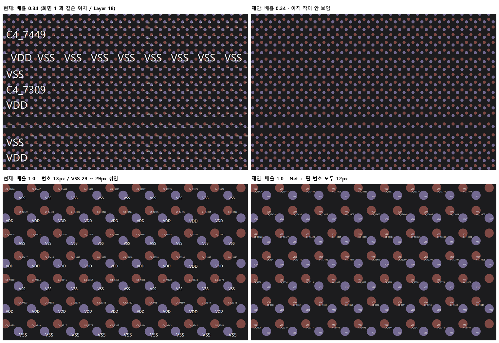

## 2. 현재 Label 표시 규칙 (소스 확인)

`DMS/06_CoreLibSource/GdsMapControl/Controls/GdsMapControl_Label.cs`

1. 글자 최대 크기 = 10px x (현재 배율 / 전체 보기 배율), 6 ~ 64px(`GetTextLabelFontPixels`).
2. Label 칸 = 같은 Layer 에서 Y 가 정확히 같은 행의 가로 간격 / X 가 정확히 같은 열의 세로 간격(`CalculateTextLabelDisplayAreas` / `AssignAvailableSpace`). 정렬 후 바로 앞 / 뒤 Label 만 본다.
3. 한쪽 방향만 이웃이 있으면 그 간격을 다른 방향에도 쓴다(2026-10-07 결정 A). 양쪽 다 없으면 화면 크기가 칸이 된다.
4. 칸의 40% 안에 들어가게 글자를 줄이고 6px 미만이면 그리지 않는다. 이미 그린 글자와 겹치면 건너뛴다(파일 순서).
5. 같은 계산을 Setup 화면(파일)과 View 화면(DB, `GdsMapControl_DbView.cs`)이 함께 쓴다.

이 규칙은 OMM 처럼 Bump 한 자리에 Label 하나가 정격자로 놓인 파일을 기준으로 만들어졌다.

## 3. 데이터 확인 (측정)

측정 대상은 현재 소스 TEMP 빌드(`%TEMP%\chippac\CLAUDE-161\bin`)로 펼친 결과(`_textLabels`)다.

| 항목 | OMM all layer2 (TOP) | U8 (OMM_PFIC_PIC_PKG_A0) |
| --- | --- | --- |
| Label 수 | 30,992 (Layer 775) | 274,162 (Layer 18: 164,494 / Layer 50: 109,668) |
| 같은 키 / 글자 / 좌표 사본을 빼면 | 30,992 (사본 없음) | 137,081 (정확히 절반) |
| TEXT MAG | 2.5 | 모두 1 (크기 정보 없음) |
| 기준점(PRESENTATION) | Center / Middle | Left / Top |
| 한 자리 Label 수 | 1 | 4 ~ 6 (아래 표) |
| 행 / 열 이웃이 모두 있는 Label | 30,987 (99.98%) | Layer 18: 104,279 (63%) / Layer 50: 91,287 (83%) |
| 이웃 없음(화면 크기 기준) | 0 | 69,084 (D1 적용 시 16) |
| 이름 길이(p10 / p90) | 10 / 11자 | Net 이름 3 / 15자, 최대 32자 |

U8 한 자리 구성(같은 좌표 묶음):

| 자리 | 곳 | Label |
| --- | --- | --- |
| C4 Bump | 27,415 | 18/3 핀 번호(`C4_7444`) 2벌 + 18/3 Net 이름(`VSS` / `AMS2_TX2_EAST_BIAS` ...) 2벌 = 4개 (구현 때 정정, 11.2절) |
| TSV | 27,327 | 18/4 Net 2벌 + 50/4 같은 Net 2벌 + 50/3 TSV 번호(`TSV_19144`) 2벌 = 6개 |
| 그 밖 | 180 | 18 / 50 Net 만(90) / 50 만(90) |

- 2벌이 되는 이유: 제품 Cell `OMM_PFIC_PIC_PKG_A0` 에 TEXT 가 직접 있고, 같은 내용의 `Unicorn08_backside_all` 이 (0, 0)에 SREF 로 한 번 더 배치되어 있다(Label 경로 2종이 137,081개씩). 좌표가 완전히 같다. Layer 18 도형도 127,209개가 같은 자리에 반복된다(그리기 비용, 이번 범위 밖).
- 핀 번호 = TEXTTYPE 3, Net 이름 = TEXTTYPE 4 (U8 로딩 설계 2.3절). CLAUDE-163 이 끝나면 화면 Layer 목록에서 `18/3` / `18/4` / `50/3` / `50/4` 로 따로 켜고 끈다. **(정정, 11.2절: 이 구분은 Layer 50 에만 맞다. Layer 18 은 TEXTTYPE 3 = C4 자리의 핀 번호 + Net 이름, 4 = TSV 자리 Net 이름이다.)**
- 배치는 엇갈린(지그재그) Bump 배열이다. 대각 이웃 92.4µm, 같은 행 160µm, 같은 열 92.4µm.

## 4. 원인 상세

### 4.1 R1 같은 좌표 3개 이상이면 간격 0

예: (14035.76, 19708.307) 자리. 같은 열(X = 14035.76)을 Y 로 정렬하면 `AMS2_TX2_EAST_BIAS`, `AMS2_TX2_EAST_BIAS`, `C4_7444`, `C4_7444` 가 같은 Y 로 이어진다.

| 정렬 위치 | 바로 앞 | 바로 뒤 | 결과 |
| --- | --- | --- | --- |
| 1번째 | 아래 자리(간격 있음) | 같은 좌표 | 간격 있음 |
| 2번째 / 3번째 | 같은 좌표 | 같은 좌표 | **간격 0** |
| 4번째 | 같은 좌표 | 위 자리(간격 있음) | 간격 있음 |

행 방향도 같은 일이 생겨 양쪽 다 0 이 되면 "이웃 없음 = 화면 크기"가 된다. 측정한 `C4_7444` 두 벌 중 하나는 칸 0 / 0, 다른 하나는 160 / 92.4µm 였다. 화면 1 의 큰 글씨는 모두 칸 0 / 0 인 Label 이다(시뮬레이션이 같은 모양을 재현, 그림 01 왼쪽 위).

### 4.2 R2 같은 자리 다른 글자

한 자리에 핀 번호와 Net 이름이 겹치면 먼저 그린 것만 남는다. 파일 순서가 자리마다 달라 번호 / 이름이 섞이고, 칸 맞춤 크기도 글자 길이에 따라 다르다.

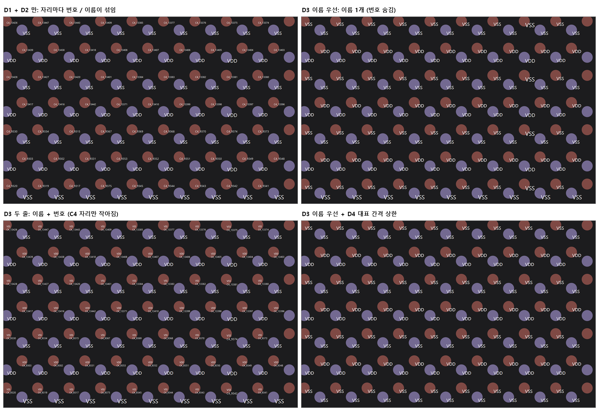

### 4.3 R3 이름 길이

칸에 맞춰 줄이는 방식이라 같은 칸에서 3자 이름은 크게, 25자 이름은 작게 나온다. 크기 비율은 배율과 관계없이 일정하다(둘 다 배율에 비례). 그래서 "확대하면 같아진다"가 되지 않는다.

## 5. 설계

공통: 바꾸는 파일은 `Controls/GdsMapControl_Label.cs` 하나다. `_textLabels` 목록(진단 목록 / Chain Input 자동 이름 / Probe 건수)은 그대로 두고, 칸 계산과 그리기 단계만 바꾼다.

### D1. 간격 계산: 같은 좌표 건너뛰기 + 화면 Layer 키 단위 (필수)

- `AssignAvailableSpace`: 바로 앞 / 뒤가 같은 좌표이면 계속 넘어가 다른 좌표가 나오는 첫 Label 까지의 간격을 쓴다.
- 묶음 키: Layer 번호 대신 화면 Layer 키(`GdsLayerKey.Make(LayerId, TextType)`, CLAUDE-163 과 같은 단위). 18/3 과 18/4 의 간격을 따로 구한다.
- 결정 A(한쪽 간격을 다른 쪽에도 사용)는 그대로 둔다.
- 기존 영향: 한 자리 Label 하나인 파일은 앞 / 뒤가 같은 좌표인 경우가 없어 결과가 같다(OMM 간격 변경 0개).
- 효과: U8 화면 크기 기준 Label 69,084 -> 16개. 큰 글씨가 없어진다.

### D2. 같은 키 / 글자 / 좌표 사본은 1개만 그린다 (권장)

- 칸 계산 직후 (키, 글자, X, Y)가 같은 두 번째 이후 Label 에 "그리기 제외" 표시만 한다(목록에서 빼지 않음).
- U8 그리기 대상 274,162 -> 137,081개(매 그리기마다 도는 수가 절반). OMM 영향 없음(사본 0).
- U8 로딩 설계 D6(펼칠 때 합치기, 10/21 회의 후)과 겹치지 않는다. D6 이 들어오면 D2 는 할 일이 없어질 뿐이다.

### D3. 같은 자리에 보이는 Label 이 여러 개일 때 (결정 필요)

같은 좌표의 Label 을 자리 묶음으로 만들고, 그릴 때 **지금 켜진 Layer 의 Label 만** 모아 처리한다. 같은 글자(18/4 VSS 와 50/4 VSS)는 하나로 합친다. 칸은 묶인 Label 중 가장 작은 칸을 쓴다.

| 안 | 동작 | 그림 |
| --- | --- | --- |
| **A 줄 나눔(권장)** | 켜진 글자를 모두 한 Label 로 묶어 줄을 나눈다. 줄 순서는 같은 Layer 에서 TEXTTYPE 큰 쪽 먼저(U8: Net 이름 위, 핀 번호 아래). 하나만 보려면 Layer 목록에서 `18/3` 또는 `18/4` 를 끈다(정정: Layer 18 은 핀 번호와 Net 이 같은 18/3 이라 따로 끌 수 없다, 11.2절). | 그림 08 오른쪽 |
| B 하나만 | 같은 자리에는 Net 이름(TEXTTYPE 큰 쪽) 하나만 그린다. 핀 번호는 Net 이름 Layer 를 꺼야 보인다. | 그림 08 왼쪽 |
| C 지금처럼 | 각각 그리고 먼저 그린 것만 남긴다(R2 그대로). | 그림 02 왼쪽 위 |

A 를 권장하는 이유: CLAUDE-163 이후 Layer 를 나눠 켜고 끄므로 "켠 것은 보인다"가 자연스럽다. D4 / D5 와 함께 쓰면 두 줄 자리와 한 줄 자리의 글자 크기가 같다(배율 1.0 12px / 2.0 25px). 두 줄은 세로 칸이 더 필요해 배율 0.5 처럼 작을 때는 한 줄 자리만 먼저 보인다.

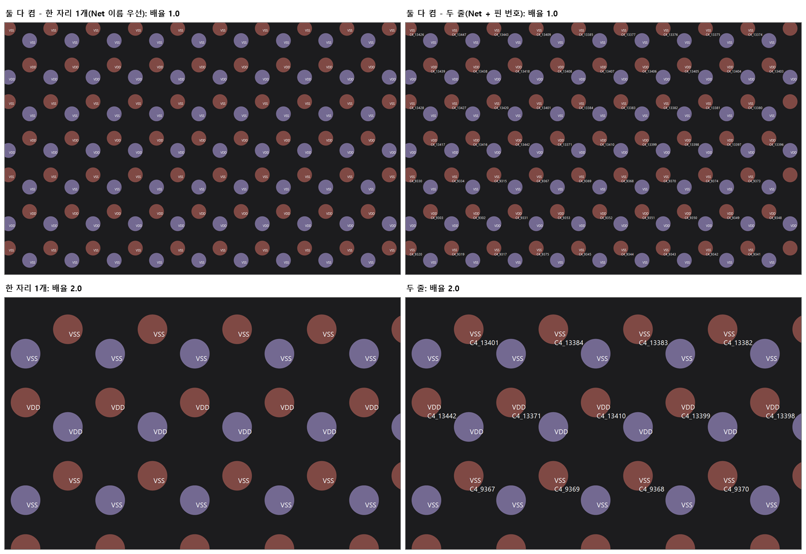

### D4. Layer 대표 간격 상한 (권장)

- 키마다 칸 가로 / 세로의 중앙값을 구해 두고, Label 칸이 중앙값보다 크면 중앙값으로 줄인다.
- 배열 중간에 빈 자리가 있으면 그 옆 Label 칸이 넓어져 조금 크게 나오던 것(배율 1.0 에서 23px 사이 25 / 29px)이 같은 크기가 된다.
- 기존 영향: OMM 은 세로 칸이 중앙값(277µm)보다 넓은 Label 이 8,881개 있지만, 이름이 8 ~ 11자라 가로 폭으로 크기가 정해져 결과가 같다(픽셀 차이 0).

### D5. 이름 길이에 따른 크기 차이 (결정 필요)

적용 조건: 키 안의 이름 길이 p90 이 p10 의 2배 이상인 경우만(U8 18/4 Net 3 / 15자 -> 적용, 18/3 핀 번호 / OMM 10 / 11자 -> 미적용).

| 안 | 동작 | 배율 1.0 / 2.0 (DDR 구역) | 보이기 시작 |
| --- | --- | --- | --- |
| A 칸 맞춤 유지 | 지금처럼 칸에 맞춰 줄인다(D4 까지만). | VSS 23 / 49px, 긴 이름 6 ~ 7 / 8 ~ 15px | 배율 0.35 |
| **B 2배 이내(권장)** | 키의 "기준 이름"(측정 폭 p90)이 대표 칸에 들어가는 크기의 2배를 그 키의 글자 상한으로 둔다. 짧은 이름도 이 상한을 넘지 않는다. | VSS 12 / 25px, 긴 이름 6 ~ 7 / 8 ~ 15px | 배율 0.5 |
| C 완전 통일 | 기준 이름 크기를 그대로 상한으로 둔다(2배 없음). | VSS 6 / 12px, 긴 이름 6 / 8 ~ 12px | 배율 1.0 |

- B 를 권장하는 이유: 한 화면 안의 크기 차이가 2배 이내로 줄고, Bump 간격 46px(배율 0.5)부터 보여 "가까이 가면 보인다"가 유지된다. C 는 크기는 같지만 Bump 가 92px 로 보일 만큼 확대해야 글씨가 나온다.
- 긴 이름(15자 이상, U8 Net 의 약 10%)은 어느 안이든 칸 폭이 정하므로 더 확대해야 읽힌다. 칸을 넘겨 그리면 옆 Bump 와 겹쳐 어느 Bump 의 이름인지 헷갈리므로 넘겨 그리지 않는다.
- 기준 이름 폭은 그 키의 글자를 100px 로 한 번씩 재서(문자열별 1회, 도면을 읽을 때마다 새로) p90 을 쓴다. 글자 측정에 Graphics 가 필요하므로 첫 그리기 때 계산해 둔다.

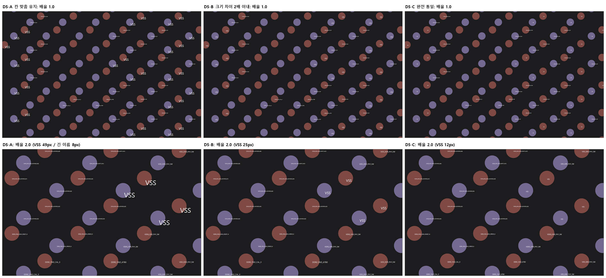

그림 03 은 D5 만 비교하려고 D3-B(자리마다 이름 하나)로 그렸다.

## 6. 기존 영향 확인 (시뮬레이션)

시뮬레이션은 `DrawTextLabels` 의 그리기 순서 / 글꼴 / 40% / 6 ~ 64px / 겹침 검사를 그대로 옮기고, Label 칸과 그릴 글자만 후보 규칙대로 바꿨다. 도형 대신 Label 자리를 원으로 그렸다(화면 1500 x 956, U8 전체 보기 배율 0.0314 px/µm).

- OMM all layer2: D1 간격 변경 0 / D2 사본 0 / D5 미적용(이름 10 / 11자). 중앙 / 왼쪽 아래 / 오른쪽 위 x 전체 보기 배율의 1 / 2.38 / 4.77 / 10 / 20 / 40배, 18 화면 픽셀 차이 합계 0.
- 바뀌지 않는 것: `_textLabels` / `GetTextLabelDiagnostics()`(Probe 건수, `GdsMapDbRestoreProbe` 파일 = DB 비교), Chain Input 자동 이름(`GdsMapControl_ChainLabel.cs`), Label 검색, DB 저장.
- View 화면(DB 조회)도 같은 함수를 써서 함께 바뀐다.

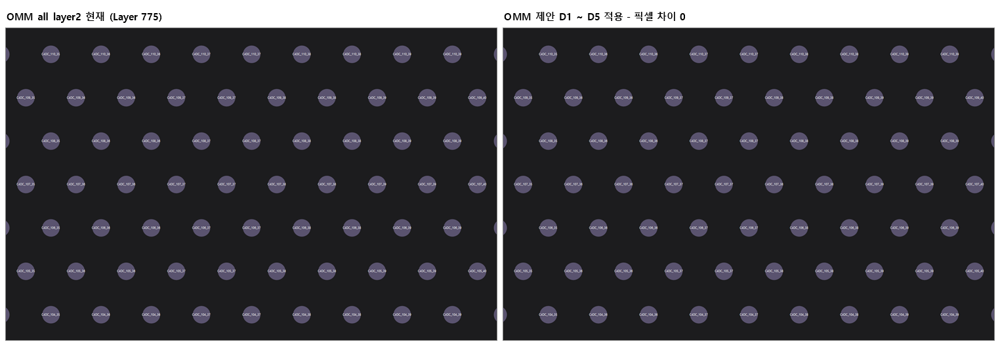

U8 결과(화면 1 위치, Layer 18, 제안 D1 ~ D4 + D3-A + D5-B):

| 배율(px/µm) | 0.12 | 0.34(화면 1) | 0.5 | 0.7 | 1.0 | 1.5 | 2.0 | 3.0 |
| --- | --- | --- | --- | --- | --- | --- | --- | --- |
| 현재 | 38px 172개 | 64px 15개 + 6 ~ 9px | - | - | 13 / 14 / 23 ~ 29px | - | - | - |
| 제안 | 안 보임 | 안 보임 | 6px | 8px | 12px | 19px | 25px | 38px |

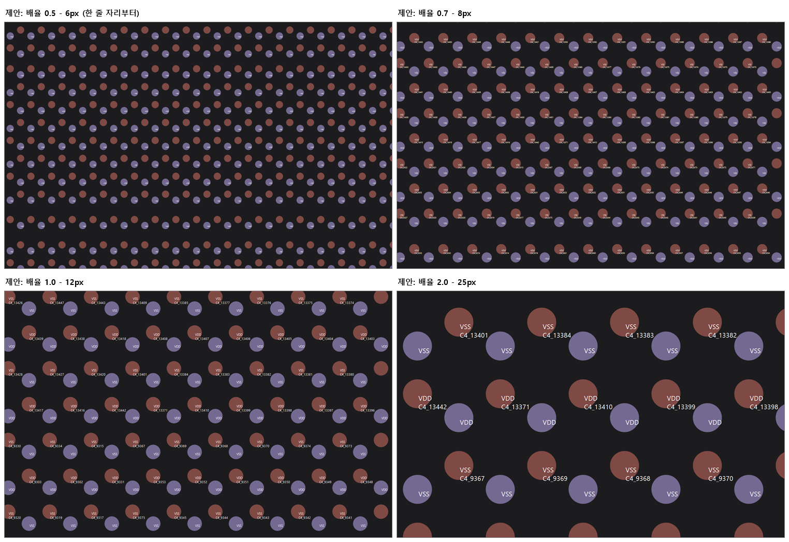

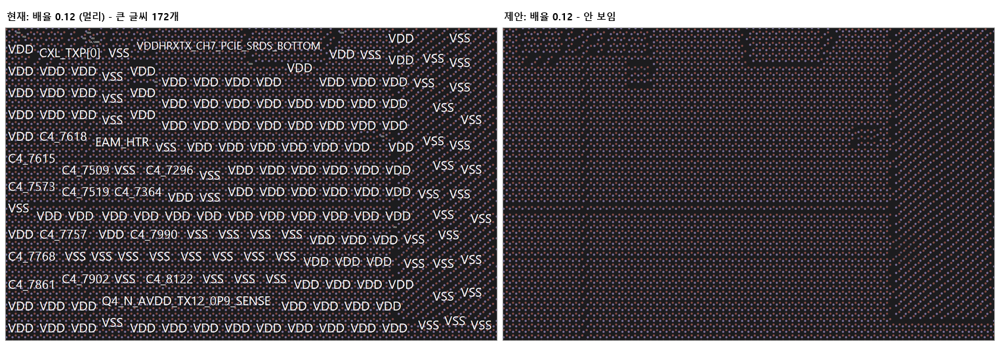

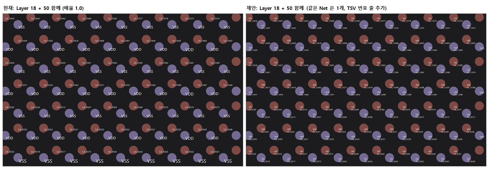

참고: 지금 화면 2 처럼 중간 배율에서 보이던 긴 이름(`VDDQ_DDR_PHY_NW` 등)은 화면 크기 기준으로 커져 있던 Label 이다. 제안 규칙에서는 칸에 맞는 배율까지 확대해야 보인다.

## 7. 그림 목록

`2026-10-20_U8_Label_표시크기_시안/` (시뮬레이션, 원 = Label 자리, 분홍 = C4 자리 / 보라 = TSV 자리)

| 파일 | 내용 |
| --- | --- |
| 01_화면1위치_현재_제안.png | 화면 1 위치, 배율 0.34 / 1.0 현재와 제안 |
| 02_같은자리_처리_후보.png | D1 + D2 만 / 이름 하나 / 두 줄 / 이름 하나 + D4 (배율 1.0) |
| 03_긴이름_크기방식_비교.png | DDR 구역 D5-A / B / C (배율 1.0 / 2.0, D3-B 로 그림) |
| 04_제안_배율별.png | 제안(D1 ~ D4 + D3-A + D5-B) 배율 0.5 / 0.7 / 1.0 / 2.0 |
| 05_멀리_현재_제안.png | 배율 0.12 |
| 06_Layer18_50_함께.png | Layer 18 + 50 함께 (배율 1.0). 제안은 같은 Net 1개 + TSV 번호 줄, 11 ~ 14px |
| 07_OMM_현재_제안_같음.png | OMM 현재 / 제안 (같음) |
| 08_핀번호_Net_둘다켬.png | D3-B 하나만 / D3-A 두 줄 |
| 09_균일크기_TSV_DDR.png | D6: 화면 3 위치 현재 / 균일, DDR 구역 기준 이름 중앙값 / p90 (10절) |
| 10_OMM_균일.png | D6: OMM 현재 / 균일 (10절) |
| 11_균일_배율별.png | D6: 배율 0.5 / 1.0 / 2.0, DDR 2.0 (10절) |

## 8. 구현 계획 / 검증

순서: CLAUDE-163(Layer / DataType 분리)이 `GdsMapControl_Label.cs` 를 다 고친 뒤 같은 파일에서 진행한다(163 은 표시 여부 비교만 키로 바꿈).

1. `GdsMapControl_Label.cs`
   - `CalculateTextLabelDisplayAreas`: 키 단위 묶음 + D1 / D2 표시 + 자리 묶음(D3) + 키별 중앙값(D4) / 길이 분포(D5 적용 여부) 저장.
   - `DrawTextLabels`: 계산(배치 목록)과 그리기를 나눈다. 계산 함수는 Graphics / 화면 크기를 받아 "글자 / 사각형 / 크기" 목록을 돌려준다(Probe 에서 비트맵 Graphics 로 호출).
   - `LayerTextLabel`: 칸 계산용 키 / 그리기 제외 / 자리 번호 필드 추가.
2. 신규 `Probes/GdsLabelLayoutProbe.ps1`
   - OMM: 이전 규칙(Probe 안에 옮긴 이전 계산)과 새 계산의 배치 목록이 18 화면에서 같다.
   - U8: 화면 크기 기준 Label 16개 이하 / 배율 0.34 에서 그린 Label 0 / 배율 1.0 / 2.0 에서 글자 크기 1종 / 18/3 만 켜면 핀 번호, 18/4 만 켜면 Net 이름.
3. 회귀: `GdsChainInputLabelProbe` / `GdsMapDbRestoreProbe`(TEXT 건수 그대로) / `GdsLabelSearchProbe` / `GdsSetupLayoutSmoke` / `GdsViewLayoutSmoke`.
4. 화면 확인(사용자): Setup / View 에서 U8 확대 / 축소, Layer 18/3 / 18/4 켜고 끄기, OMM 계열 Map 비교.

## 9. 결정 (2026-10-20 13:57, 사용자)

> "D3-A 줄 나눔(Net 위 / 핀 번호 아래), D5-B 크기 차이 2배 이내, D1 / D2 / D4 진행으로 결정. CLAUDE-163 이 끝나면 구현 진행해줘."

| # | 항목 | 결정 | 다른 안(채택 안 함) |
| --- | --- | --- | --- |
| 1 | D3 같은 자리 여러 Label | **A 줄 나눔(Net 위 / 핀 번호 아래)** | B Net 이름 하나 / C 지금처럼 |
| 2 | D5 이름 길이 차이 | **B 2배 이내** | A 칸 맞춤 유지 / C 완전 통일 |
| 3 | D1 / D2 / D4 | **진행** | - |
| 4 | D4 / D5 -> D6 균일 크기 | **화면 3 요청으로 변경(10절)** | - |

구현은 CLAUDE-163(Layer / DataType 분리)이 `GdsMapControl_Label.cs` 수정을 끝낸 뒤 시작한다.

## 10. 크기 규칙 변경: 배율이 같으면 모든 Label 같은 크기 (D6, 2026-10-20 14:48)

- 요청(화면 3, Layer 50 TSV 번호): "글씨가 제각각 이다 현재 컨셉으로는 작게 보이다가 zoom in 하면 크게 보이는게 맞다. Logic 상 element 간의 거리에 비해서 크기가 조정되는 것 같은데 해당 부분은 일률적으로 처리 할 수 있도록 해야 한다. 제각각 크기가 아니라 동일한 크기로.."
- 확인: 같은 TSV 번호(모두 9자)인데 `TSV_26858` 은 칸 0(R1) -> 화면 크기 기준 64px, `TSV_14050` / `TSV_13673` 은 같은 행 이웃이 800µm 떨어져 칸이 넓어 25 ~ 30px, 나머지는 칸 160µm 라 작다. Label 마다 자기 칸(이웃 거리)으로 크기를 정하는 것이 원인이다. D4(대표 간격 상한)는 이름 길이 차이가 큰 키에만 쓰기로 했으므로 TSV 번호(50/3)에는 적용되지 않았다.
- 변경(D6, D4 / D5 를 대체):
  1. 글자 크기는 배율마다 화면 전체에서 하나다. Label 마다 이웃 거리로 줄이거나 키우지 않는다.
  2. 크기 = 켜진 Label Layer 키마다 "그 키의 대표 칸(간격 중앙값) 40% 에 보통 이름(이름 폭 중앙값)이 들어가는 크기"를 구하고, 그중 가장 작은 값. 최대 글꼴(10px x 배율 비율, 64px) 이하이고 6px 미만이면 그리지 않는다(멀리서는 안 보임, 가까이 갈수록 같은 비율로 커짐).
  3. 모든 Label 을 이 크기로 그린다. 보통 이름보다 긴 이름은 칸을 넘어도 같은 크기로 그리고, 이미 그린 글자와 겹치면 건너뛴다(겹침 검사는 그대로).
  4. D1(같은 좌표 건너뛰기) / D2(사본 제외) / D3-A(줄 나눔)는 그대로 쓴다. D1 은 대표 칸(중앙값)을 정확히 구하는 데 쓴다.
- 기준 이름: 긴 이름(p90)으로 잡으면 U8 Net 이름은 15자가 기준이 되어 배율 1.0 에서 6px 로 너무 작다(그림 09 오른쪽 가운데). 보통 이름(중앙값)으로 정했다.
- 결과(시뮬레이션):

| 위치 | 현재 | D6 |
| --- | --- | --- |
| 화면 3 (Layer 50, 배율 1.0) | 6 ~ 64px | 모두 11px |
| 화면 1 위치 (Layer 18) | 1.0: 번호 13 / 14px, VSS 23 ~ 29px | 0.5: 6px / 1.0: 13px / 2.0: 26px |
| DDR 구역 (긴 이름) | 2.0: VSS 49px / 긴 이름 8px | 2.0: 긴 이름도 26px |
| OMM all layer2 | x10: 6 / 9 / 10 / 12px, x20: 18 ~ 22px, x40: 37 ~ 44px | x10: 9px, x20: 20px, x40: 40px |

- 기존 영향: OMM 도 크기가 한 가지로 맞춰진다. 보이는 Label 수는 비교한 15 화면 모두 같고, 크기 차이는 약 10% 안이다. 6절의 "OMM 픽셀 차이 0" 은 D4 / D5 기준 결과라 D6 에는 해당하지 않는다.
- 구현 변경: `LayoutTextLabels` 가 배율마다 글자 크기를 한 번 정하고 모든 자리에 같은 글꼴을 쓴다. Label 별 칸 맞춤 / 기준 이름 상한 코드는 넣지 않는다. Probe 는 "OMM 이전 규칙과 같음" 대신 "OMM 보이는 Label 수 같음 + 글자 크기 1종"을 확인한다.

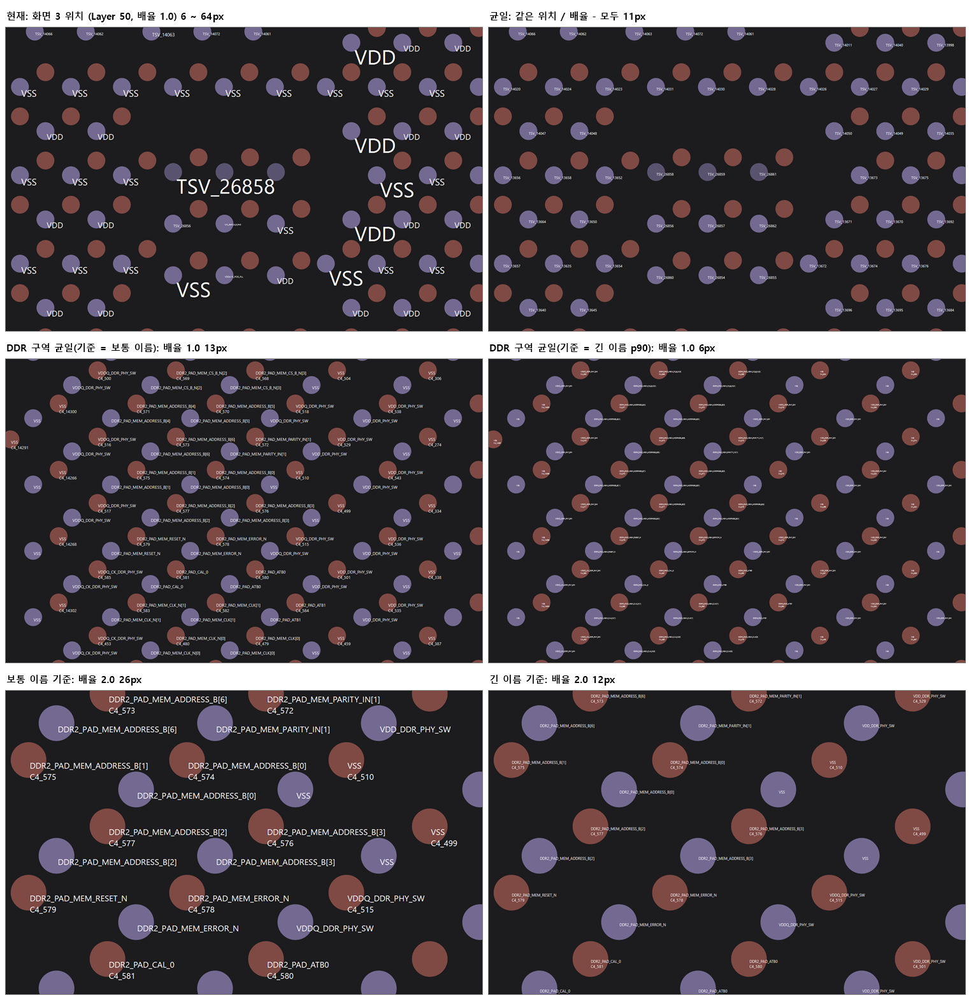

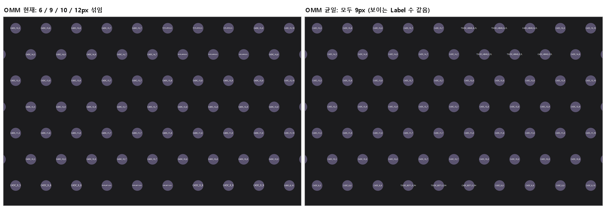

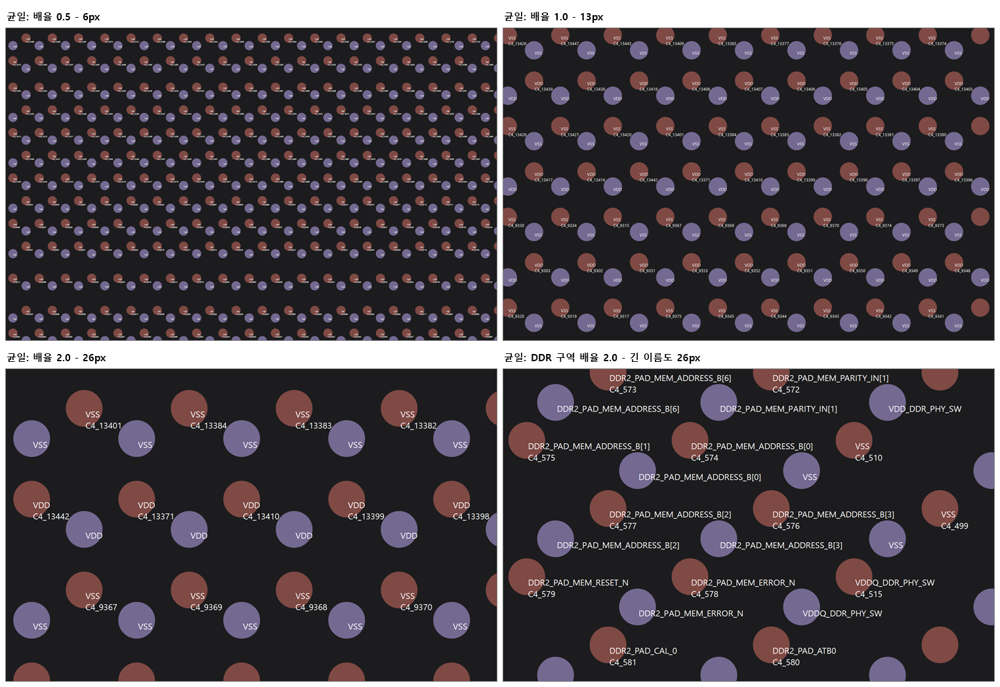

## 11. 구현 결과 (2026-10-20 15:05)

### 11.1 수정 파일

CLAUDE-163(Layer / DataType 분리)이 끝난 뒤 같은 파일에서 진행했다. 163 이 바꾼 "표시 여부를 Layer 키로 비교"는 그대로 둔다.

- `DMS/06_CoreLibSource/GdsMapControl/Controls/GdsMapControl_Label.cs`
  - `CalculateTextLabelDisplayAreas`: 간격 묶음 키 = 화면 Layer 키(Layer 번호 + TEXTTYPE). 결정 A 뒤에 `MarkDuplicateTextLabels`(D2) / `BuildTextLabelKeyInfos`(키별 대표 칸 중앙값 + 보통 이름) / `BuildTextLabelSpots`(D3 자리 묶음)를 부른다.
  - `AssignAvailableSpace`: 같은 좌표는 건너뛰고 다른 좌표의 첫 이웃까지 본다(D1).
  - `DrawTextLabels` -> 계산 `LayoutTextLabels`(internal, Probe 에서 비트맵으로 호출) + 그리기. D6: 글자 크기는 배율마다 하나 = 켜진 Label 키의 `GetKeyFontPixels`(대표 칸 40% 에 보통 이름이 들어가는 크기) 중 가장 작은 값, 최대 글꼴 이하, 6px 미만이면 그리지 않는다.
  - 자리 안 줄 순서: 이름 -> 번호형 이름(`접두어_숫자`, `C4_7444` / `TSV_19144`) -> Layer 번호 -> TEXTTYPE 큰 쪽 -> 파일 순서.
  - `LayerTextLabel`: `LayerKey` / `TextType` / `SkipDraw` 추가. `_textLabels` 목록과 `GetTextLabelDiagnostics()` 는 그대로(Chain Input 자동 이름 / Probe 건수 영향 없음).
- 신규 `Probes/GdsLabelLayoutProbe.ps1`(16 항목).
- D4 / D5 는 D6 으로 대체되어 넣지 않았다.

### 11.2 구현 중 확인 / 정정

- U8 TEXTTYPE 실제 구성(제품 Cell 펼친 결과, 2벌 포함):

| Layer / TEXTTYPE | 내용 | 수 |
| --- | --- | --- |
| 18/3 | C4 자리 핀 번호(`C4_19134`) + 같은 자리 Net 이름(`VSS` / `WDM_HTR_R_MONITOR_FH` ...) | 54,830 + 54,830 |
| 18/4 | TSV 자리 Net 이름 | 54,834 |
| 50/3 | TSV 번호(`TSV_19144`) | 54,834 |
| 50/4 | TSV 자리 Net 이름 | 54,834 |

- 그래서 Layer 18 은 18/3 / 18/4 로 핀 번호만 끌 수 없고(C4 자리 / TSV 자리로 나뉨), TEXTTYPE 만으로는 줄 순서를 정할 수 없다. 처음 구현(TEXTTYPE 큰 쪽 먼저)은 C4 자리에서 핀 번호가 위로 나와(Probe FAIL) 번호형 이름을 아래로 두는 규칙으로 고쳤다. Layer 50 은 50/3 TSV 번호 / 50/4 Net 으로 따로 켜고 끌 수 있다.
- U8 로딩 설계 2.3절의 "TEXTTYPE 3 = 핀 번호 / 4 = Net 이름" 은 Layer 50 기준이다(그 문서는 고치지 않고 여기에 적는다).

### 11.3 검증 (TEMP `%TEMP%\chippac\CLAUDE-162\build\bin`, `NexplantQMS.GdsMap.exe` MD5 `de25fc76`)

- 빌드: 오류 0 / 경고 0.
- `GdsLabelLayoutProbe.ps1` `GDS_LABEL_LAYOUT_PROBE=PASS (16)`:
  - OMM: Label 30,992 / 사본 0, 이전 규칙과 같은 Label 이 보임 18/18 화면(256개), 화면마다 글자 크기 1종 18/18(이전 규칙은 2 화면에서 여러 크기).
  - U8: 그리기 대상 274,162 -> 137,081, 화면 크기 기준 칸 10개, 0.12 / 0.34 px/µm 에서 0개, 1.0 -> 14px(129개) / 2.0 -> 30px(26개) 각각 1종, 두 줄 12개 모두 이름 위 / 핀 번호 아래, 18/3 만 = C4 자리, 18/4 만 = TSV 자리 Net, 18 + 50 같은 Net 한 줄 + TSV 번호 줄, 화면 3 위치(50/3) 52개 모두 11px / 한 줄.
- 회귀(같은 TEMP EXE): `GdsChainInputLabelProbe` PASS / `GdsTopCellProbe` PASS (6) / `GdsSetupLayoutSmoke` PASS (4) / `GdsViewLayoutSmoke` PASS (29) / `GdsChainListDoubleClickSmoke` PASS (28).
- 실행 안 함: `GdsMapDbRestoreProbe`(로컬 DB 저장) / `GdsLabelSearchProbe` / `GdsFrontBackViewProbe`(BSL / DB, CLAUDE-163 서버 DLL 배포 전). 셋 다 이번에 바꾼 그리기 계산을 쓰지 않는다.
- 시간(U8): 도면 읽을 때 칸 / 자리 계산 약 0.5초(전체 약 18초 중), 그릴 때 배치 계산 4ms 이하(배율 1.0, 129개).
- 화면 확인: 사용자 배포 후(Setup / View, U8 Layer 18/3 / 18/4 / 50/3 / 50/4, OMM 계열 Map).

### 11.4 배포 / 기타

- 배포는 사용자가 한다. 이 GdsMap EXE 는 CLAUDE-163 변경도 담고 있어 163 배포 순서(서비스 중지 -> DDL -> BSL DLL + XML -> 서비스 시작 -> GdsMap EXE)의 마지막 단계로 함께 반영한다.
- 커밋 `d8bed7c`(10-20 14:57 일괄 커밋)에 첫 구현(줄 순서 TEXTTYPE 기준)과 Probe 첫 버전이 들어갔다. 줄 순서 수정과 Probe 정정은 그 뒤의 미커밋 변경이다.
- 남은 선택: C4 자리에서 핀 번호만 / Net 이름만 보는 방법은 지금 없다(같은 18/3). 필요하면 "번호형 이름 숨김" 같은 표시 옵션을 따로 정한다.

## 12. 분석 방법 (저장소 밖)

scratchpad `label/` 폴더(저장소에 넣지 않음).

- `LabelStats.ps1` / `.cs`: 현재 소스 TEMP 빌드로 두 파일을 펼쳐 `_textLabels`(리플렉션)와 원본 TEXT MAG 를 읽고 Layer 별 통계 / TSV 저장.
- `tolerance.py` / `analyze.py` / `spot.py` / `kinds.py`: 이웃 유무 / 사본 / 자리 구성 / 글자 형태 분석.
- `DupOrigin.ps1` / `.cs`: 사본 Label 의 구조 경로와 도형 반복 확인.
- `LabelSim.cs` / `Run*.ps1` / `OmmCompare.ps1`: 현재 규칙과 후보 규칙 그리기, OMM 픽셀 비교, 그림 생성.
- `Uniform.cs` / `RunUniform.ps1` / `RunUOmm.ps1`: D6 균일 크기 시뮬레이션(10절).
