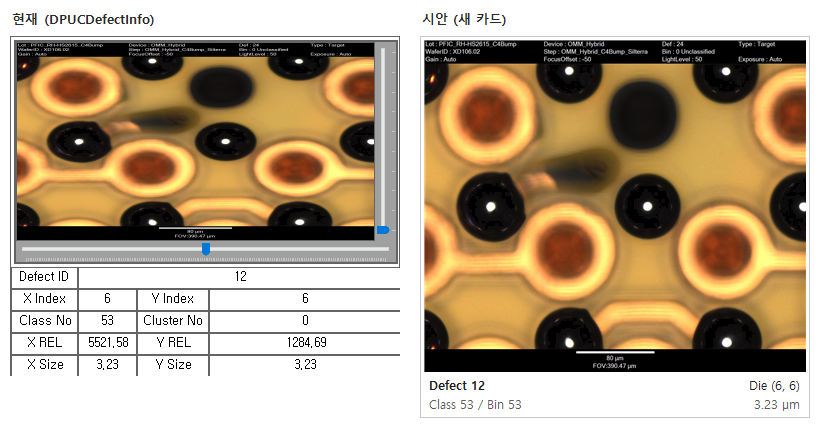
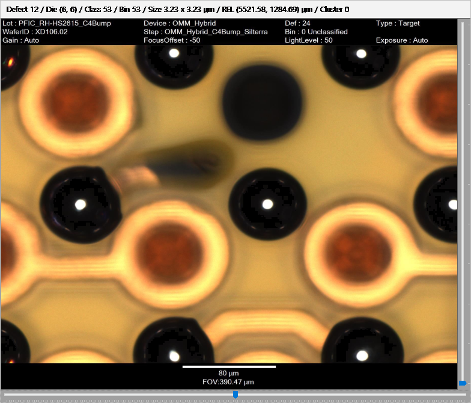
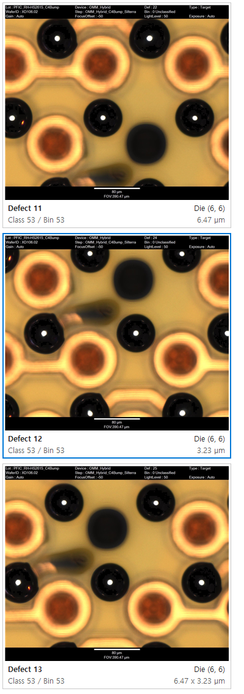
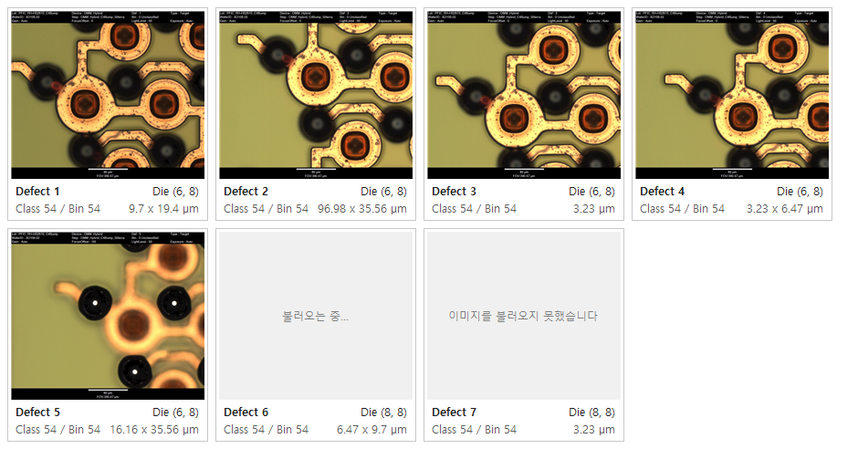

# Defect Image 카드 단순화 설계

작성: 2026-10-20 Claude (CLAUDE-159) / 상태: **D1 ~ D6 권장안 결정(2026-10-20 "권장안 D1 ~ D6 로 구현 진행해") / 구현 3곳 완료(7절, Image 탭 2026-10-21) / 카드 · Viewer · 상세보기는 운영 ClientBin(10-20 16:36 VS 빌드)에 들어 있음, Image 탭은 다음 ENGUI 빌드 / DMS 화면 확인 대기**

요청 (2026-10-20, Defect 이미지 카드 화면 사진과 함께):

> Defect Image 보여 주는 부분을 심플하게 만들어줘.
> 현재 기능 대비 가볍고 필요 정보만 잘보이게.
> 설계 후 화면 샘플 보여줘

화면 샘플: [2026-10-20_Defect_Image_카드_시안](2026-10-20_Defect_Image_카드_시안/) (실제 데이터 STEP_SEQ 528 = XD106.02, Defect 1 ~ 15 와 FTP 저장소 이미지로 그림)

## 1. 현재 구조

사진의 카드는 `DMS/02_DMS/DACrux.SEMDMS.Control/DPUCDefectInfo` 다. 이미지 1장마다 카드 1개를 만든다.

| 부분 | 내용 |
| --- | --- |
| 이미지 | `ImageControl`(UserControl) 안 `PictureBox`, `SizeMode = StretchImage` |
| 막대 2개 | 오른쪽 세로 = 감마, 아래 가로 = 밝기 (`ImageControl.GammatrackBar` / `BrighttrackBar`) |
| 정보 표 | Label 18개 = 9칸(Defect ID / X Index / Y Index / Class No / Cluster No / X REL / Y REL / X Size / Y Size) |
| 이미지 읽기 | 카드마다 스레드 1개로 FTP 다운로드(`DefectMapDraw.fnFTPImageDownload`) -> 원본 `Image` + `MemoryStream` 을 카드가 보관 |
| 더블클릭 | 기존 `ImagePopUp`(같은 `ImageControl` = 이미지 + 감마 / 밝기 막대, Esc 닫기, Ctrl+C 복사) |

사용처 5곳:

| 화면 | 위치 | 비고 |
| --- | --- | --- |
| Defect Map Viewer 이미지 목록(IL) | `Control/DPUCDefecMapViewer.cs` `map_OnSelectedDefect` / `ControlAdd` | 선택한 Defect 의 이미지 전부. 카드 폭 = 목록 폭(사진 화면). 반복문에 `Thread.Sleep(10)` |
| 연관 분석 화면 A Image 탭 | `ENGUI/DefectMapAnalysis/frmGdsKlarfAnalysis.cs` `ShowImages` | 고른 Die 의 이미지 |
| 상세보기(화면 B) 이미지 창 | `ENGUI/GdsMap/frmGdsDieAnalysis.cs` `ShowDefectImages` | Defect ID 만 넘기고 나머지 칸은 빈 값 |
| Defect Source Analysis | `Control/DPUCDefectSourceAnalysis.cs` | 기존 화면 |
| TEST Wafer Map Matching | `09_TEST/DACrux.TEST.ENGUI/Report/frmWaferMapMatching.cs` | 기존 화면 |

문제:

- **무겁다.** 카드 1개에 창(컨트롤) 24개(UserControl 2 / Panel / PictureBox / TrackBar 2 / Label 18)가 붙는다. 원본 이미지(1808 x 1572, 풀면 약 11MB)를 카드가 그대로 들고, 그릴 때마다 카드 크기로 늘려 그린다. 카드마다 스레드를 만들고 호출 쪽은 카드마다 10ms 를 멈춘다.
- **보기 어렵다.**
  - Defect Map Viewer 는 카드 폭을 목록 폭(약 390)으로 늘리고 이미지 높이는 그대로라, 이미지가 옆으로 늘어난다. 사진의 둥근 Bump 가 타원으로 보인다.
  - 표 9칸 중 POC 에서 보는 값은 Defect ID / Die / Class 정도이고, 칸 테두리가 많아 눈에 잘 안 들어온다.
  - 장비가 이미지 위아래에 그려 넣은 글자 띠(Lot / Device / Def / Bin, 80 µm 축척)는 카드 크기에서는 읽을 수 없다.

## 2. 측정 (현재 카드 vs 새 카드 시안)

같은 이미지(STEP 528, 15장 x 2)로 카드 30장을 한 창에 띄워 쟀다. 현재 카드는 운영 `100_ClientBin/DACrux.SEMDMS.Control.dll` 의 `DPUCDefectInfo` 를 그대로 썼다. FTP 다운로드는 빼고 같은 파일을 읽었다. 샘플 프로그램 기준이며 DACrux 안의 값은 아니다(2회 같은 결과).

| 항목 (카드 30장) | 현재 | 시안 |
| --- | --- | --- |
| 창 핸들(USER) 증가 | 741 | 50 |
| GDI 객체 증가 | 207 | 21 |
| 메모리(Private) 증가 | 272 MB | 14 MB |
| 만들기 + 처음 그리기 | 1.8 ~ 2.9 초 | 1.0 ~ 1.2 초 (원본 풀기 포함, 구현 때는 백그라운드) |
| 목록 전체 다시 그리기 5회 | 3.6 초 | 0.2 초 |

## 3. 새 카드 설계

이름: `DPUCDefectImageCard` (`DACrux.SEMDMS.Control` 에 새 파일). 기존 `DPUCDefectInfo` / `ImageControl` / `ImagePopUp` 은 고치지 않는다(다른 화면이 계속 쓴다).



### 3.1 화면

```
┌──────────────────────────────┐
│                              │
│   이미지 (원본 비율 그대로)     │
│                              │
├──────────────────────────────┤
│ Defect 12          Die (6, 6) │  <- 굵게 / 보통
│ Class 53 / Bin 53     3.23 µm │  <- 회색
└──────────────────────────────┘
```

- 이미지: 원본 비율 유지. 카드 폭에 맞추고 높이는 비율로 정한다(늘이지 않음).
- 글자 2줄. 칸 테두리 없이 한 장에 그린다.
  - 1줄: `Defect {DEFECTID}`(굵게) / 오른쪽 `Die ({XINDEX}, {YINDEX})`
  - 2줄: `Class {CLASSNUMBER} / Bin {ROUGHBINNUMBER}` / 오른쪽 크기. X / Y 가 같으면 `3.23 µm`, 다르면 `6.47 x 3.23 µm`.
  - Bin 을 넣는 이유: 표준 업로드(CLAUDE-112) 이후 고객 데이터는 CLASSNUMBER 0, 분류 코드는 RoughBin(53 RDLopen / 54 RDLshort)이다.
- 카드에서 뺀 정보(X REL / Y REL / Cluster No / X·Y Size 따로)는 더블클릭 창 제목 줄에 모두 보인다(3.3). 툴팁에 숨기지 않는다.
- 감마 / 밝기 막대는 카드에서 뺀다. 더블클릭 창(기존 `ImagePopUp`)에 이미 있다.
- 상태: 읽는 중 = 회색 칸에 `불러오는 중...`, 실패 = `이미지를 불러오지 못했습니다`. 정보 줄은 그대로 보인다.
- 선택: 한 번 클릭하면 파란 테두리(2px). Map 과 연동하지 않는다.

### 3.2 가볍게 만드는 방법

| 현재 | 새 카드 |
| --- | --- |
| 컨트롤 24개 | 컨트롤 1개(직접 그림, 더블 버퍼) |
| 원본 Image(풀면 약 11MB)를 들고 매번 늘려 그림 | 읽을 때 한 번 카드 크기 축소본(폭 최대 400)을 만들고 원본은 버린다. 원본 JPEG 바이트(약 0.2 ~ 0.3MB)만 큰 이미지 창용으로 보관 |
| 카드마다 스레드 + 호출 쪽 `Thread.Sleep(10)` | 이미지 읽기 대기열 1개(백그라운드 스레드 1개)가 순서대로 받고 축소본까지 만든다. 카드가 지워지면 건너뛴다. 호출 쪽 Sleep 삭제 |
| 다운로드 파일 삭제 | 지금처럼 읽은 뒤 임시 파일 삭제(`DefectMapDraw.fnFTPImageDownload` 그대로 사용) |

### 3.3 더블클릭 = 큰 이미지 창

기존 `ImagePopUp` 을 그대로 열고 창 제목에 카드에서 뺀 정보를 모두 적는다.

`Defect 12 / Die (6, 6) / Class 53 / Bin 53 / Size 3.23 x 3.23 µm / REL (5521.58, 1284.69) µm / Cluster 0`



(그림의 위 회색 줄은 창 제목을 보여 주려고 그린 것이다. 실제로는 Windows 제목 표시줄이다.)

### 3.4 호출 방법 (계약)

- `new DPUCDefectImageCard(Defect defect, string imagePath)`: Defect 객체(`DACrux.Base.Defect`)에서 위 값을 읽는다. `imagePath` = 기존과 같은 FTP 상대 경로(`IMAGE_PATH/IMAGE_FILENAME`).
- `new DPUCDefectImageCard(long defectId, string imagePath)`: 상세보기처럼 Defect ID 만 있을 때. 2줄은 비운다.
- 폭은 부르는 쪽이 정한다. 높이는 폭과 이미지 비율로 카드가 정한다.

### 3.5 화면별 모습

Defect Map Viewer 이미지 목록(목록 폭에 맞춤, Defect 12 선택):



연관 분석 Image 탭(폭 220 고정, 읽는 중 / 실패 상태 포함, Die (6, 8)):



## 4. 결정 항목

| ID | 내용 | 권장 | 다른 안 |
| --- | --- | --- | --- |
| D1 | 적용 화면 | Defect Map Viewer 이미지 목록 + 연관 분석 Image 탭 + 상세보기 이미지 창(3곳). Defect Source Analysis / TEST Wafer Map Matching 은 기존 카드 유지 | 5곳 모두 / POC 화면 2곳만 |
| D2 | 카드 글자 | 2줄: `Defect / Die`, `Class / Bin / 크기` | Bin 빼기 / Size 빼기 |
| D3 | 뺀 정보(REL / Cluster / X·Y Size) | 더블클릭 창 제목 줄에 모두 | 버림 |
| D4 | 감마 / 밝기 막대 | 카드에서 빼고 더블클릭 창에만(기존 그대로) | 카드에 유지 |
| D5 | 이미지 위아래 장비 글자 띠 | 자르지 않음(장비마다 위치가 다르고 축척 막대가 필요) | 카드에서만 위 띠 자르기 |
| D6 | 카드 크기 | Defect Map Viewer = 목록 폭(지금과 같음), Image 탭 / 상세보기 창 = 폭 220 고정, 높이 = 이미지 비율 | 모두 220 고정 |

Class 이름(예: 53 = RDLopen)은 DB 에 없다(KLARF ClassLookup 은 업로드 화면에서만 읽음). 이미지 파일 이름 끝(`RDLopen_53`)에 보이지만 장비 규칙이라 쓰지 않는다. 이름 표시는 이번 범위 밖이다.

## 5. 구현 계획 (결정 후)

| 단계 | 파일 | 내용 |
| --- | --- | --- |
| 1 | 신규 `02_DMS/DACrux.SEMDMS.Control/DPUCDefectImageCard.cs` + Control csproj Compile 1행 | 카드 그리기 / 상태 / 선택 / 더블클릭 / 이미지 읽기 대기열 |
| 2 | `Control/DPUCDefecMapViewer.cs` | `map_OnSelectedDefect` / `ControlAdd` / 이름 비교(`"DPUCDefectInfo"`) 를 새 카드로, `Thread.Sleep(10)` 삭제. 이 파일은 cp949 라 인코딩을 유지해 고친다 |
| 3 | `ENGUI/DefectMapAnalysis/frmGdsKlarfAnalysis.cs` `ShowImages` / `ENGUI/GdsMap/frmGdsDieAnalysis.cs` `ShowDefectImages` | 새 카드로 교체(폭 220) |
| 4 | 확인 | TEMP 빌드 / 기존 `GdsKlarfAnalysisFormSmoke` + 카드 검사(정보 줄 / 상태 / 제목 줄 / 컨트롤 1개) / 실제 데이터 STEP 528 그림 / 핸들 수 측정. 배포는 사용자 VS 빌드 |

배포 대상: Control / ENGUI DLL(100_ClientBin). 서버 변경 없음.

## 6. 샘플 그림 만든 방법

- scratchpad 의 샘플 프로그램(제품 소스 아님)이 운영 `DPUCDefectInfo`(현재)와 시안 카드를 화면 밖 창에 띄워 PNG 로 저장했다.
- 데이터: 로컬 DB STEP_SEQ 528 의 `TQD_DEFECT` + `TQD_IMAGES` 15행(SELECT 만), 이미지 `D:\FTP\SCK\20261013\PFIC_RH-HS2615_C4BUMP`.
- 사용자 사진의 카드와 같은 Defect 12(Die (6, 6) / Class 53 / REL 5521.58, 1284.69 / 3.23)를 썼다.

## 7. 구현 결과 (2026-10-20)

결정: D1 ~ D6 모두 권장안.

| 파일 | 변경 |
| --- | --- |
| 신규 `DMS/02_DMS/DACrux.SEMDMS.Control/DPUCDefectImageCard.cs` + `DACrux.SEMDMS.Control.csproj` Compile 1행 | 3절 카드. `System.Windows.Forms.Control` 상속(이 프로젝트 네임스페이스 이름이 Control 이라 전체 이름), 글꼴 2개는 모든 카드가 함께 씀. 이 PC 에 있는 파일 경로면 FTP 를 거치지 않고 읽는다(확인용) |
| `Control/DPUCDefecMapViewer.cs` (cp949 / CRLF 유지) | `map_OnSelectedDefect` 카드 교체 + `Thread.Sleep(10)` 삭제 / `ControlAdd` 폭만 지정(`ImageCardWidth`) / `imageList_SizeChanged` 폭만 바꿈(크기가 바뀔 때마다 높이에 여백이 더해져 카드가 길어지던 것도 없앰) / Excel 내보내기 `cr is DPUCDefectImageCard` / 새 Map 읽을 때 `Controls.Clear()` 대신 카드 해제 |
| `ENGUI/GdsMap/frmGdsDieAnalysis.cs` `ShowDefectImages` | `new DPUCDefectImageCard(defectId, path)` (폭 220, 2줄째 비움) |
| `ENGUI/DefectMapAnalysis/frmGdsKlarfAnalysis.cs` `ShowImages` | 2026-10-21 교체(CLAUDE-160 완료 뒤): `new DACrux.SEMDMS.Control.DPUCDefectImageCard(d, path)` (폭 220). 연관 분석 Smoke `GDS_KLARF_FORM_SMOKE=PASS (75/75)` |

확인 (`.testagent/reports/run-20261020-113138-CLAUDE159/report.md`):

- TEMP 빌드(전용 폴더 `%TEMP%\ChippacBuild\CLAUDE-159`): Control / ENGUI 오류 0, 경고는 기존 파일만(Control 12 / ENGUI 4, 새 카드 0).
- 카드 확인 `IMAGE_CARD_CHECK=PASS (16/16)`: TEMP DLL 로 STEP 528 15장 읽기 / 글자 2줄 = DB 값 / 제목 줄 / 자식 컨트롤 0 / 높이 규칙 / 선택 / 더블클릭 창 / 실패 상태 / Defect ID 만 / 읽는 중 해제.
- 측정(카드 30장, 실제 카드): USER +34 / GDI +6 / Private +24 MB / 다시 그리기 5회 182 ms.
- 그림: [Viewer 목록](2026-10-20_Defect_Image_카드_시안/05_구현_DefectMapViewer_목록.png) / [상세보기 창 + 실패 상태](2026-10-20_Defect_Image_카드_시안/06_구현_상세보기창_실패상태.png).
- 미확인: 실제 FTP 다운로드(기존 함수 그대로), DMS 화면, Excel 내보내기 그림.

반영: Control / ENGUI DLL -> 100_ClientBin(사용자 VS 빌드) 후 DACrux 재시작. 서버 변경 없음.
