# 연관 분석 화면 A 레이아웃 후보 (GDS / KLARF / E-Test 기능별 묶음)

작성: 2026-10-19 (CLAUDE-146) / 상태: **결정 완료 / 구현 완료(코드) / TEMP 빌드 + Smoke 64/64 / 배포 안 함 / DMS 화면 확인 대기**

## 1. 요구 (2026-10-19 사용자)

1. GDS / KLARF / E-Test 로 나눠 분석 탭을 기능별로 나눈다.
2. 오른쪽 탭에서 기준을 기능별로 묶어, 엔지니어가 기능별로 찾아가기 쉽게 한다.
3. 색 구간은 버튼 팝업, 또는 자리가 되면 Map 아래에 둔다.
4. 목적 = 엔지니어가 잘 읽고 잘 찾아서 분석하는 구조.
5. 후보 몇 개를 그림으로 제시.

## 2. 지금 화면 A 구성 (소스 기준)

| 영역 | 지금 있는 것 |
| --- | --- |
| 위쪽 1줄 | 분석 Wafer / GDS Device / [분석] |
| 위쪽 2줄 | Defect 영역(크기 + 허용오차 / 중심 사각형) / 좌표 보정 X / Y |
| 왼쪽 | Wafer Map |
| 오른쪽 위 | 색 구간 표(FROM / TO / 색 / Die 수, 자동 구간, 표시 기준, 기준 미만 / Defect 없음 / E-Test Fail Die 행), 빨간 삼각형 기준(Spec Out / Fail Die, CLAUDE-145) |
| 오른쪽 아래 탭 8개 | 준비(Wafer Key / GDS / Chain 면 / KLARF Step 표 / E-Test 표) / Die / Chain / Defect / 허용오차 / E-Test 연결 / E-Test Fail / Image |
| 숨김(10-16 결정, 기능 유지) | 분류 기준 / 분류 / Chain 거르기 / Die Index 표시 / 큰 Defect 제외 / 색 기준(B22) |

문제: 기준이 위쪽 2줄 + [준비] 탭 + 색 구간 옆에 흩어져 있고, 결과 탭 8개가 기능 구분 없이 한 줄이다.

## 3. 기능별 묶음 (세 후보 공통)

| 묶음 | 기준 | 결과 |
| --- | --- | --- |
| GDS | Map 상태(READY / Chain READY · DRAFT / 최종 저장) / [다시 조회] / Chain 면(FS / BS) | Chain |
| KLARF | KLARF Step 표(같은 Wafer, 사용 / 검사 면) + [직접 찾기] / Defect 영역 / 좌표 보정 | Defect / 허용오차 / Image |
| E-Test | E-Test 표(같은 Wafer, 공정 1개) + [직접 찾기] / 빨간 삼각형 기준(Spec Out / Fail Die) | E-Test Fail / E-Test 연결 |
| 종합 | (없음) | Die (Defect 전체 / Chain In / Chain Out / ET 판정 / Fail Chain / 일치 Chain) |
| 색 구간 | 자동 구간 / 표시 기준 / FROM · TO | Map 범례(색 / 구간 / Die 수) |

- 10-16 에 숨긴 조건은 세 후보 모두 그대로 숨긴다.
- 위쪽에는 Wafer / GDS Device / [분석] 만 남긴다. 안 1 / 안 2 는 그 아래에 "지금 기준" 요약 한 줄(GDS / KLARF / E-Test 색 칩)을 두어 탭을 열지 않아도 조건을 본다(L3).
- 탭 머리 색 = 기능 색(파랑 GDS / 초록 KLARF / 주황 E-Test / 보라 종합).

## 4. 후보

그림: `2026-10-19_화면A_레이아웃_후보/` (Map / 색 구간 값 = 2026-10-19 화면 SCKLOTIDA-01, 표 행 값은 배치를 보이기 위한 예시).

### 안 1. 기능 탭 = 기준 + 결과 (권장)

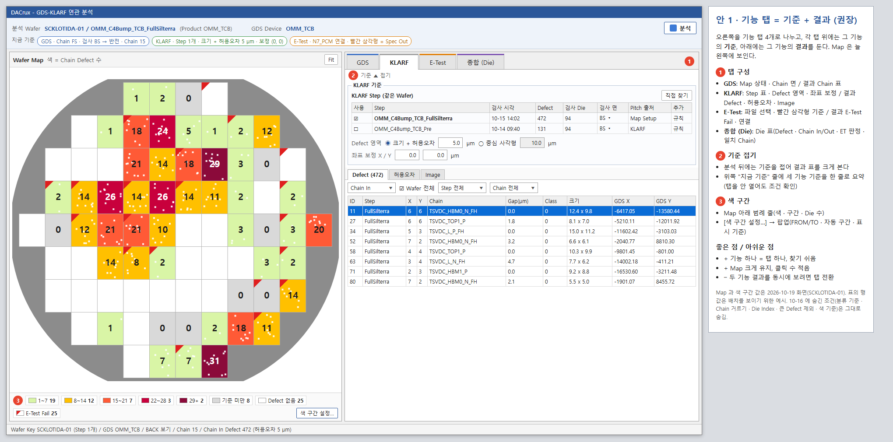

- 오른쪽 탭 = [GDS] [KLARF] [E-Test] [종합 (Die)]. 탭마다 위에 그 기능의 기준 묶음(접기 가능), 아래에 그 기능의 결과(하위 탭).
- 색 구간: Map 아래 범례 줄(색 / 구간 / Die 수 / E-Test Fail) + [색 구간 설정…] 팝업(FROM / TO / 자동 구간 / 표시 기준).
- 좋은 점: 기능 하나 = 탭 하나라 찾기 쉬움. Map 이 늘 크게 보임. 분석 뒤 기준을 접으면 결과 표가 커짐.
- 아쉬운 점: 두 기능 결과(예: Defect 와 E-Test Fail)를 같이 보려면 탭을 바꿔야 함.

### 안 2. 기준 탭(위) / 결과 탭(아래) 2단

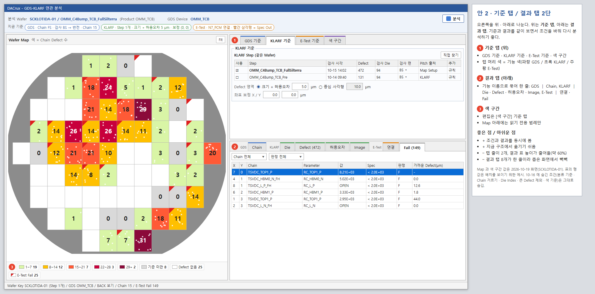

- 오른쪽 위 = 기준 탭 [GDS 기준] [KLARF 기준] [E-Test 기준] [색 구간], 아래 = 결과 탭을 기능 이름으로 묶은 한 줄(GDS │ Chain, KLARF │ Die · Defect · 허용오차 · Image, E-Test │ 연결 · Fail).
- 색 구간: 편집은 [색 구간] 기준 탭, Map 아래는 읽기 전용 범례.
- 좋은 점: 기준과 결과를 같이 보며 조건을 바꿔 다시 분석하기 좋음. 지금 구조에서 옮기기 쉬움.
- 아쉬운 점: 탭 줄 2개, 결과 표 높이가 줄어듦(약 60%), 결과 탭이 한 줄에 빽빽함.

### 안 3. 단계 탭(① 분석 기준 → ② 분석 결과) + 색 구간 팝업

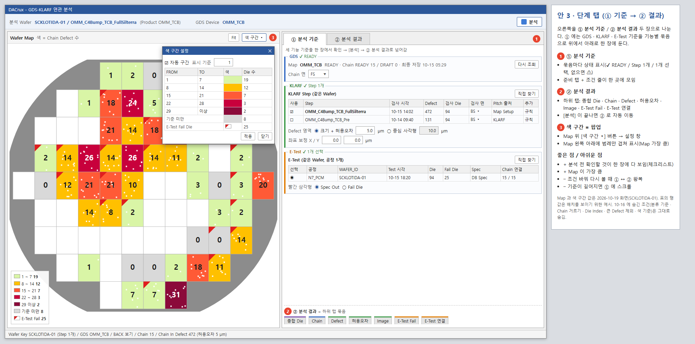

- 오른쪽 = [① 분석 기준] [② 분석 결과]. ① 에 GDS / KLARF / E-Test 기준을 묶음으로 위에서 아래로 한 장에 두고, 묶음마다 상태(✔ READY / Step 1개 / 1개 선택, 없으면 ⚠) 표시. ② 는 하위 탭(종합 Die / Chain / Defect / 허용오차 / Image / E-Test Fail / E-Test 연결). [분석] 이 끝나면 ② 로 이동.
- 색 구간: Map 위 [색 구간 ▾] 버튼 팝업, Map 왼쪽 아래에 범례만 겹쳐 표시.
- 좋은 점: 분석 전에 확인할 것이 한 장에 다 보임(체크리스트). Map 이 가장 큼.
- 아쉬운 점: 조건을 바꿔 다시 볼 때 ① ↔ ② 를 오감. 기준이 길어지면 ① 에 스크롤.

## 5. 비교

| 항목 | 안 1 | 안 2 | 안 3 |
| --- | --- | --- | --- |
| 기능별 찾기 | 탭 1번 | 기준 / 결과 각 탭 1번 | ① 은 한 장, ② 는 하위 탭 |
| 기준과 결과 동시에 보기 | 같은 기능만 | 됨 | 안 됨 |
| 결과 표 높이 | 기준 접으면 큼 | 작음(약 60%) | 큼 |
| Map 크기 | 큼 | 큼 | 가장 큼 |
| 색 구간 | Map 아래 범례 + 팝업 | 기준 탭 + 읽기 범례 | 팝업 + 겹친 범례 |
| 지금 구조에서 바뀌는 양 | 중간 | 작음 | 중간 |

## 6. 결정 필요 (권장안)

| ID | 항목 | 권장 | 다른 안 |
| --- | --- | --- | --- |
| L1 | 레이아웃 | 안 1(기능 탭 = 기준 + 결과) | 안 2 / 안 3 |
| L2 | 색 구간 위치 | Map 아래 범례 줄 + [색 구간 설정…] 팝업 | 팝업만(Map 위 겹친 범례) / 기준 탭 안 |
| L3 | 위쪽 "지금 기준" 요약 한 줄 | 넣음 | 넣지 않음 |
| L4 | [분석] 뒤 처음 보이는 탭 | 종합 (Die) | 지금처럼 Chain / 마지막에 보던 탭 |

결정(2026-10-19 사용자): "권장안으로 하되 색구간설정은 팝업으로 하자" -> L1 안 1 / L3 요약 줄 넣음 / L4 종합 (Die), L2 = 색 구간 설정은 팝업([색 구간 설정] 버튼), Map 아래 범례 줄은 두지 않고 Map 왼쪽 아래에 범례만 겹쳐 보인다.

## 7. 구현 때 바뀌는 곳 (결정 뒤)

- ENGUI `DefectMapAnalysis/frmGdsKlarfAnalysis.Designer.cs`(+ resx): 컨트롤 재배치. 컨트롤 이름은 그대로 두어 동작 코드(.cs)는 탭 이동 / 색 구간 팝업 / 요약 줄 정도만 바꾼다. CLAUDE-137 버튼 아이콘 / 크기 기준을 따른다.
- 색 구간 팝업(안 1 / 안 3): 지금 `dgvBand` / 자동 구간 / 표시 기준을 작은 창으로 옮기고 Map 아래 범례는 같은 값을 읽기 전용으로 보인다.
- Smoke `Verification/GdsKlarfAnalysisFormSmoke.cs` 화면 배치 검사, 시안 `Verification/Preview-GdsKlarfLayout.ps1` 다시 찍기.
- 겹침 주의: 오늘 CLAUDE-145(빨간 삼각형 라디오)가 같은 Designer 를 고쳤다(09:47, 완료). 구현 전에 다시 확인한다.

## 8. 구현 결과 (2026-10-19 10:27)

화면(Preview `Verification/Preview-GdsKlarfLayout.ps1 -StepSeq 528 -Device OMM_Hybrid`, 로컬 DB + 예시 E-Test 값): `2026-10-19_화면A_레이아웃_구현/`

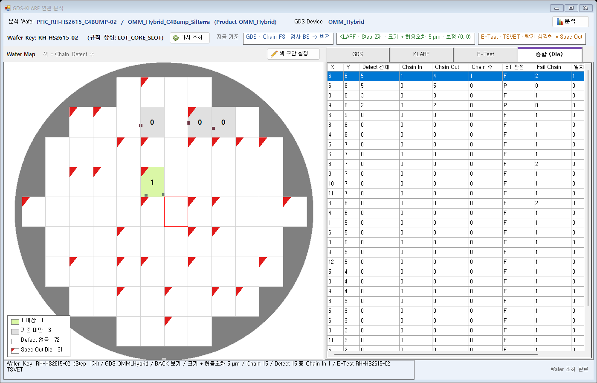

| 영역 | 구현 |
| --- | --- |
| 위쪽 | 줄 1 = 분석 Wafer / GDS Device / [분석]. 줄 2 = Wafer Key + [다시 조회] + "지금 기준" 요약 3칸(GDS: Chain 면 · 검사 면 · 반전 / KLARF: Step 수 · Defect 영역 · 보정 / E-Test: 공정 · 빨간 삼각형 기준). 조건이 바뀔 때마다 고친다(`Condition_Changed` -> `UpdateCriteriaSummary`) |
| 왼쪽 | Map 위 막대 = "Wafer Map / 색 = Chain Defect 수" + [색 구간 설정](EDIT 아이콘). Map 왼쪽 아래 범례(`flowLegend`) = 색 구간 표 행 그대로(색 / 구간 / Die 수, E-Test 표식 행은 빨간 삼각형), 누르면 팝업 |
| 색 구간 팝업 | 색 구간 표(`pnlBand`: 자동 구간 / 표시 기준 / FROM · TO / 색 / Die 수)를 처음 열 때 작은 창(SizableToolWindow)으로 옮긴다. X / Esc 는 숨기기, 화면을 닫을 때 해제. 다른 MDI 화면으로 가면 숨긴다 |
| 오른쪽 | 기능 탭 [GDS] [KLARF] [E-Test] [종합 (Die)] (탭 머리 위쪽에 기능 색 막대, 고른 탭 굵게). 탭마다 "○○ 기준" 머리 + [기준 접기 / 펴기](COLLAPSE / EXPAND) + 기준 묶음 + 결과 하위 탭 |
| GDS 탭 | GDS Map 표(Device / Map / READY · DRAFT Chain / Chain 저장 / Cache) + Chain 면 -> 결과 [Chain] |
| KLARF 탭 | KLARF Step 표 + [직접 찾기] + Defect 영역 / 좌표 보정 -> 결과 [Defect] [허용오차] [Image] |
| E-Test 탭 | E-Test 표 + [직접 찾기] + Map 빨간 삼각형(Spec Out / Fail Die) -> 결과 [E-Test Fail] [E-Test 연결] |
| 종합 탭 | Die 표 |
| 탭 이동 | Wafer 를 받으면 [KLARF], 그 Wafer 의 첫 [분석] 결과면 [종합 (Die)], Defect 더블클릭 -> [KLARF] + [Image] (`ShowResultTab`) |

- 컨트롤 이름은 그대로 두고(준비 탭 `tabReady` / `tlpReady` / `pnlReadyHead`, 오른쪽 위아래 나누기 `splitRight` 만 없앰) 동작 코드는 탭 이동 / 요약 / 팝업 / 범례 / 접기만 더했다.
- 10-16 에 숨긴 조건은 그대로 숨김. 버튼 기준 검사(`button_icons.py audit`): 아이콘 없는 버튼 0, 새 버튼 높이 42(실행 28).
- 검증: `Verify-GdsKlarfAnalysis.ps1` -> `GDS_KLARF_FORM_SMOKE=PASS (64/64)`. 새 검사: 화면 배치(기능 탭 / 하위 탭 / 준비 탭 없음 / 색 구간 표 = 팝업 / 요약 / Wafer 받으면 KLARF), [분석] 뒤 종합 (Die) + 범례 = 색 구간 표, 기준 접기 · 펴기 + 결과 탭 열기, 색 구간 팝업. 색 구간 표 편집 검사는 팝업을 연 뒤 그대로 통과.
- 참고: `DrawToBitmap` 은 겹친 컨트롤을 뒤에서부터 그려 Map 범례가 Map 에 가려진 그림이 나온다(실제 화면은 범례가 맨 앞). Preview 는 범례를 제자리에 다시 그린 그림(A2s)을 따로 만든다.
- 미확인: DMS(DACrux) 에서 MDI 탭 안 배치 / 팝업 위치 / 다른 화면으로 갈 때 팝업 숨김, 1920 보다 좁은 화면에서 요약 줄 길이.

## 9. 상세보기(화면 B) 기능 탭 후보 (2026-10-19 오후, 결정 대기)

요청: "상세보기 화면과 동일한 컨셉으로 나눠서 확인 할 수 있도록 화면 레이아웃 정리 해줘"(화면 A 기능 탭 사진) -> 컨셉 화면 요청 -> "해당 화면에 대한 컨셉을 얘기 한거다"(상세보기 화면 사진).

- 뜻: 화면 A 에 넣은 컨셉(기능 탭 GDS / KLARF / E-Test / 종합 (Die), 탭마다 기준 + 결과)을 **상세보기 화면**에도 같게 적용한다.
- 처음에는 화면 A [종합 (Die)] 탭을 상세보기처럼 나누는 뜻으로 이해해 시안 3개를 만들었다. 요청과 달라 지웠다.
- E-Test 값은 Parameter 별 값(지금 상세보기와 같음, 질문 답 "권장안").

지금 상세보기: 위쪽 정보 2줄(Wafer · 분석 기준 / Die 정보 · 배경 도면 · 원점 · 전체 보기) / 왼쪽 Chain 표(표시 · 색 · Chain · Defect · 분류 · ET · Fail Para, [걸린 / Fail Chain 만]) / 가운데 도면 / 오른쪽 탭 Defect · E-Test 값.

시안(값 = SCKLOTIDA-01 / STEP 582 분석 결과, Die (4, 6). 도면 = DB 의 Chain Member 도형을 BACK 보기로 그린 그림): `2026-10-19_상세보기_기능탭_후보/`

| 후보 | 배치 | 좋은 점 | 아쉬운 점 |
| --- | --- | --- | --- |
| 안 1 (권장) | 위쪽 Wafer · Die 정보 + "분석 기준" 요약 3칸 / 왼쪽 도면 / 오른쪽 기능 탭 [GDS] [KLARF] [E-Test] [종합 (Die)] | 화면 A 와 같은 자리에 같은 기능. 도면이 지금보다 넓음 | Chain 표와 Defect 표를 동시에 못 봄(탭 전환) |
| 안 2 | 지금 3칸(Chain 표 / 도면 / 탭) 유지 + 칸 머리를 기능 이름 · 색으로 묶음, 오른쪽 탭에 [종합] 추가 | Chain · 도면 · Defect 동시에 봄, 바꿀 것 적음 | 화면 A 와 배치가 다름, 표 두 개가 좁음 |

안 1 탭 구성:

| 탭 | 기준(위) | 결과(아래) |
| --- | --- | --- |
| GDS | 보기 면(Back side 좌우 반전) · Chain 수 · 최종 저장 / 배경 도면 · 원점 표시 · 걸린 / Fail Chain 만 / 역추적 · [역추적 해제] | Chain 표(표시 · 색 · Chain · Member · Defect · 분류 · ET · Fail Para) = 지금 왼쪽 표 |
| KLARF | Step · 검사 면 · Defect 영역 · 보정(읽기 전용) | Defect 표(Defect 전체 / Chain In / Chain Out, Chain In · Out 수) + Image = 지금 오른쪽 Defect 탭 |
| E-Test | 공정 · DUT · Die 판정(파일 Flag) | E-Test 값 표(판정 · Parameter · 값 · Lower · Upper · GDS Chain, Fail 먼저) = 지금 E-Test 값 탭 |
| 종합 (Die) (신규) | Die 요약(Defect 전체 · Chain In · Out · 걸린 Chain · E-Test · Fail Chain · 일치 Chain) + 4분류 수(일치 / Fail만 / Defect만 / 정상 / 비교 불가) | 일치 · Fail만 · Defect만 Chain 표(분류 · Chain · Defect · 가까운 거리 · ET · Fail Para · 첫 Fail Parameter · 값), 그 밖 정상 / 비교 불가 수 |

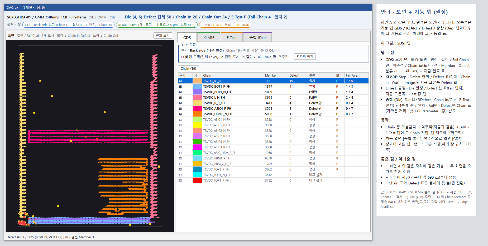
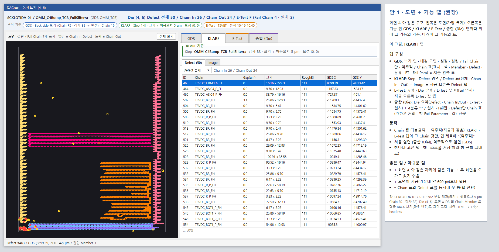
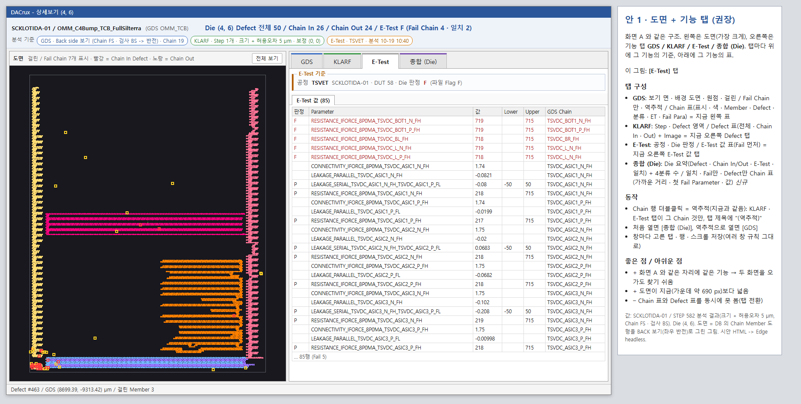
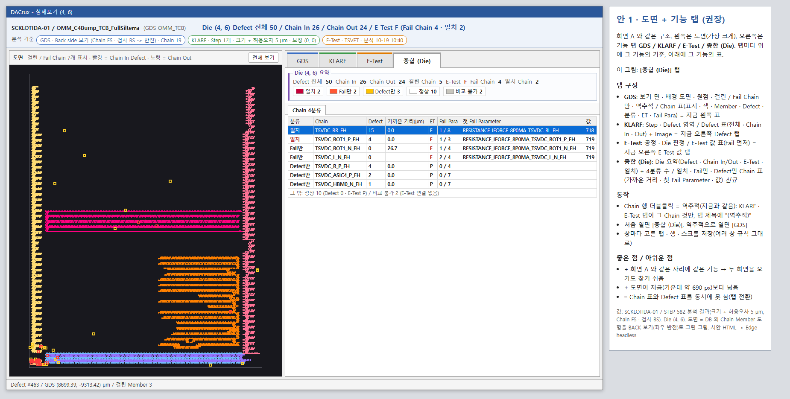
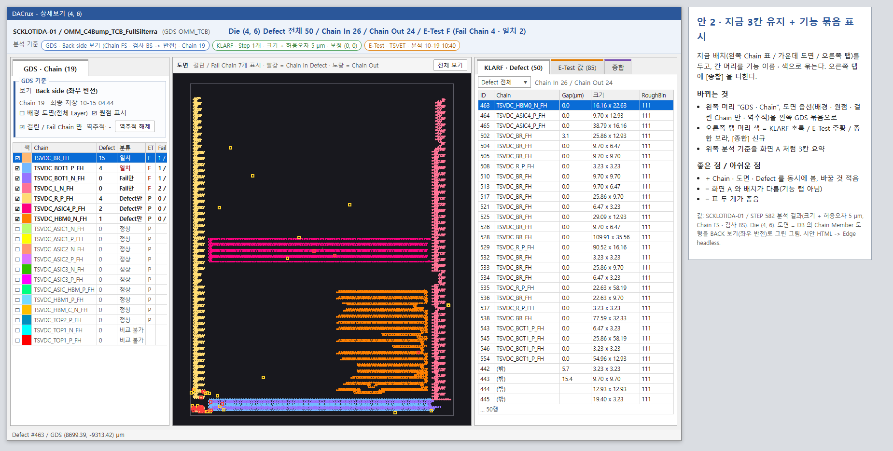

- 안 1 동작(제안):
  - Chain 행 더블클릭 = 역추적(지금과 같음). KLARF · E-Test 탭이 그 Chain 것만 보이고 탭 제목에 "(역추적)"을 붙인다.
  - 처음 열면 [종합 (Die)], 화면 A E-Test Fail 역추적으로 열면 [GDS].
  - 여러 상세보기 창 규칙(창마다 결과 / 보기 상태 저장)에 고른 기능 탭도 넣는다.
- 바뀌는 곳(결정 뒤): `06_CoreLibSource/GdsMapControl/GdsDieAnalysisForm.Designer.cs` / `.cs`(GdsMap EXE, .NET 4.8), Smoke `GdsKlarfAnalysisFormSmoke.cs` 화면 B 검사. 서버 / DB 변경 없음(종합 탭은 지금 받는 AnalyzeDie 결과 DIE / DIE_CHAIN 으로 채움).
- 결정(2026-10-19): "1안으로 하되 해당 화면에 컨셉에 맞게 문구나 용어를 잘 확인하여 설계 및 수정 바람" -> 10절.
## 10. 상세보기 안 1 구현 설계 (2026-10-19, CLAUDE-148)

### 10.1 배치

| 영역 | 내용 | 지금 컨트롤 -> 바뀌는 곳 |
| --- | --- | --- |
| 위 1줄 | Wafer / Step / GDS Device + "분석 기준" 요약 3칸(화면 A "지금 기준" 칸과 같은 글자 모양 · 색) | `lblWaferInfo` 그대로, `lblCriteria` -> 칸 3개 `lblSumGds` / `lblSumKlarf` / `lblSumEt` |
| 위 2줄 | Die 정보(화면 A 상태줄 둘째 줄과 같은 문구) + 역추적 Chain + [역추적 해제] | `lblDieInfo` / `lblFocus` / `btnClearFocus` 그대로 |
| 왼쪽 | "GDS 도면" 머리(보기 면 문구 / 배경 도면 / 원점 표시 / 전체 보기) + 도면 | 위쪽에 있던 `chkBackground` / `chkOriginCross` / `btnFit` 을 도면 머리로 |
| 오른쪽 | 기능 탭 [GDS] [KLARF] [E-Test] [종합 (Die)](화면 A 와 같은 기능 색 막대 / 굵은 글자) | `splitMain` 왼쪽 Chain 표 + `splitRight` 오른쪽 탭 -> `splitMain` = 도면 \| 기능 탭 `tabMain` |
| [GDS] | "GDS 기준": 보기 면 · Chain 면 · 검사 면 · Chain 수 · 최종 저장 / [걸린 / Fail Chain 만] -> Chain 표 | `dgvChains` 를 이 탭으로 |
| [KLARF] | "KLARF 기준": Step · 검사 면 · Defect 영역 · 보정 · 분석 시각 -> Defect 범위 콤보 + Chain In / Out 수 -> Defect 표 | `pnlDefectHead` / `dgvDefects` 를 이 탭으로 |
| [E-Test] | "E-Test 기준": 공정 · E-Test Wafer · Spec 판정(Spec Out) · 결과 파일 Flag(Fail Die) · Spec 바뀜 -> E-Test 값 표 | `dgvEtValues` 를 이 탭으로 |
| [종합 (Die)] | Die 요약(Defect 전체 · Chain In · Out · 걸린 Chain · E-Test · Fail Chain · 일치 Chain) + 4분류 수 칸(색 = 4분류 색) -> 일치 · Fail만 · Defect만 Chain 표 | 신규 `pnlDieSummary` / `dgvSummary` |

- 처음 열면 [종합 (Die)], 역추적으로 열면(화면 A E-Test Fail 더블클릭) [KLARF](그 Chain 까지 거리 순 Defect). 창마다 고른 기능 탭은 보기 상태에 저장(여러 창 규칙 그대로).
- 역추적이면 [KLARF] / [E-Test] 탭 제목 끝에 " (역추적)". [종합 (Die)] 표 행 더블클릭도 [GDS] Chain 표 더블클릭처럼 역추적.
- 기준 묶음은 읽기 전용이라 짧다(1 ~ 2줄). [기준 접기] 는 두지 않는다.
- 서버 / DB 변경 없음. 종합 탭은 지금 받는 AnalyzeDie 결과(DIE / DIE_CHAIN / CHAIN)로 채운다.

### 10.2 문구 / 용어 (화면 A 와 맞춤)

| 항목 | 지금 상세보기 | 화면 A | 바꾼 뒤 |
| --- | --- | --- | --- |
| 기능 탭 / 기준 제목 | 없음 | GDS / KLARF / E-Test / 종합 (Die), "GDS 기준" 등 | 같은 이름 |
| 분석 기준 줄 | "분석 기준: Back side(좌우 반전) 보기 / Defect 크기 + 허용오차 5 µm / 보정 (0, 0) / Chain 19 (최종 저장 ..) / 분석 .." 한 줄 | "GDS · Chain FS · 검사 BS -> 반전" / "KLARF · Step 1개 · 크기 + 허용오차 5 µm · 보정 (0, 0)" / "E-Test · TSVET · 빨간 삼각형 = Spec Out" | "분석 기준" + "GDS · Chain FS · 검사 BS -> 반전" / "KLARF · Step 1개 · 크기 + 허용오차 5 µm · 보정 (0, 0)" / "E-Test · TSVET" (분석 결과 값, 최종 저장 · 분석 시각은 각 기준 묶음) |
| Die 줄 | "Die (x, y)  Defect 전체 n / Chain In n / Chain Out n / E-Test F (Fail Chain n)" | 상태줄 "Die (x, y) Defect 전체 n / Chain In n / Chain Out n / 걸린 Chain n / E-Test F (Fail Chain n, 일치 n)" | 화면 A 와 같은 항목(걸린 Chain / 일치 추가) |
| 4분류 비교 불가 | "-" | "비교 불가" | 비교 불가 |
| Chain 표 Defect 열 | Defect | Defect 수 (Chain 탭) | Defect 수 |
| Defect 표 번호 | ID | Defect ID | Defect ID |
| Defect 분류 열 | Class(CLASSNUMBER, 지금 고객 파일은 모두 0) | RoughBin + Class(분석 분류 기준 RoughBin) | RoughBin + Class |
| Defect 범위 | Chain In / Chain Out / Defect 전체 | 같음 | 그대로 |
| E-Test Die 판정 | E-Test F | "ET 판정" 열 / Map 표식 "Spec Out"(DMS Spec) · "Fail Die"(결과 파일) | "Spec 판정 F (Spec Out)" + "결과 파일 F (Fail Die)" |
| E-Test 값 열 | 판정 / Parameter / 값 / Lower / Upper / GDS Chain / Chain / 헤더 원문 | (E-Test Fail 탭) Fail Parameter / 값 | 그대로 |
| 종합 Chain 표 | 없음 | E-Test Fail 탭: 분류 / 가까운 Defect(µm) / 걸린 Defect / Fail Para / Fail Parameter / 값 | 분류 / Chain / Defect 수 / 가까운 거리(µm) / ET / Fail Para / Fail Parameter / 값 |
| 도면 제목 | 없음 | "Wafer Map" + "색 = Chain Defect 수" | "GDS 도면" + "보기 = Back side(좌우 반전)" |
### 10.3 구현 결과 (2026-10-19 16:56)

화면(TEMP 빌드, 실제 로컬 데이터 SCKLOTIDA-01 / STEP 582 / OMM_TCB / Die (4, 6), 150% 화면): `2026-10-19_상세보기_기능탭_구현/`

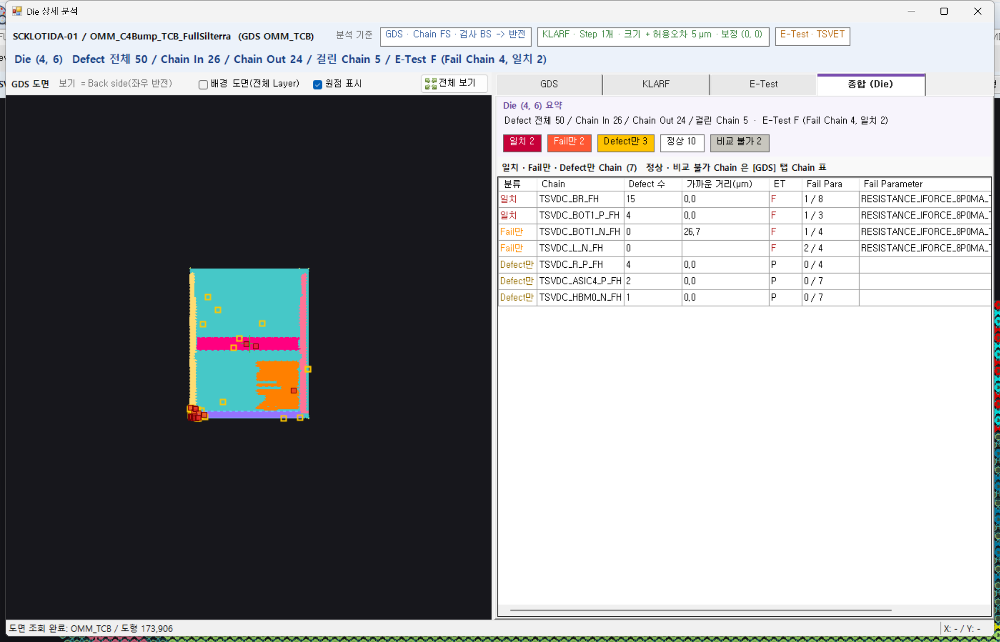
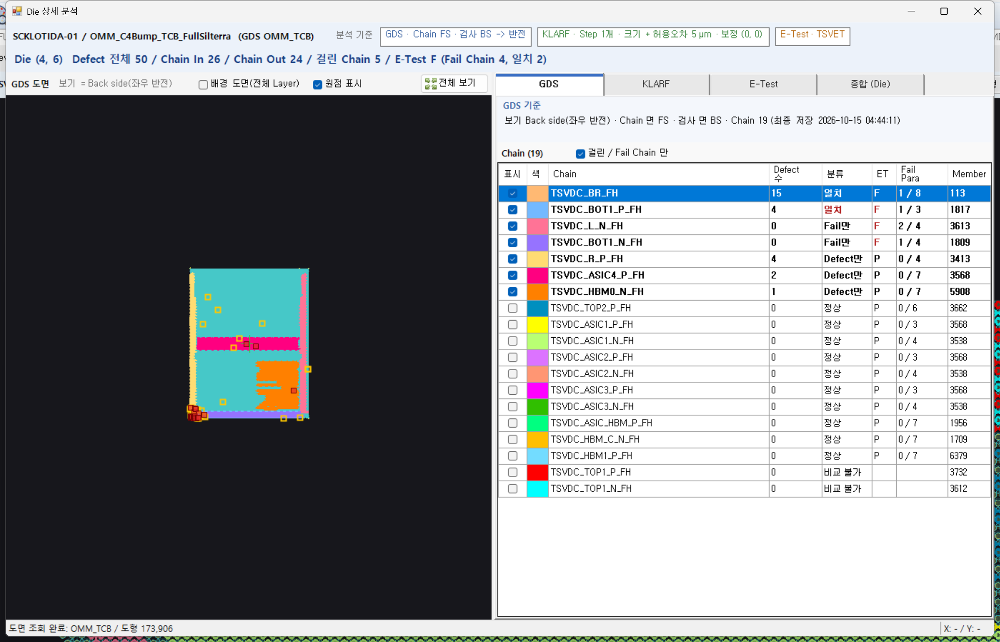
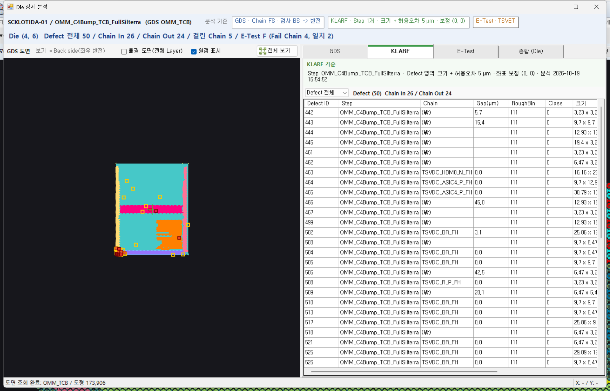
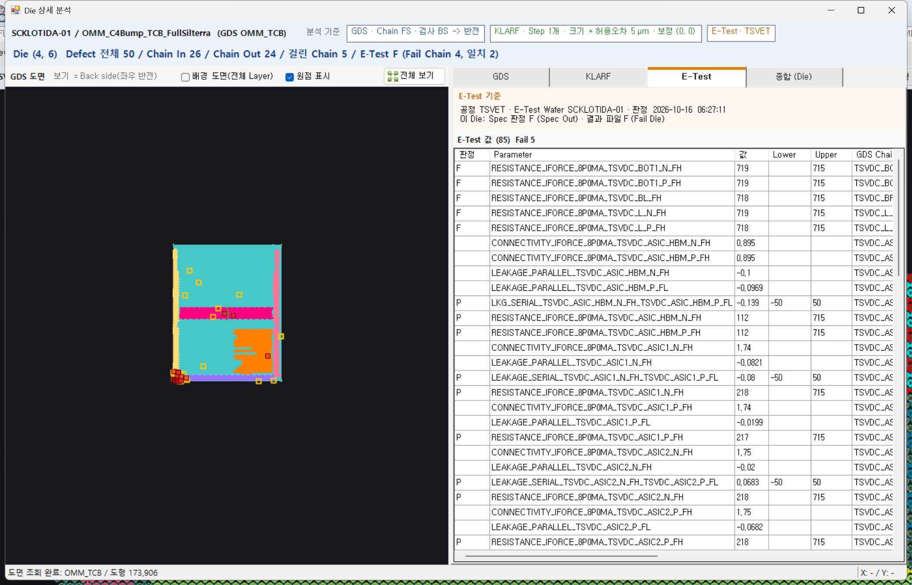
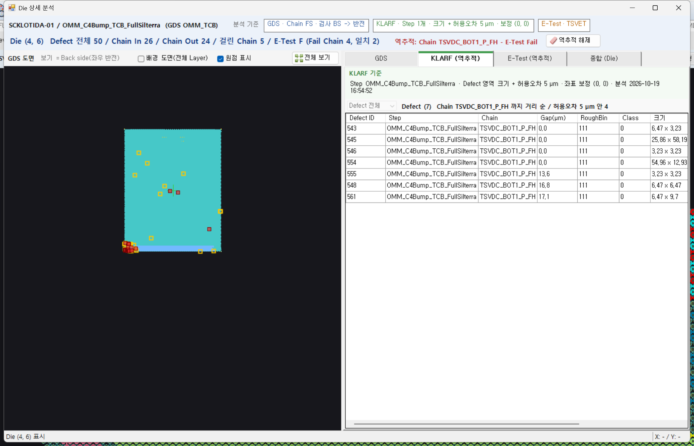

- 10.1 / 10.2 대로 구현. 설계와 달라진 곳 / 더한 것:
  - [GDS] Chain 표의 행 없는 칸(서버가 보내지 않는 Defect 0 + E-Test P 칸)은 화면 A 규칙대로 "정상"(ET P) / "비교 불가" 로 채운다. 상세 결과(AnalyzeDie)는 연결 Chain 을 모두 보내 Fail Para 가 "0 / 6" 처럼 보인다.
  - [E-Test] 기준은 2줄: 파일(공정 · E-Test Wafer · 판정 시각 · Spec 바뀜) / 이 Die(Spec 판정 (Spec Out) · 결과 파일 (Fail Die)). E-Test 가 없는 분석은 "E-Test 파일 없음".
  - 숨은 탭의 표는 처음 보일 때 첫 행을 저절로 골라 도면을 확대했다 -> 탭 전환 동안 선택 처리를 건너뛰고, 전에 고른 행이 없던 표는 선택을 지운다.
  - 지도에서 Defect 를 누르면 [KLARF] 탭으로 옮겨 그 행을 고른다.
- 검증: Smoke 68/68, 실제 데이터 9/9(리포트 `.testagent/reports/run-20261019-164515-CLAUDE-148/report.md`). 배포 안 함 / DMS 화면 확인 대기.
## 11. 2026-10-20 정리 (CLAUDE-149)

사용자 지시(2026-10-20): "1) 표시된 1번 영역 제거 2) 표시된 2번은 그냥 색 구간 설정 팝업에서만 확인 하면 된다. 3) GDS 관련 Cain 면은 Default로 BS로 한다."

| 항목 | 바뀐 것 |
| --- | --- |
| 1번 = 위쪽 "지금 기준" 요약 3칸 | 삭제(결정 L3 "넣음" -> 넣지 않음). 줄 2 에는 Wafer Key + [다시 조회] 만 남는다. 분석 기준은 아래 상태줄 / 각 기능 탭 기준 묶음에서 본다. 화면 B(상세보기)의 "분석 기준" 3칸은 그대로 |
| 2번 = Map 왼쪽 아래 범례(`flowLegend`) | 삭제(결정 L2 -> 팝업만). 색 / 구간 / Die 수 / Spec Out · Fail Die 행은 [색 구간 설정] 팝업 표에서만 본다 |
| 3번 = GDS Chain 면 기본값 | FS -> **BS**. 화면 콤보 기본, 서버 Ready `READY_GDS.CHAIN_SIDE` 기본 BACK, Analyze 요청 Chain 면이 비면 BACK. 기본 조건(Chain BS · 검사 BS)은 반전 없음 |

- 소스: `frmGdsKlarfAnalysis.Designer.cs`(lblSumTitle / lblSumGds / lblSumKlarf / lblSumEt / flowLegend 삭제), `frmGdsKlarfAnalysis.cs`(UpdateCriteriaSummary / RefreshLegend / LegendItem_Paint / PlaceLegend 삭제, Chain 면 기본 BS), BSL `GdsKlarfReady.cs` / `GdsKlarfAnalysis_Analyze.cs`(기본 BACK).
- 그림: 8절의 A2s(범례 겹쳐 그림)는 더 만들지 않는다.

## 12. 2026-10-20 KLARF 탭 Step 정보 / Wafer 1개만 분석 (CLAUDE-150)

사용자 지시(2026-10-20): "KLARF 탭의 Step 표를 없애고, 고른 Step 정보 한 줄 + 검사 면 [BS / FS] 콤보 + Pitch 출처 문구로 줄여줘. 서버의 여러 Step 기능은 그대로 두고, 설계 B16 은 2차로 돌려 기록해줘." / "해당 문구도 그냥 1개의 Wafer만 분석 가능하다 정도로 문구 수정" / "GDS, Klarf, E Test 전부 상단에 비슷한 내용이 있는데 이부분들도 1개의 wafer만 분석한다는 내용으로 수정해줘"

| 항목 | 바뀐 것 |
| --- | --- |
| KLARF 탭 Step 표(`dgvReadyStep`) / KLARF [직접 찾기] | 삭제. 그 자리에 고른 Step 정보 두 줄 `Step … / Lot …` · `검사 … / Defect … / 검사 Die …` + 검사 면 [BS / FS] 콤보(기본 = Ready `VIEW_SIDE`, BACK) + "Pitch 출처: Map Setup / KLARF". Step ID / Lot 이 길어 한 줄이면 뒤쪽이 잘려 두 줄로 나눴다 |
| 분석 요청 | `StepSeqs` / `ViewSides` = 고른 Step 1개 + 검사 면 콤보 값. 서버 Analyze 의 여러 Step 합치기는 그대로(설계 B16 = 2차) |
| 탭 위쪽 제목 | "GDS Map (Wafer 1개만 분석)" / "KLARF Step (Wafer 1개만 분석)" / "E-Test (Wafer 1개만 분석, 공정 1개 선택)". GDS 제목이 길어져 Chain 면 콤보를 오른쪽으로 옮김 |
| Wafer 여러 개 선택 오류 | "1개 Wafer 만 분석할 수 있습니다. Wafer 를 하나만 선택하세요. (선택 n개)" (같은 Wafer 다른 Step 안내 문구 삭제) |
| E-Test 표 / E-Test [직접 찾기] | 그대로 |

(미리보기 `Preview-GdsKlarfLayout.ps1 -StepSeq 528`, 150% 화면. 서버 Ready 자리는 예시 값이라 Pitch 출처가 "KLARF" 로 보인다. 실제 STEP 528 은 "Map Setup")

- 소스: `frmGdsKlarfAnalysis.Designer.cs`(btnFindStep / dgvReadyStep / colStep* 삭제, pnlStepInfo · lblStepInfo · cboStepSide · lblPitchSource 추가, 탭 제목), `frmGdsKlarfAnalysis.cs`(ShowStepInfo / cboStepSide_SelectedIndexChanged 추가, ReadySteps = 1개, Step 표 · KLARF 직접 찾기 메서드 삭제, 여러 Wafer 오류 문구). 서버(BSL / Interface) 변경 없음.
- 참고: Step 정보의 "검사 Die" 는 KLARF 헤더 값(`INSPECTED_DIE`, SampleTestPlan 수)이고, 아래 상태줄의 "검사 Die" 는 Map 에 그린 Die 행 수라 숫자가 다를 수 있다(STEP 528: 26 / 76). 예전 Step 표도 같은 값(26)을 보였다.

## 13. 2026-10-20 KLARF 검사 면 FS 고정 / 화면에서 숨김 (CLAUDE-154)

사용자 지시(2026-10-20, 12절 화면 캡처를 보고): "Klarf는 검사면이 FS가 Default다. GDS만 선택가능하고 Default나 BS다. Klarf에서는 검사면을 보여주지마라. Klarf, E-test는 그대로 사용한다."

| 항목 | 바뀐 것 |
| --- | --- |
| KLARF 탭 검사 면 [BS / FS] 콤보 | 삭제(12절에서 넣은 것). Pitch 출처 문구를 Step 정보 바로 아래로 올리고 KLARF 기준 묶음 높이를 줄임 |
| KLARF 검사 면 | FS 고정. 화면은 `ViewSides = FRONT` 로 보내고, 서버 Ready `VIEW_SIDE` 도 FRONT, 요청이 비면 FRONT |
| 고를 수 있는 면 | GDS 탭 Chain 면 콤보 하나(기본 BS, 11절 그대로) |
| 반전 | 규칙 그대로(Chain 면 ≠ 검사 면). 기본 Chain BS · 검사 FS = 반전(BACK 보기), Chain FS 로 바꾸면 반전 없음 |
| KLARF / E-Test Die | 그대로. 서버가 검사 면 FS 일 때 KLARF Die 번호를 좌우로 바꾸던 것(MinX + MaxX − x)을 쓰지 않는다 |

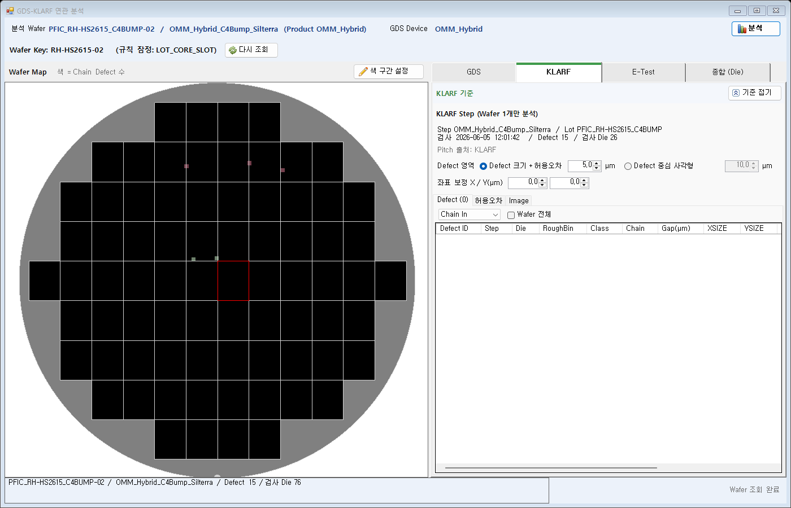

- 상태줄 / 상세보기 "분석 기준" 칸 · GDS / KLARF 기준 줄도 검사 면을 뺐다(같은 날 사용자 "빼줘", CLAUDE-157): 상태줄 "BACK 보기 (Chain BS -> 반전)" / Chain FS 면 "FRONT 보기 (Chain FS)", 상세보기 "GDS · Chain BS -> 반전", 기준 줄 "· Chain 면 BS".
- STEP 528 기본 조건 결과: Chain In 1 / 15(반전). 11절 기본(Chain BS · 검사 BS, 8 / 15)과 다르다. Chain FS 로 바꾸면 8 / 15.
- 상세: 통합 분석 설계 결정 B28 / 6.4 / 18절.
