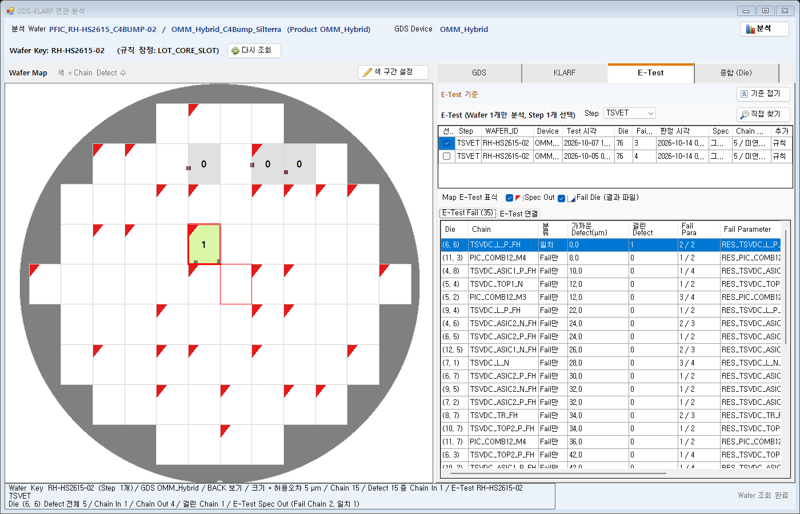

# 연관 분석 화면 A [E-Test] 탭 목록 조건: Wafer ID · Device · Step (2026-10-20)

관련: 통합 분석 설계 `2026-10-15_GDS_KLARF_ETest_통합분석_데이터_설계.md` B8 / B19 / 16.4 / 16.6절, 결정 B29(이 문서).

## 1. 요청과 결정

- 질문: "여러 Test 결과 중에 동일한 Wafer ID 로 List에 보여주고 하나만 선택 할 수 있는 건가?"
- 요청: "Wafer ID, Device, Step이 동일한 것만 E Test 결과 List에 나와야 한다."
- 결정(사용자 선택, 모두 권장안):

| 항목 | 결정 | 다른 안 |
| --- | --- | --- |
| Wafer ID | **Wafer Key 같음**: KLARF Wafer ID 에서 앞뒤(PFIC_ / _C4BUMP)를 뺀 Lot 핵심 + Slot = E-Test Wafer ID (지금 규칙 그대로) | 글자가 완전히 같음 (RH-HS2615-02 가 빠짐) |
| Device | **분석 GDS Device**: E-Test `DEVICE_ID` = 분석에 쓰는 GDS Device(대소문자 무시) | KLARF Product |
| Step | **Step 콤보로 고름**: Wafer ID + Device 가 같은 파일 중 Step 을 콤보로 하나 고르면 그 Step 파일만 목록에 나오고, 그 안에서 1개 선택 | KLARF Step 과 대응표 / Step 조건 없음 |

## 2. 확인한 데이터 사실

- E-Test 파일(`TQP_GDS_SRC_FILE`)에는 Step 칸이 없다. 원본 xlsx 머리의 `Step ID:` 칸 값은 `TSVET` 로, 파일명 공정(`TEST_PROGRAM`)과 같다.
  - 예: `CAI_OMMTCB_ATV_A0_TSVET_20261002161846_SCKLOTIDA_SCKLOTIDA-01$Silterra$.xlsx` 의 B23 = `TSVET`.
  - 그래서 "E-Test Step" = `TEST_PROGRAM`(TSVET / COWET / FT) 이다. KLARF Step ID(예: `OMM_C4Bump_TCB_FullSilterra`)와는 글자가 같아질 수 없다.
- 로컬 데이터(2026-10-20)에서 Device 조건의 영향:

| 분석 대상 KLARF (STEP / Product = GDS Device) | E-Test 파일 (SEQ / Device / Wafer ID / Step) | 결과 |
| --- | --- | --- |
| 528 / OMM_Hybrid | 361 / OMM / RH-HS2615-02 / TSVET | **빠짐**(Device 다름) -> 상태줄 "E-Test 1개는 Device 가 GDS Device OMM_Hybrid 와 달라 목록에서 뺌(OMM TSVET)" |
| 603 / OMM_TCB | 331 / OMMTCB / SCKLOTIDA-01 / TSVET | **빠짐**(Device 다름) |
| 601 / OMMTCB | 331 (위와 같음) | 목록에 나옴 |

  - 2026-10-19 F07DATA 검증 조합(STEP 603 OMM_TCB + E-Test 331 OMMTCB)은 이제 자동 목록에 나오지 않는다. 같은 조합으로 분석하려면 [직접 찾기]로 더한다.

## 3. 동작

### 3.1 서버 `GetWaferReady` (BSL `GdsKlarfReady.cs`)

- E-Test 후보: `SELECT_ET_FILE_BY_WAFER`(Lot 글자 / Slot, 저장 완료) -> `WaferKeyRule.FromETest` 가 같고 **`DEVICE_ID` = 분석 GDS Device** 인 파일만 `READY_ET` 에 넣는다.
  - 분석 GDS Device = 화면이 넘긴 Device, 비면 KLARF Product 와 이름이 같은 READY GDS Device(없으면 Product 이름).
- Wafer Key 는 같지만 Device 가 다른 파일은 목록에 넣지 않고 점검 `ET_OTHER_DEVICE`(정보)로만 남긴다. 문구 = "E-Test n개는 Device 가 GDS Device X 와 달라 목록에서 뺌(파일 Device Step, ...)".
- 쿼리 / DDL / Interface 변경 없음. `SELECTED` = Test 시각 최신 1개(B19) 그대로.

### 3.2 화면 A [E-Test] 탭 (ENGUI `frmGdsKlarfAnalysis`)

```
E-Test (Wafer 1개만 분석, Step 1개 선택)   Step [TSVET ▼]                 [직접 찾기]
┌선택┬Step ─┬WAFER_ID ────┬Device ─┬Test 시각 ──────────┬Die┬Fail Die┬판정 시각┬Spec┬Chain 연결┬추가┐
│ ☑ │TSVET │RH-HS2615-02 │OMM_..  │2026-10-07 11:02:00 │76 │ 3     │ ...    │그대로│5 / 미연결 2│규칙│
│ ☐ │TSVET │RH-HS2615-02 │OMM_..  │2026-10-05 09:30:00 │76 │ 4     │ ...    │그대로│...       │규칙│
```

- 탭 제목 = "E-Test (Wafer 1개만 분석, Step 1개 선택)". GDS / KLARF 탭과 같이 "Wafer 1개만 분석"을 둔다(2026-10-20 사용자 지시).
- Step 콤보 = 목록 파일의 Step 종류(Test 시각 최신 순). 기본 = 서버가 고른 최신 파일의 Step.
- 표 = 고른 Step 의 파일만. 체크는 1개(기본 = 그 Step 의 최신 파일). Step 을 바꾸면 그 Step 의 최신 파일을 고른다. 체크를 모두 끄면 E-Test 없이 분석한다(전과 같음).
- 파일이 없으면 Step 콤보를 끄고 표는 비운다.
- 열 머리 "공정" -> "Step". [직접 찾기] 창의 "공정" 콤보 이름도 "Step".
- [직접 찾기]: 찾기 Device 기본값 = 분석 GDS Device. 고른 파일을 목록에 "직접"으로 더하고, Step 콤보를 그 파일 Step 으로 바꿔 체크한다. 규칙(Wafer Key / Device)이 맞지 않는 파일을 엔지니어가 일부러 넣는 길이다.
- 상태줄: Wafer 를 받았을 때 `ET_OTHER_DEVICE` 문구를 결과로만 붙인다(사용법 안내 없음). 서버 조회 실패(`READY_LOCAL`)가 있으면 그것이 먼저다.

## 4. 바뀐 파일

| 파일 | 내용 |
| --- | --- |
| BSL `GdsKlarfReady.cs` | E-Test Device 조건 + `ET_OTHER_DEVICE` 점검 |
| BSL `Probes/GdsKlarfEtProbe.cs` | T7 = Device 를 넘겨 같은 Device 파일, 새 T7-1 = 다른 Device 0행 + 점검 / Device 빈 값 = Product 이름 기준 |
| ENGUI `DefectMapAnalysis/frmGdsKlarfAnalysis.cs` / `.Designer.cs` | Step 콤보(`lblEtStep` / `cboEtStep`), `_etFiles` / `ShowEtSteps` / `ShowEtRows` / `cboEtStep_SelectedIndexChanged`, 탭 제목, 열 머리, [직접 찾기] Device 기본값, 상태줄 문구 |
| ENGUI `DefectMapAnalysis/frmGdsKlarfSourceFind.Designer.cs` | "공정" -> "Step" |
| ENGUI `Verification/GdsKlarfAnalysisFormSmoke.cs` | 새 검사 3개(목록 Device · 상태줄 / Step 콤보 / 파일 없음) |
| ENGUI `Verification/GdsKlarfLayoutPreview.cs` | 예시 E-Test 행 Device = 분석 Device, 같은 Step 재측정 예시 1행 추가 |

## 5. 구현 결과 (2026-10-20)

- 서버 Probe `BSL/Probes/GdsKlarfEtProbe.ps1` -> `GDS_KLARF_ET_PROBE=PASS (18/18)`(새 T7-1). 운영 폴더의 예전 BSL 로 같은 Probe 를 돌리면 T7-1 FAIL(다른 Device 1행 / 점검 없음).
- 실제 데이터(최종 BSL 조회): 528 -> 0개 + "OMM TSVET" 뺌 / 601 -> 331 1개 선택 / 603 -> 0개 + "OMMTCB TSVET" 뺌 / 563 · 602 -> 0개(Wafer Key 다름, 전과 같음).
- 화면 Smoke `Verify-GdsKlarfAnalysis.ps1` -> `GDS_KLARF_FORM_SMOKE=PASS (75/75)`(새 4개: 목록 Device · 상태줄 / Step 콤보 / 머리 줄 배치 / 파일 없음).
- 그림을 보고 고친 것: 굵은 제목 끝이 Step 라벨에 가려짐 -> Step 라벨 / 콤보를 실행 중 제목 바로 뒤에 놓음(`PlaceEtStep`).
- 그림: `2026-10-20_ETest_목록_조건/` A1(E-Test 탭, Step 콤보 + TSVET 2행 예시) / A2([직접 찾기] 창, Step 콤보 이름).
- 리포트: `.testagent/reports/run-20261020-113039-CLAUDE-160/report.md`(판정 DONE). 배포 안 함, DMS 화면 확인 대기.



## 6. 배포 묶음

- 서버 BSL(`101_ServerBin`) + 화면 ENGUI(`100_ClientBin`)를 함께 배포해야 한다.
  - 서버만 배포하면 목록 조건은 바뀌지만, 화면 표는 예전처럼 모든 Step 을 한 표에 보인다.
  - 화면만 배포하면 Step 콤보는 생기지만 Device 가 다른 파일도 목록에 남는다.
- SEMDMS Service / DACrux 를 다시 시작해야 한다.
