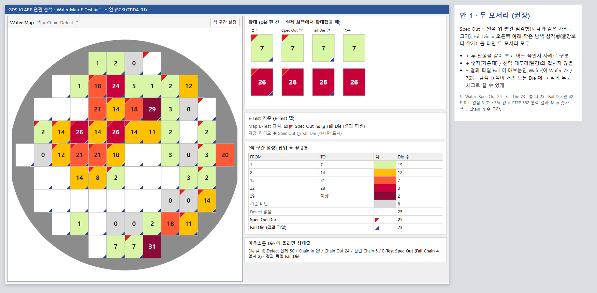
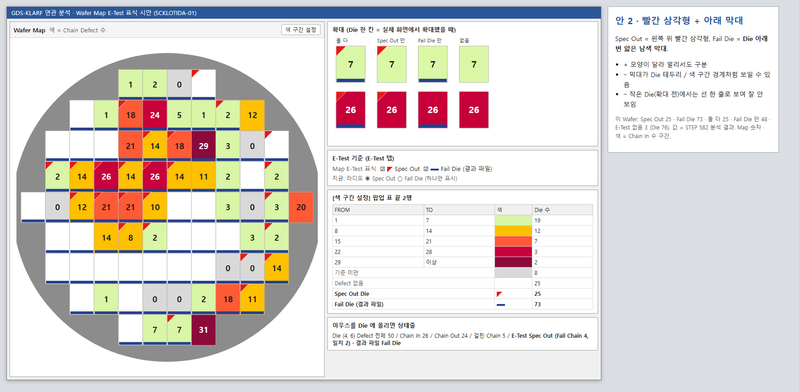
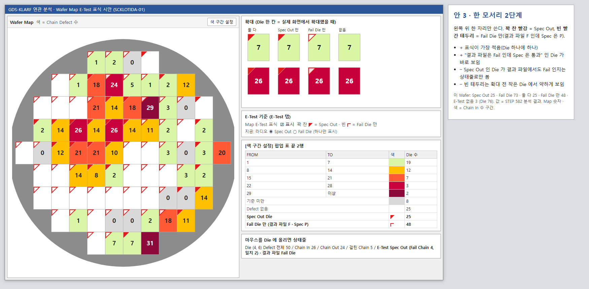
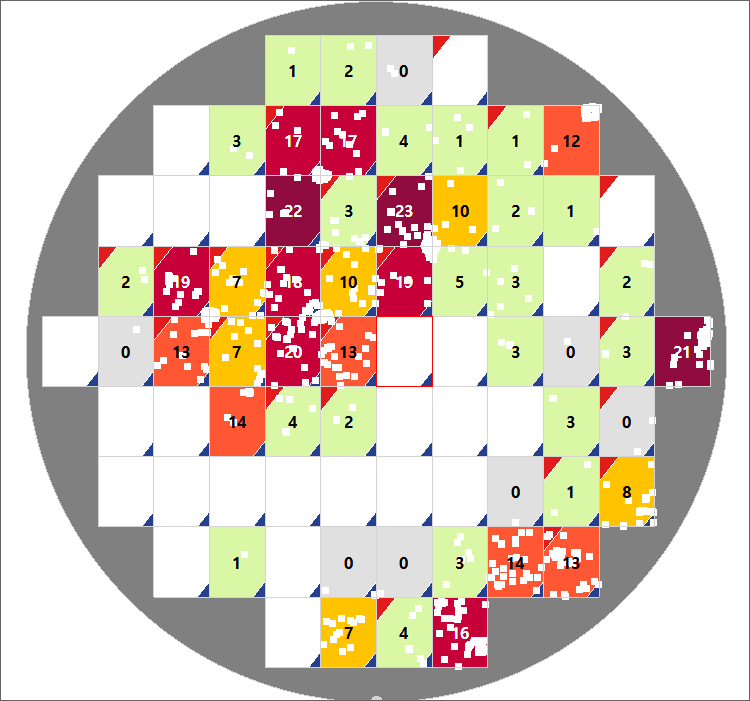
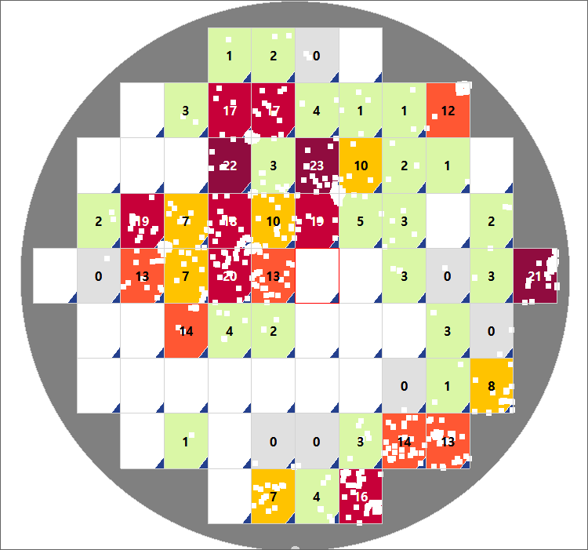

# 연관 분석 화면 A Wafer Map: E-Test Spec Out / Fail Die 표식 나눠 보이기 (CLAUDE-153, 설계)

작성: 2026-10-20 / 상태: 결정 "안 1, E1 ~ E4 권장안" -> 구현 완료(TEMP 빌드 + Smoke + 실제 데이터, 배포 안 함)

## 1. 요구 (2026-10-20 사용자)

"E-Test 결과 Data에 대한 Wafer Map에서 표시 할때 Fail Die 와 Spec Out에 대한 표시를 다르게 표시 했으면 좋겠다. Die에 대한 확인 표시를 너무 과하게하지는 말고 엔지니어가 확인 가능한 수준으로 했으면 한다. 설계 우선 하고 표시되는 내용에 대한 컨셉을 나한테 보여줘"

## 2. 지금 (소스 기준)

| 항목 | 지금 | 근거 |
| --- | --- | --- |
| 표식 | Die 왼쪽 위 빨간 삼각형(두 변의 35%) 하나 | `DefectMapAnalysis/GdsKlarfAnalysisMap.cs` `DrawDies` / `FailMarkRatio` (CLAUDE-140) |
| 기준 | [E-Test] 탭 "Map 빨간 삼각형" 라디오 ◉ Spec Out / ○ Fail Die 중 **하나만** | `frmGdsKlarfAnalysis.cs` `IsFailMarkDie` (CLAUDE-145) |
| Spec Out | DMS Spec 판정 `TQP_GDS_ET_DIE.JUDGE_FLAG` = F (결과 DIE.ET_STATE) | 통합 분석 설계 6.2 / B12 |
| Fail Die | 결과 파일 DUT Pass/Fail Flag `TQP_GDS_ET_DIE.PASS_FLAG` = F (결과 DIE.ET_FILE_FLAG) | CLAUDE-145 |
| 색 구간 팝업 | 표 끝 1행 "Spec Out Die n" 또는 "Fail Die (결과 파일) n" (라디오 따라) | `AddFailMarkRow` |
| 겹침 피하기 | 선택 Die = 빨간 테두리, 숫자 = 가운데, Index 라벨 = 위쪽 | `DrawDies` / `DrawDieCounts` |

- 서버 결과(DIE 표)에 두 값이 이미 있다. **서버 / DB 변경 없음.**

## 3. 데이터 사실 (SCKLOTIDA-01 / STEP 582 분석, Die 76)

| Spec 판정 \ 결과 파일 | F (Fail Die) | P | 없음 |
| --- | --- | --- | --- |
| F (Spec Out) | 25 | 0 | - |
| P | 48 | 0 | - |
| 없음 | - | - | 3 (E-Test Die 없음) |

- 결과 파일 Fail Die 가 73 / 76 Die 다(이 E-Test 파일은 DUT Flag 가 모두 Failed). 표식이 크거나 진하면 Map 전체가 덮여 Chain Defect 색 / 숫자가 안 보인다.
- 그래서 **Spec Out 은 지금 표식 그대로**, Fail Die 는 **더 작게 / 따로 끌 수 있게** 둔다(과하지 않게).

## 4. 후보 (그림: `2026-10-20_Map_ETest_표식_후보/`, 값 = 위 Wafer)

| 후보 | Spec Out | Fail Die | 좋은 점 | 아쉬운 점 |
| --- | --- | --- | --- | --- |
| **안 1 (권장) 두 모서리** | 왼쪽 위 빨간 삼각형 35%(지금 그대로) | **오른쪽 아래 작은 남색 삼각형 22%** | 자리로 구분, 둘 다 같이 봄. 숫자 / 선택 테두리와 안 겹침 | Fail Die 가 대부분인 Wafer 는 남색 점이 거의 모든 Die 에 -> 작게 + 체크로 끔 |
| 안 2 삼각형 + 아래 막대 | 왼쪽 위 빨간 삼각형 | Die 아래 변 얇은 남색 막대 | 모양이 달라 멀리서도 구분 | 막대가 Die 테두리 / 구간 경계처럼 보이고 무거움, 작은 Die 에서는 선 한 줄 |
| 안 3 한 모서리 2단계 | 왼쪽 위 꽉 찬 빨간 삼각형 | 같은 자리 **빈 빨간 테두리 삼각형** = Fail Die 만(결과 파일 F · Spec P) | 표식 가장 적음(Die 하나에 하나), "파일은 Fail 인데 Spec 통과" Die 가 바로 보임 | Spec Out 이면서 파일도 Fail 인지는 상태줄로만, 빈 테두리는 작은 Die 에서 약함 |

## 5. 공통 (안 1 기준)

| 항목 | 바뀐 뒤 |
| --- | --- |
| [E-Test] 탭 기준 | 라디오 2개 -> **체크 2개** "Map E-Test 표식 ☑ Spec Out ☑ Fail Die (결과 파일)". 기본 둘 다 켬. 문구 "Map 빨간 삼각형" -> "Map E-Test 표식" |
| 표식 모양 | Spec Out = 빨강(#E21B1B) 왼쪽 위 35%, Fail Die = 남색(#24408E) 오른쪽 아래 22%. 둘 다 흰 1px 테두리(진한 구간 색 위에서도 보이게) |
| 색 구간 팝업 표 끝 | 2행 "Spec Out Die n" / "Fail Die (결과 파일) n" (켠 표식만), 색 칸 = 표식 모양 |
| 상태줄(Die 위 마우스) | "… / E-Test Spec Out (Fail Chain n, 일치 n) · 결과 파일 Fail Die" (지금 "E-Test F (…)") |
| E-Test 없는 결과 | 체크는 보이되 표식 / 표 행 없음(지금과 같음) |
| 상세보기 / 다른 화면 | 바꾸지 않음(상세보기 [E-Test] 기준은 이미 "Spec 판정 F (Spec Out) · 결과 파일 F (Fail Die)") |
| Die 색 기준 | 그대로(Chain Defect 수). 표식은 색 기준과 상관없이 그림 |

## 6. 결정 필요 (권장안)

| ID | 질문 | 권장 |
| --- | --- | --- |
| E1 | 표식 모양 | 안 1 두 모서리 |
| E2 | 켜고 끄기 | 체크 2개(기본 둘 다 켬) |
| E3 | Fail Die 색 | 남색 #24408E(빨강 · 구간 색과 겹치지 않음) |
| E4 | 상태줄 문구 | "E-Test Spec Out … · 결과 파일 Fail Die" |

## 7. 구현 때 바뀌는 곳 (결정 뒤)

- ENGUI `DefectMapAnalysis/GdsKlarfAnalysisMap.cs`: 표식 집합 2개(`SetEtMarks(spec, file)`), 오른쪽 아래 삼각형, 흰 테두리, Smoke 확인용 수 2개.
- ENGUI `DefectMapAnalysis/frmGdsKlarfAnalysis.cs` / `.Designer.cs`: 라디오 -> 체크 2개, 색 구간 팝업 끝 2행, 상태줄 문구.
- Smoke `Verification/GdsKlarfAnalysisFormSmoke.cs`: 라디오 검사 -> 체크 검사(Spec Out / Fail Die 수 = 결과 DIE 표, 끄면 표식 / 행 없음), 실제 E-Test 데이터 대조(SCKLOTIDA-01: 25 / 73).
- 서버 / DB 변경 없음. 배포 = ENGUI DLL.
- 겹침 주의: 화면 A 파일은 오늘 CLAUDE-149 / 150 이 고쳤다(09:34 완료). Smoke 는 CLAUDE-152(다른 세션, 상세보기)가 화면 B 검사를 고칠 수 있어 구현 전에 그 행 상태를 다시 본다.

## 8. 구현 결과 (2026-10-20 10:05)

결정: "안 1(두 모서리: Spec Out 왼쪽 위 빨강, Fail Die 오른쪽 아래 작은 남색, 체크 2개)로 구현해줘. E1 ~ E4 모두 권장안."

그림(TEMP 빌드, 실제 로컬 데이터 SCKLOTIDA-01 / STEP 603 / E-Test 331): `2026-10-20_Map_ETest_표식_구현/`

.png)

| 곳 | 구현 |
| --- | --- |
| `GdsKlarfAnalysisMap.cs` | `_specDies` / `_fileDies` + `SetEtMarks(spec, file)`, Spec Out = 왼쪽 위 35% 빨강(#E21B1B), Fail Die = 오른쪽 아래 22% 남색(#24408E, `FileFailMarkColor`), 둘 다 흰 1px 테두리(`FillMark`). 확인용 `SpecOutMarkCount` / `FileFailMarkCount` |
| `frmGdsKlarfAnalysis.Designer.cs` | 라디오 `rdoFailSpec` / `rdoFailFile` -> 체크 `chkMarkSpec` "Spec Out" / `chkMarkFile` "Fail Die (결과 파일)"(기본 둘 다 켬), 문구 "Map 빨간 삼각형" -> "Map E-Test 표식" |
| `frmGdsKlarfAnalysis.cs` | `ApplyEtMarks` / `IsSpecOutDie` / `IsFileFailDie` / `chkEtMark_CheckedChanged`(서버 다시 부르지 않음), 체크 앞 그림 = 표식 모양(`MarkImage` / `DrawMarkBox`), 색 구간 표 끝 = 켠 표식마다 1행("Spec Out Die n" / "Fail Die (결과 파일) n", 색 칸 = 표식 모양), FROM 칸 폭 늘림, 상태줄 `EtStatusText` "E-Test Spec Out / Spec 통과 (Fail Chain n, 일치 n) · 결과 파일 Fail Die / Pass" |
| Smoke | 라디오 검사 -> "E-Test 표식 체크 2개" 검사(둘 다 / Spec 만 / Fail 만 / 다시 둘 다 / 되돌림) |

- 검증: Smoke 70/70, 실제 데이터 `MARK_CHECK_PROBE=PASS (5/5)`(Spec Out 25 / Fail Die 73). 리포트 `.testagent/reports/run-20261020-095726-CLAUDE-153/report.md`.
- 남은 것: 배포(ENGUI, CLAUDE-149 / 150 과 함께) / DMS 화면 확인. 진한 구간 색 위 빨간 삼각형 대비는 원래부터 약함(흰 테두리만 더함).