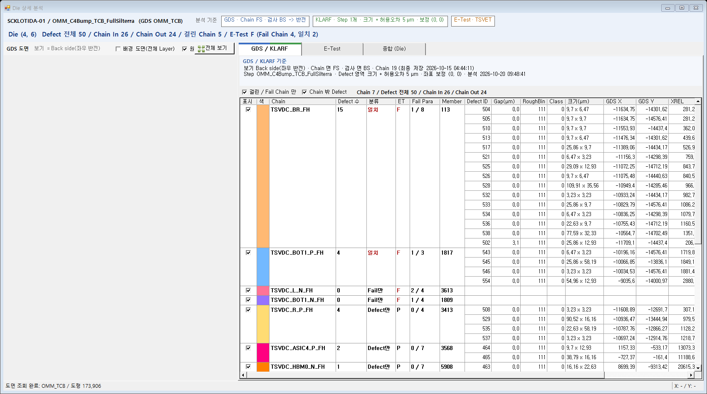
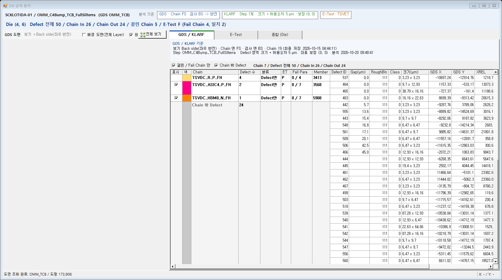
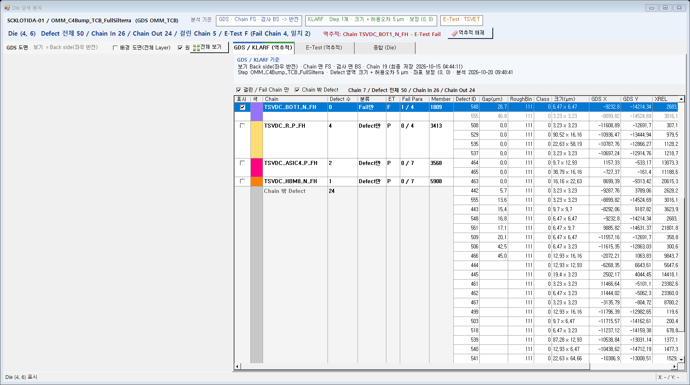
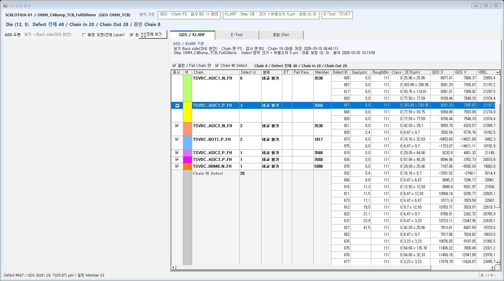
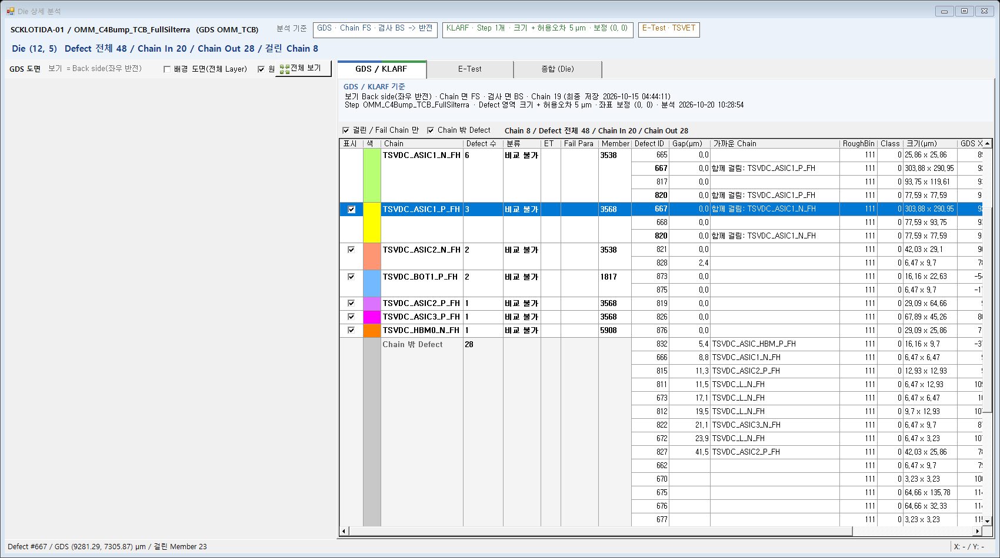

# 상세보기(화면 B) GDS 탭 + KLARF 탭 합치기 설계

작성: 2026-10-20 Claude (CLAUDE-151) / 상태: **M1 ~ M5 권장안 결정 (2026-10-20 사용자) / 구현 완료 (CLAUDE-152, 6절) / 배포 안 함 / DMS 화면 확인 대기**

사용자 지시 (2026-10-20):

> 상세보기 화면에서 GDS와 Klarf를 하나의 탭으로 Merge 하자
> 하나의 Chain 오른쪽에 Cahin에 해당하는 Defect의 정보를 넣어 준다.
> 할당된 Chain에 부합하지 않은 Defect은 최하단에 Chain에 들어가지 않은 Defect으로 동일한 포맷으로 추가해 준다. 설계 하고 예시들어서 하나 보여줘

앞 문서: [화면 A 레이아웃 후보 10절 상세보기 안 1 구현](2026-10-19_화면A_레이아웃_후보.md) (CLAUDE-148, 기능 탭 [GDS] [KLARF] [E-Test] [종합 (Die)])

---

## 1. 지금과 바뀌는 것

| 항목 | 지금 (CLAUDE-148) | 바뀐 뒤 |
| --- | --- | --- |
| 기능 탭 | [GDS] [KLARF] [E-Test] [종합 (Die)] | **[GDS / KLARF]** [E-Test] [종합 (Die)] |
| Chain 과 Defect | [GDS] 탭 Chain 표(`dgvChains`)와 [KLARF] 탭 Defect 표(`dgvDefects`)를 오가며 본다. Defect 표의 Chain 열로만 어느 Chain 인지 안다 | 표 하나. Chain 행 오른쪽에 그 Chain 에 걸린 Defect 를 줄줄이 붙인다 |
| 어느 Chain 에도 안 걸린 Defect | Defect 표에서 Chain 열 "(밖)" | 표 맨 아래 **"Chain 밖 Defect"** 묶음. 열은 위와 같다 |
| 기준 묶음 | "GDS 기준" / "KLARF 기준" 따로 | "GDS / KLARF 기준" 2줄 (1줄 = GDS, 2줄 = KLARF, 지금 문구 그대로) |
| 거르기 | [GDS] "걸린 / Fail Chain 만" 체크, [KLARF] Defect 범위 콤보(Chain In / Chain Out / Defect 전체) | 체크 2개: "걸린 / Fail Chain 만"(지금과 같음), **"Chain 밖 Defect"**(기본 켬). 범위 콤보는 없앤다 (M4) |

E-Test 탭 / 종합 (Die) 탭 / 도면 / 위쪽 Die 줄은 그대로다. 서버(AnalyzeDie) 결과도 그대로 쓴다.

## 2. 표 배치

한 행 = (Chain, Defect) 1쌍. 왼쪽 8열은 Chain 칸, 오른쪽 10열은 Defect 칸이다.

| 구분 | 열 | 값 (AnalyzeDie 결과) |
| --- | --- | --- |
| Chain 칸 (같은 Chain 의 행끼리 한 칸으로 보임) | 표시 / 색 / Chain / Defect 수 / 분류 / ET / Fail Para / Member | 지금 [GDS] Chain 표와 같다 (`CHAIN`, `DIE_CHAIN`) |
| Defect 칸 | Defect ID / Gap(µm) / RoughBin / Class / 크기(µm) / GDS X / GDS Y / XREL / YREL / 가까운 Chain | 지금 [KLARF] Defect 표 열 (`DEFECT`). Gap = 그 Chain 까지 거리(`DEFECT_CHAIN.GAP`, 허용오차 안이면 걸림) |

- Step 열은 뺀다. 상세보기는 Step 1개이고(CLAUDE-150), Step 이름은 기준 묶음 2줄에 있다. 여러 Step 이 다시 생기면(B16 2차) 열을 되살린다.
- "가까운 Chain" 열은 Chain 밖 묶음에서만 채운다(탐색 거리 안 가장 가까운 Chain 이름). 위 묶음에서는 빈칸이다. 두 Chain 에 걸린 Defect 는 이 열에 "함께 걸림: 다른 Chain 이름" 을 쓴다 (M3).

### 2.1 행 규칙

1. Chain 순서: 지금 [GDS] Chain 표와 같다. 분류(일치 -> Fail만 -> Defect만 -> 정상 -> 비교 불가) 다음 Defect 수가 많은 순서.
2. Chain 마다 걸린 Defect 수만큼 행을 만든다. 걸린 Defect 가 0인 Chain(예: E-Test Fail만)은 Defect 칸이 빈 1행.
3. 묶음 안 Defect 순서: Gap 작은 순서, 같으면 Defect ID 순서.
4. **두 Chain 에 걸린 Defect** 는 두 묶음에 모두 나온다(판정 단위가 (Die, Chain) 이라 Chain 마다 1개로 센다). "가까운 Chain" 열에 함께 걸린 다른 Chain 이름을 쓴다. Chain 칸의 Defect 수 합이 Die 의 Chain In 수보다 클 수 있다.
5. **Chain 밖 Defect 묶음**: 맨 아래, 같은 열.
   - Chain 칸: 표시 체크 없음 / 색 회색 / Chain = "Chain 밖 Defect" / Defect 수 = Chain Out 수 / 나머지 빈칸.
   - Defect 칸: Gap = 가장 가까운 Chain 까지 거리(탐색 거리 밖이면 빈칸), 가까운 Chain = 그 Chain 이름.
   - 순서: Gap 있는 것(가까운 것)부터, 그다음 Defect ID. 허용오차를 조금 넓히면 걸릴 Defect 가 위에 온다.
6. "걸린 / Fail Chain 만" 을 끄면 걸린 Defect 도 없고 E-Test Fail 도 아닌 Chain 도 Defect 칸이 빈 1행으로 나온다(지금 Chain 표와 같은 수).

### 2.2 화면 표시

- WinForms 표(DataGridView)는 칸 병합이 없어 **그리기로 병합처럼** 보인다.
  - 같은 묶음의 Chain 칸은 묶음 첫 행(스크롤로 첫 행이 가려지면 화면에 보이는 첫 행)에만 글자와 색을 그리고, 묶음 안 가로선은 그리지 않는다.
  - 묶음 사이에는 굵은 가로선.
- 행마다 Tag = (CHAIN_SEQ, STEP_SEQ, DEFECTID). Chain 밖 묶음은 CHAIN_SEQ 없음.
- 역추적 Chain 묶음은 지금처럼 굵은 글자. 묶음을 맨 위로 올리지 않는다(10-16 지시 "그대로 있어야 한다").

### 2.3 동작

| 동작 | 결과 |
| --- | --- |
| Chain 칸 클릭 | 그 Chain 을 고른다(도면 강조, 지금 Chain 표 클릭과 같음) |
| Defect 칸 클릭 | 그 Defect 를 고른다(도면 확대 / 상태줄, 지금 Defect 표 클릭과 같음) |
| Chain 칸 더블클릭 | 역추적(지금과 같음) |
| 표시 체크 | 도면에 그 Chain 보이기 / 숨기기(지금과 같음) |
| 도면에서 Defect 클릭 | 그 Defect 의 첫 행을 고르고 보이게 스크롤(지금은 [KLARF] 탭으로 옮김 -> 같은 탭이라 옮기지 않음) |
| 역추적으로 열기 | [GDS / KLARF] 탭을 열고 그 Chain 묶음으로 스크롤 |

## 3. 예시 (실제 데이터)

SCKLOTIDA-01 / OMM_C4Bump_TCB_FullSilterra (GDS OMM_TCB) / Die (4, 6). 조건은 Chain FS / 검사 BS, 크기 + 허용오차 5 µm, E-Test TSVET, "걸린 / Fail Chain 만" 켬.
값은 TEMP 빌드 BSL `AnalyzeDie` 로 로컬 DB 에서 뽑았다(STEP 603, E-Test SRC_FILE_SEQ 331, 읽기 전용).

- Die: Defect 전체 50 / Chain In 26 / Chain Out 24 / 걸린 Chain 5 / E-Test F (Fail Chain 4, 일치 2).
- 전체 표(52행, 병합 칸): [예시_SCKLOTIDA-01_Die(4,6).xlsx](2026-10-20_상세보기_GDS_KLARF_합친탭/예시_SCKLOTIDA-01_Die(4,6).xlsx)

| 묶음 (Chain) | Defect 수 | 분류 | ET | Fail Para | 걸린 Defect ID (Gap 순) |
| --- | --- | --- | --- | --- | --- |
| TSVDC_BR_FH | 15 | 일치 | F | 1 / 8 | 504, 505, 510, 513, 517, 521, 525, 526, 528, 532, 533, 534, 536, 538, 502(Gap 3.1) |
| TSVDC_BOT1_P_FH | 4 | 일치 | F | 1 / 3 | 543, 545, 546, 554 |
| TSVDC_L_N_FH | 0 | Fail만 | F | 2 / 4 | (빈 1행) |
| TSVDC_BOT1_N_FH | 0 | Fail만 | F | 1 / 4 | (빈 1행) |
| TSVDC_R_P_FH | 4 | Defect만 | P | 0 / 4 | 508, 529, 535, 537 |
| TSVDC_ASIC4_P_FH | 2 | Defect만 | P | 0 / 7 | 464, 465 |
| TSVDC_HBM0_N_FH | 1 | Defect만 | P | 0 / 7 | 463 |
| Chain 밖 Defect | 24 | | | | 442(5.7, TSVDC_ASIC3_P_FH), 555(13.6, TSVDC_BOT1_P_FH), 443(15.4, TSVDC_ASIC1_N_FH), 548(16.8), 561(17.1), 509(20.1), 506(42.5), 466(45.0), 그 밖 16개(탐색 거리 밖) |

- 이 Die 에는 두 Chain 에 함께 걸린 Defect 가 없다(26개 모두 Chain 1개).
- 442 는 TSVDC_ASIC3_P_FH 까지 5.7 µm 라 허용오차를 6 µm 로 넓히면 그 Chain 에 걸린다. 맨 아래 묶음의 첫 행으로 바로 보인다.

## 4. 영향 / 구현 범위 (결정 뒤)

- GdsMap `06_CoreLibSource/GdsMapControl/GdsDieAnalysisForm.cs` / `.Designer.cs`
  - `tabGds` + `tabKlarf` -> 탭 1개(`tabChainDefect`, 제목 "GDS / KLARF").
  - `dgvChains` + `dgvDefects` -> 표 1개. `pnlChainHead`(chkHitOnly) + `pnlDefectHead`(cboScope) -> 머리 1줄(체크 2개 + "Chain n / Defect 전체 n / Chain In n / Chain Out n").
  - 채우기: `FillChainGrid` / `FillDefectGrid` -> 합친 채우기 1개.
  - 선택 / 역추적 / 도면 연동 / 보기 상태 저장(여러 창 규칙, CLAUDE-139)은 행 Tag 로 옮긴다.
- 호스트 `frmGdsDieAnalysis` 계약(ShowDie 등)은 그대로다. 화면 A / 서버 / DB 변경 없음.
- Smoke `02_DMS/DACrux.SEMDMS.ENGUI/Verification/GdsKlarfAnalysisFormSmoke.cs`: 화면 B 검사 중 `dgvChains` / `dgvDefects` / KLARF 탭을 쓰는 검사(Chain 이름 표시 / 더블클릭 순서 유지 / Defect 행 선택 / 탭 전환 자동 선택)를 새 표로 바꾸고, 묶음 규칙 검사를 더한다(행 수 = Σ Chain 별 걸린 Defect + 빈 Chain 행 + Chain Out, 묶음 순서, Chain 밖 Gap 순서).
- 실제 데이터 대조: 위 예시(Die (4, 6))로 묶음별 Defect ID 가 위 표와 같은지.

## 5. 결정 항목 (2026-10-20 사용자 "M1 ~ M5 권장안으로 상세보기 GDS / KLARF 합친 탭을 구현해줘." -> 권장안 전부 확정)

| # | 항목 | 권장안 | 다른 안 |
| --- | --- | --- | --- |
| M1 | 탭 이름 | "GDS / KLARF" | "Chain / Defect" |
| M2 | Defect 0 인 Chain | 빈 1행으로 보임(Fail만 Chain 을 놓치지 않음). "걸린 / Fail Chain 만" 으로 거름 | 걸린 Chain 만 |
| M3 | 두 Chain 에 걸린 Defect | 두 묶음에 모두 넣고 "가까운 Chain" 열에 "함께 걸림: 다른 Chain" | 첫 Chain 에만 넣음(Chain 별 Defect 수와 어긋남) |
| M4 | Defect 범위 콤보(Chain In / Out / 전체) | 없애고 "Chain 밖 Defect" 체크 1개(기본 켬) | 콤보 유지 |
| M5 | Chain 밖 묶음 순서 | 가까운 거리 순(허용오차 밖이지만 가까운 Defect 가 위) | Defect ID 순 |

## 6. 구현 결과 (2026-10-20, CLAUDE-152)

- 소스: GdsMap `06_CoreLibSource/GdsMapControl/GdsDieAnalysisForm.cs` / `.Designer.cs`. 서버 / DB 변경 없음.
  - `tabGds` + `tabKlarf` -> `tabChainDefect`("GDS / KLARF", 기능 색 막대 = 왼쪽 GDS 색 + 오른쪽 KLARF 색), `dgvChains` + `dgvDefects` -> `dgvChainDefects`(열 18개, 모두 정렬 안 됨), `cboScope` -> `chkOutside`("Chain 밖 Defect", 기본 켬), 기준 묶음 "GDS / KLARF 기준" 2줄.
  - 채우기 `FillChainDefectGrid` + `AddGroup`(행 Tag = Chain 번호 / Defect / 묶음 / 첫 / 끝 행), 그리기 `dgvChainDefects_CellPainting`(묶음 안 가로선 없음, Chain 글자는 묶음 첫 행 또는 화면 첫 행, 묶음 끝 진한 선, 스크롤하면 다시 그림).
  - 행 선택: Defect 행 = 지도에서 그 Defect 강조(허용오차 점선) + 주변으로 이동 + 상태줄. 2026-10-20 CLAUDE-155: 걸린 Member / Chain 도형을 노란 선택 색으로 칠하지 않는다(사용자 "Row 선택 시 Defect 만 따라가고 노란색으로 Chain 을 채워줄 필요는 없다"), Chain 칸 클릭도 칠하지 않는다. Defect 없는 Chain 행 = 상태줄에 Chain 이름만. 더블클릭: Chain 칸 = 역추적, Defect 칸 = 이미지. 지도 Defect 클릭 = 그 Defect 첫 행(숨은 Chain 밖 묶음이면 켬).
  - 창마다 보기 상태: Chain 밖 Defect / 걸린 Chain 만 / Chain 표시 / 고른 행(Chain 번호 + Defect 키) / 스크롤.
- 2.1 과 달라진 / 더한 것:
  - "걸린 / Fail Chain 만" 은 예전에는 도면 표시 체크만 정했다. 이제 표 행도 거른다(예시처럼 Chain 7개). 끄면 모든 Chain 행 + 모두 표시.
  - 역추적 Chain 묶음은 예전 [KLARF] 역추적처럼 탐색 거리 안 Defect 를 거리 순으로 모두 보인다(허용오차 밖은 회색 + "허용오차 밖"). 걸린 Defect 가 없는 Fail만 Chain 도 가까운 Defect 를 볼 수 있다.
  - 역추적 해제 등으로 고른 행이 없어지면 같은 Chain 묶음의 첫 행을 고른다.
- 검증:
  - `Verify-GdsKlarfAnalysis.ps1`(SCK / OMM_Hybrid / 528) -> `GDS_KLARF_FORM_SMOKE=PASS (70/70)`. 화면 B 검사를 새 표로 바꾸고 묶음 규칙 검사 1개를 더했다.
  - 실제 데이터(SCKLOTIDA-01 / STEP 603 / E-Test 331 / Die (4, 6), scratchpad 확인 프로그램): 머리 줄 "Chain 7 / Defect 전체 50 / Chain In 26 / Chain Out 24", 52행, 묶음과 Defect 순서가 3절 예시와 같다. 역추적 TSVDC_BOT1_N_FH(Fail만) = 548(26.7) / 555(46.8) 허용오차 밖.

(그림은 화면 밖 캡처라 GDS 도면은 비어 보인다. 도면 그리기는 바뀌지 않았다.)

## 7. 두 Chain 에 걸린 Defect 표시 (2026-10-20, CLAUDE-155)

- 판정 단위가 (Die, Chain) 이라 Defect 하나가 Chain 두 개의 허용오차 안에 있으면 두 Chain 모두에 "걸림"이다(설계 2.1 의 4번, M3).
- 표: 두 Chain 묶음에 같은 Defect 행이 하나씩 나온다. 두 행 모두 "가까운 Chain" 칸에 "함께 걸림: (다른 Chain 이름)". Chain 칸 Defect 수는 묶음마다 1개씩 센다.
- 머리 줄 / Die 줄의 Chain In 은 Defect 기준이라 한 번만 센다. 그래서 Chain 칸 Defect 수의 합이 Chain In 보다 클 수 있다.
- 지도: Defect 표식은 하나다. 어느 묶음의 행을 골라도 같은 Defect 로 옮기고 강조한다(노란 칠 없음).
- 실제 데이터(SCKLOTIDA-01 / STEP 603, Chain FS / 검사 BS, 5 µm, Wafer 전체 Analyze): Chain In 472 중 두 Chain 에 걸린 Defect 6개. 대부분 같은 이름의 P / N 쌍이다.
  - Die (7, 8) 13: TSVDC_ASIC3_P_FH + TSVDC_ASIC3_N_FH / Die (10, 8) 30: TSVDC_TOP1_P_FH + TSVDC_TOP1_N_FH / Die (5, 8) 117: TSVDC_L_N_FH + TSVDC_BOT1_P_FH
  - Die (12, 5) 667 / 820: TSVDC_ASIC1_P_FH + TSVDC_ASIC1_N_FH / Die (10, 2) 1042: TSVDC_BOT1_P_FH + TSVDC_BOT1_N_FH
  - 허용오차 20 µm 면 8개(Die (6, 6) 621, Die (12, 5) 668 추가).
- Die (12, 5) 화면: TSVDC_ASIC1_N_FH 묶음(6) 과 TSVDC_ASIC1_P_FH 묶음(3) 에 667 / 820 이 함께 있다. 머리 줄 "Chain 8 / Defect 전체 48 / Chain In 20 / Chain Out 28". 묶음 Defect 수 합은 6 + 6 + 3 + 2 + 2 + 1 + 1 + 1 = 22 = Chain In 20 + 두 Chain 에 걸린 Defect 2(667 / 820 이 한 번씩 더 세어짐).

(그림: ASIC1_P 묶음의 667 행을 고른 상태. "함께 걸림" 은 맨 오른쪽 "가까운 Chain" 열이라 이 폭에서는 가로 스크롤 뒤에 보인다.)

### 7.1 Defect ID 굵게 + "가까운 Chain" 열을 Gap 뒤로 (2026-10-20, CLAUDE-156)

사용자: "두 Chain 에 걸린 Defect 는 Defect ID 칸에 표시(예: 굵은 글자 + 말풍선 없이 옆 열 "함께 걸림")를 넣어서 가로 스크롤 없이 보이게 해줘. "가까운 Chain" 열을 Gap 바로 뒤로 옮겨도 돼."

- 두 Chain 이상에 걸린 Defect 는 Defect ID 를 굵게(말풍선 없음). 다른 Defect 는 보통 글자.
- 열 순서: ... Member / Defect ID / Gap(µm) / **가까운 Chain** / RoughBin / Class / 크기 / GDS X / GDS Y / XREL / YREL. "함께 걸림: (다른 Chain)" 이 Defect ID 바로 옆(Gap 다음)에 보인다.
- 폭: Chain 140 / Defect 수 68 / 분류 64 / Fail Para 64 / Member 56 / 가까운 Chain 220 (Chain 칸을 줄여 가까운 Chain 까지 가로 스크롤 없이 보이게).
- 확인: Smoke `GDS_KLARF_FORM_SMOKE=PASS (71/71)`(새 검사 = 복사본 결과에서 Defect 하나를 두 Chain 에 걸어 두 묶음 / 굵게 / 옆 열 문구 / 열 순서). 실제 Die (12, 5): 667 / 820 굵게 + "함께 걸림: TSVDC_ASIC1_P_FH / TSVDC_ASIC1_N_FH".

