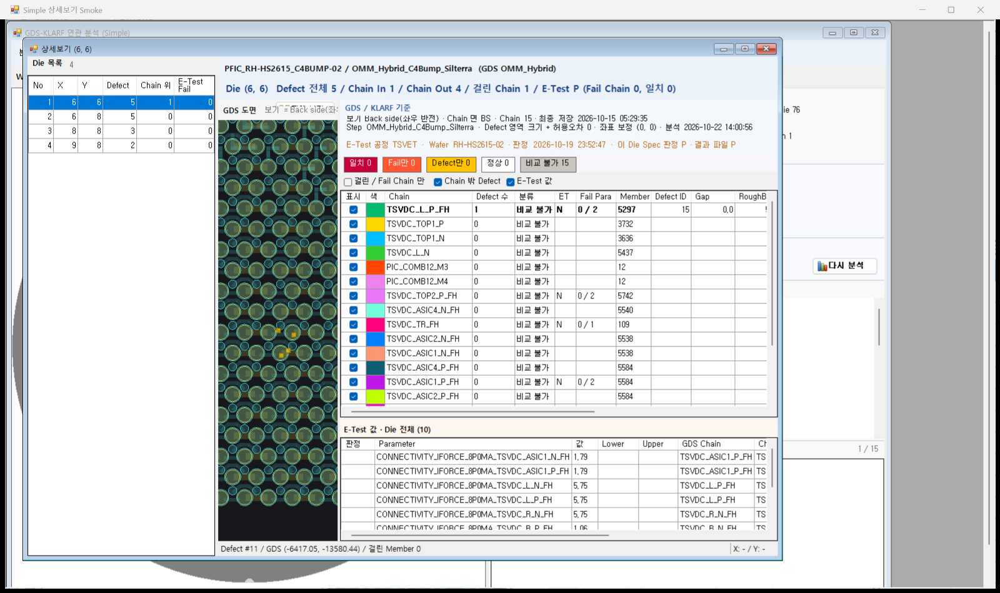

# Die 상세 화면 DLL 로딩 + 왼쪽 Die 목록 설계

작성: 2026-10-22 (CLAUDE-200) / 상태: **결정 완료(권장안 + 사용자 수정 2건) / 구현 완료(코드) / TEMP 빌드 + Smoke 확인 / 배포 안 함 / DMS 화면 확인 대기** (11절)

관련:
- [GDS-KLARF 연관 분석 화면 설계](2026-10-12_GDS_KLARF_연관분석_화면_설계.md) 7.3 / 14.1 / 14.4절: ShowForm 을 쓰지 않는 이유, 상세 화면 = Chip 1개.
- [Die 상세 여러 화면 + GDS 재사용 설계](2026-10-16_Die상세_여러화면_GDS재사용_설계.md): Die 마다 창, 공유 도면, 미리 읽기.
- [Simple 화면 설계](2026-10-22_GDS_KLARF_연관분석_Simple_화면_설계.md) 15절: Simple 상세보기.

## 1. 요청 (2026-10-22)

- "Die 상세 분석 기능을 지금 exe 형태로 Loading 하지 말고 다른 화면과 동일하게 Assembly를 Loading 하는 형태로 바꾸자."
- "단, 상세 화면이 Open이 되면 좌측에 Die에 대한 정보를 Index 및 좌표정보를 List 보여주고 거기서 선택하면서 die에 대한 분석을 할 수 있도록 한다. 그러면 한 화면에서 여러개의 Die를 조회 할 수 있다."
- 바뀌는 이전 결정:
  - 2026-10-16 "Die 마다 상세보기 창 하나" -> 연 화면마다 창 하나 + 왼쪽 Die 목록(L4).
  - 2026-10-12 "상세 화면은 그 Chip 하나만 분석" 은 그대로다. 한 번에 분석하는 Die 는 목록에서 고른 하나다.

## 2. 지금 구조 (소스 확인)

| 단계 | 위치 | 동작 |
| --- | --- | --- |
| 상세 열기 | ENGUI `frmGdsKlarfAnalysis.OpenDetail` / `frmGdsKlarfSimple.OpenDetail` | `FindWindow(연 화면, x, y)` 로 그 Die 창을 찾는다. 없으면 `AnalyzeDie(마지막 요청, x, y)` 로 그 Die 만 서버에서 다시 계산하고 `new frmGdsDieAnalysis` 를 직접 만든다 |
| 호스트 | ENGUI `GdsMap/frmGdsDieAnalysis` (.NET 4.0, `DACruxUXBasic01`) | 숨김 메뉴 `MNU_GDS_DIE_ANALYSIS` 가 있지만 여는 데는 쓰지 않는다. `GdsFormType()` 은 이미 읽힌 `NexplantQMS.GdsMap` 어셈블리를 쓰고, 없으면 `100_ClientBin\GdsMap\NexplantQMS.GdsMap.exe` 를 `Assembly.LoadFrom` 한다. 그 뒤 `GdsDieAnalysisForm` 을 만들어 패널에 붙이고 `ShowDie` / `CaptureViewState` / `PreloadMap` / `ClearMapCache` / `MapKeyOf` / `LoadedMapKey` / `DefectImageRequested` 를 리플렉션으로 부른다 |
| GDS 상세 화면 | `06_CoreLibSource/GdsMapControl` `GdsDieAnalysisForm` | 도면 + 오른쪽 표. 도면 컨트롤 하나가 약 1.85 GB(10-16 설계 3절)라 모든 상세보기 창이 하나를 같이 쓴다(static) |
| GdsMap 프로젝트 | `NexplantQMS.GdsMap.csproj` | `OutputType = WinExe`, .NET 4.8, 출력 `100_ClientBin\GdsMap\`. `Program.Main` 은 `GdsMapForm` 단독 실행. 같은 EXE 를 `frmGdsMapView` / `frmGdsMapSetup` / `frmGdsMapViewU8` 도 `LoadFrom` 한다 |
| 다른 화면 | `MenuFile.mnu` `<ASSEMBLY>DACrux.SEMDMS.ENGUI.frmXxx</ASSEMBLY>` | DACrux `ShowForm` -> `AssemblyUtil.LoadAssembly` = `Assembly.Load(byte[])` 로 DLL 을 **열 때마다 새로** 읽는다(10-12 설계 14.1절 확인) |

- GdsMap 폴더 파일:
  - `NexplantQMS.GdsMap.exe` / `.exe.config`(`supportedRuntime` 4.8) / `.pdb`
  - `OpenTK.dll` / `OpenTK.GLControl.dll` 3.3.3: ClientBin 에는 없다.
  - `Oracle.ManagedDataAccess.dll` 4.122.19.1: ClientBin 과 같은 버전이다.
  - 그래서 지금 이름이 같고 버전이 다른 DLL 은 없다. 폴더를 나눈 것은 앞으로 생길 충돌을 막으려는 것이다.
- 프레임워크:
  - `DACruxV5.exe` 는 v4.0 이고 config 가 없다. 그래서 PC 에 설치된 4.x 런타임(4.8)으로 돈다. 4.8 GdsMap 을 같은 프로세스에 읽을 수 있는 이유다.
  - ENGUI 도 v4.0 이고, `DACruxV5.csproj` 가 ENGUI 를 ProjectReference 로 참조한다.
- GdsMap 소스에는 `GetEntryAssembly` / `ConfigurationManager` / `Application.StartupPath` 사용이 없다. EXE 로 떠야만 도는 코드가 없다.
- EXE 경로(`NexplantQMS.GdsMap.exe`)를 쓰는 곳은 38개다.
  - ENGUI 호스트 4개
  - `Verification` 의 Verify / Preview 스크립트 4개
  - `GdsMapControl/Probes` 30개. 그중 6개는 이미 exe 를 `NexplantQMS.GdsMap.dll` 이름으로 복사해 읽는다.
- Wafer 결과 `DIE` 표:
  - 대상: Map Step 검사 Die + Defect Die + E-Test Die
  - 열: `XINDEX` / `YINDEX`(Map Die Index) / `SYS_X` / `SYS_Y` / `DEFECT_COUNT` / `IN_CHAIN_COUNT` / ... / `ET_STATE` / `ET_FAIL_CHAIN_COUNT`
  - 순서: Chain 위 많은 순 -> Defect 많은 순 -> Y 큰 순 -> X

## 3. 바꿀 것

1. GdsMap 출력을 EXE 에서 DLL 로 바꾼다(4절, L1 ~ L3).
2. 상세보기 창은 연 화면마다 하나로 하고, 왼쪽에 Die 목록을 둔다. 목록에서 고른 Die 를 분석한다(5절, L4 ~ L10).

두 단계는 따로 구현하고 확인할 수 있다. 1단계만 해도 화면 모양은 지금과 같다.

## 4. 로딩 방식 (L1)

| 방안 | 내용 | 좋은 점 | 문제 |
| --- | --- | --- | --- |
| **a. GdsMap 을 DLL 로 (권장)** | `OutputType` 을 `Library` 로 바꾼다. 이름 / namespace / 폴더는 그대로라 `100_ClientBin\GdsMap\NexplantQMS.GdsMap.dll` 이 된다. 호스트 4개는 그 DLL 을 한 번 읽는다(`LoadFrom`) | EXE 가 없어진다. 바뀌는 곳이 작다(csproj 1줄, 호스트 경로, 스크립트 경로). 공유 도면 / 미리 읽기 캐시는 그대로 하나만 있다 | 호스트는 지금처럼 리플렉션으로 부른다(ENGUI 4.0 이 4.8 DLL 을 컴파일 참조할 수 없다). GdsMap 단독 실행이 없어진다(L3) |
| b. DLL + ENGUI 직접 참조 | a 에 더해 ENGUI 와 DACruxV5 를 4.8 로 올리고 `new GdsDieAnalysisForm()` 으로 직접 만든다 | 리플렉션이 없어지고 컴파일 때 검사된다 | DMS 화면 DLL 전체와 실행 파일의 프레임워크가 바뀐다(다른 작업 / 빌드 스크립트 전부 영향). ENGUI 가 `Load(byte[])` 로 읽히므로 GdsMap DLL 을 ClientBin 바로 아래로 옮기거나 `AssemblyResolve` 를 둬야 한다 |
| c. GDS 상세 화면을 메뉴 화면으로 | GdsMap DLL 안에 DACrux 화면을 두고 `MenuFile.mnu` + `ShowForm` 으로 연다 | 다른 화면과 여는 방법이 똑같다 | `ShowForm` 이 DLL 을 열 때마다 새 사본으로 읽는다. 그래서 공유 도면 / 캐시(static)가 창마다 따로 생긴다(창마다 도면 약 2 GB, 첫 표시 약 4초, 미리 읽기 무효). 10-12 의 "상세 화면 두 개" 버그와 같은 원인이다. GdsMap 이 DACrux.Framework 를 참조해야 하고 OpenTK 도 ClientBin 에서 찾게 해야 한다 |

권장 a. 요청의 "EXE 로 읽지 않고 Assembly(DLL)로" 는 맞추고, 2 GB 도면을 하나만 쓰는 지금 구조는 지킨다.

### 4.1 권장안 a 상세

- `NexplantQMS.GdsMap.csproj`: `OutputType` WinExe -> Library.
  - 어셈블리 이름 / namespace / 형식 이름이 그대로라 리플렉션으로 찾는 이름(`NexplantQMS.GdsMap.GdsDieAnalysisForm` 등)은 바뀌지 않는다.
  - `Program.cs` 는 Compile 에서 뺀다(L3).
  - `App.config` 는 라이브러리라 `.dll.config` 로 나와도 DACrux 안에서는 쓰지 않는다(지금 exe.config 도 DACrux 안에서는 안 씀).
- ENGUI 에 작은 도우미 `GdsMap/GdsMapAssembly.cs`(신규)를 둔다. 호스트 4개(`frmGdsDieAnalysis` / `frmGdsMapView` / `frmGdsMapSetup` / `frmGdsMapViewU8`)가 같이 쓴다.
  - 이미 읽힌 `NexplantQMS.GdsMap` 이 있으면 그것을 쓴다.
  - 없으면 `GdsMap\NexplantQMS.GdsMap.dll` 을 `LoadFrom` 한다. 같은 경로의 `LoadFrom` 은 한 번만 읽히므로 static 공유가 지금과 같다.
  - 파일이 없을 때 문구: "GDS Map DLL 을 찾을 수 없습니다." + 경로.
  - 이전 exe 를 대신 읽을지는 L2.
- 리플렉션 호출(ShowDie 5 / 4 / 3인자 찾기 등)은 그대로 둔다. 바꾸는 것은 읽는 파일뿐이다.
- 상세 화면을 `ShowForm` 으로 열지 않는 것도 그대로다(위 c 의 이유).
- 스크립트 38개의 경로는 `.exe` -> `.dll` 로 바꾼다. exe 를 dll 이름으로 복사하던 6개는 복사 대신 바로 읽는다.
- 배포(사용자):
  - `100_ClientBin\GdsMap` 에 `NexplantQMS.GdsMap.dll` + `.pdb` 를 넣는다.
  - 이전 `NexplantQMS.GdsMap.exe` / `.exe.config` / `.pdb` 는 지운다.
  - ENGUI DLL 을 같이 넣고 DACrux 를 다시 시작한다.
  - GDS Map 조회 / 설정 / 조회 U8 화면도 같은 DLL 을 쓰게 되므로 같이 확인한다.

## 5. 상세보기 화면: 왼쪽 Die 목록 (L4 ~ L10)

### 5.1 배치

```text
┌ 상세보기 (6, 6) ────────────────────────────────────────────────────────┐
│ Die 목록  18          │                                                   │
│ ───────────────────── │   GDS 상세 화면 (지금과 같음)                      │
│ No   X    Y  Defect Chain 위 │   도면 + 오른쪽 GDS / KLARF 표                    │
│  1   6    6    12     5 ◀ │                                                   │
│  2   7    3     9     4  │                                                   │
│  3   ...                │                                                   │
│                       │                                                   │
└──────────────────────────────────────────────────────────────────────────┘
```

- 호스트 `frmGdsDieAnalysis` 에 SplitContainer 를 둔다.
  - 왼쪽(Panel1, 고정 폭): 머리 줄 "Die 목록" + 건수, 아래 DataGridView. 읽기 전용, 행 전체 선택, 한 행만, POC 표 모양.
  - 오른쪽(Panel2): 지금 `pnlGdsMap`(공유 GDS 상세 화면 / 안내 문구)을 그대로 옮긴다.
- 목록은 ENGUI 호스트에 둔다. GdsMap `GdsDieAnalysisForm` 은 이 기능 때문에 바꾸지 않는다.
- 너비 / 나누기 위치는 실행 크기로 맞추고, SplitterDistance 는 OnShown 에서 정한다(Simple 화면과 같은 이유).

### 5.2 목록 내용

- 대상(L5), 권장: Wafer 결과 `DIE` 표 중 Defect 1개 이상인 Die. E-Test 가 연결된 결과면 E-Test Fail Die(`ET_STATE` F)도 넣는다.
  - 연 Die 가 대상 밖이면(Defect 0 Die 를 더블클릭) 그 Die 도 목록에 넣는다.
- 열(L6), 권장:
  - 기본: No / X / Y / Defect / Chain 위.
  - X / Y = Map Die Index(`XINDEX` / `YINDEX`). 탭 제목 "상세보기 (X, Y)" 와 Wafer Map 이 쓰는 값과 같다.
  - E-Test 가 연결된 결과면 "E-Test Fail" 열(`ET_FAIL_CHAIN_COUNT`)을 붙인다.
  - KLARF 원래 Die Index(`SYS_X` / `SYS_Y`)가 필요하면 열을 더한다.
- 순서(L7), 권장: `DIE` 표 순서(Chain 위 많은 순). Simple [종합] 탭 / 화면 A Die 표와 같다.
- 필터 / 정렬 바꾸기는 넣지 않는다(필요하면 다음에 열별 콤보).

### 5.3 동작

| 동작 | 결과 |
| --- | --- |
| 연 화면에서 Die 더블클릭, 그 화면 창 없음 | 새 창: 목록을 만들고 그 Die 를 고른다 -> `AnalyzeDie` -> 공유 화면 `ShowDie` (지금과 같은 첫 표시) |
| 연 화면에서 Die 더블클릭, 그 화면 창 있음 | 새 창을 만들지 않는다. 그 창 목록에서 그 Die 를 고르고 창을 앞으로 가져온다 |
| 목록에서 다른 행 선택(클릭 / 위 · 아래 키) | 선택이 멈추면(L8) 창이 가진 요청 사본으로 `AnalyzeDie` -> `ShowDie`. 도면 키가 같아 도면은 다시 읽지 않는다. 탭 제목 = "상세보기 (X, Y)" 로 바뀜 |
| 이미 본 Die 를 다시 고름 | 같은 창 안에서 그 Die 결과 / 보기 상태(확대 범위 / 선택 Defect / Chain 행)를 기억해 서버를 다시 부르지 않고 돌아간다(L9) |
| 화면 A E-Test Fail 행 더블클릭(역추적) | 그 Die 를 고르고 역추적 Chain 으로 계산한다. 목록에서 다른 Die 를 고르면 역추적 없이 계산한다 |
| 연 화면이 다시 분석 / Wafer 바꿈 | 권장(L10): 지금처럼 탭 제목에 "(이전 분석)". 그 창은 이전 요청으로 계속 쓰고, 연 화면에서 다시 더블클릭하면 새 결과로 목록을 바꾼다 |
| 연 화면을 닫음 | 상세보기 창은 남는다. 가진 목록 / 요청 사본으로 계속 고를 수 있다 |
| `AnalyzeDie` 실패 | 목록 선택은 그대로 두고 메시지 상자로 알린다. 오른쪽은 이전 Die 를 그대로 보인다 |

- `AnalyzeDie` 는 호스트가 직접 부른다(ENGUI 는 RO 를 참조한다). 연 화면이 닫혀도 동작하게 하려는 것이다.
  - 연 화면은 Wafer 결과 + 마지막 요청 + 연 Die 를 넘긴다.
  - Smoke 는 호스트의 서비스 속성으로 BSL 을 넣는다(지금 `AnalysisService` 와 같은 방식).
- 계산하는 동안 모래시계 커서를 보인다(`BusyCursor`, 지금과 같음).

### 5.4 창 / 공유 도면

- 창 = 연 화면마다 하나(L4).
  - 화면 A 창과 Simple 창이 각각 하나씩 생길 수 있다. 같은 화면을 여러 개 띄우면 그만큼 생긴다.
  - `FindWindow(연 화면, x, y)` -> `FindWindow(연 화면)`.
- 공유 도면을 창 사이에서 옮기는 구조(10-16 설계 5.2절), 미리 읽기, 닫을 때 해제 규칙은 그대로 둔다. 창 수만 줄어든다.
- Die 를 바꿀 때 보기 상태 저장 / 복원은 창 사이 이동에 쓰던 `CaptureViewState` / `ShowDie` 5인자를 그대로 쓴다.

## 6. 바꿀 파일 (구현 시)

| 단계 | 파일 | 내용 |
| --- | --- | --- |
| 1 | `06_CoreLibSource/GdsMapControl/NexplantQMS.GdsMap.csproj` | `OutputType` Library, `Program.cs` Compile 제외 |
| 1 | ENGUI `GdsMap/GdsMapAssembly.cs`(신규) + `DACrux.SEMDMS.ENGUI.csproj` Compile 1줄 | GdsMap DLL 읽기 도우미 |
| 1 | ENGUI `GdsMap/frmGdsDieAnalysis.cs` / `frmGdsMapView.cs` / `frmGdsMapSetup.cs` / `frmGdsMapViewU8.cs` | 도우미 사용, 문구 "EXE" -> "DLL" |
| 1 | `Verification/Verify-GdsKlarfAnalysis.ps1` / `Verify-GdsKlarfSimple.ps1` / `Verify-PocButtonLayout.ps1` / `Preview-GdsKlarfLayout.ps1` + `GdsMapControl/Probes/*.ps1` 30개 | 경로 `.exe` -> `.dll` |
| 2 | ENGUI `GdsMap/frmGdsDieAnalysis.cs` / `.Designer.cs` | SplitContainer + Die 목록, 요청 사본 / `AnalyzeDie` / Die 별 결과 · 보기 상태, `FindWindow(연 화면)`, 새 진입 함수(Wafer 결과 + 요청 + Die + 역추적 Chain) |
| 2 | ENGUI `DefectMapAnalysis/frmGdsKlarfAnalysis.cs` / `frmGdsKlarfSimple.cs` | `OpenDetail`: 창이 있으면 그 창에서 Die 고르기, 없으면 새 창 |
| 2 | `Verification/GdsKlarfAnalysisFormSmoke.cs` / `GdsKlarfSimpleFormSmoke.cs` | "Die 마다 창" 검사 -> "연 화면마다 창 + 목록" 검사 |
| - | 변경 없음 | GdsMap `GdsDieAnalysisForm` 동작 / 서버(Interface / RO / BSL / DSL) / DB / `MenuFile.mnu` |

## 7. 검증 계획

- TEMP 빌드: GdsMap(Library) / Control / ENGUI. 경고 수는 기존과 같아야 한다.
- 1단계:
  - GdsMap 폴더에 DLL 만 둔 TEMP 실행 폴더에서 화면 A / Simple 상세보기, GDS Map 조회 / 설정 / 조회 U8 이 열리는지 본다.
  - `Verify-GdsKlarfAnalysis.ps1` / `Verify-GdsKlarfSimple.ps1` 전 항목 PASS.
  - Probe 대표: `GdsMapViewU8Smoke` / `GdsViewLayoutSmoke` / `GdsSetupLayoutSmoke` / `GdsMapDbRestoreProbe`.
- 2단계 새 검사:
  - 목록 행 수 = 대상 Die 수, 열 값 = `DIE` 표 값.
  - 목록 선택 결과 = `AnalyzeDie` 직접 호출 결과(Die 별 같음).
  - Die 를 바꿔도 도면을 다시 읽지 않음(`GdsDieMapCache.LoadCount` 그대로).
  - 이미 본 Die 를 다시 고르면 서버를 안 부름.
  - 연 화면에서 다른 Die 더블클릭 = 새 창 없이 그 창 목록 선택.
  - 연 화면을 닫아도 목록 선택이 동작함.
  - 버튼 / 배치 검사(`PocButtonLayoutCheck`) PASS.
- DB 연결은 Smoke 설정 사본만 DMSMGR(서버 config 는 실제 앱 DB 그대로).

## 8. 결정 필요 (권장안)

| 번호 | 결정 | 권장 |
| --- | --- | --- |
| L1 | 로딩 방식 | **a. GdsMap 을 DLL 로**, 호스트는 그 DLL 을 한 번 읽음(4절) |
| L2 | 이전 exe 를 대신 읽기 | 두지 않음: DLL 만 찾는다(섞여 읽히지 않게). 배포 때 exe 는 지운다 |
| L3 | GdsMap 단독 실행(`Program.Main`) | 없앤다. 모든 GDS 화면은 DACrux 안에서 연다 |
| L4 | 상세보기 창 단위 | 연 화면마다 창 하나(Die 는 목록에서 고름) -> **결정: 전체에서 창 하나**(11절) |
| L5 | 목록 대상 Die | Defect 1개 이상 + E-Test Fail Die, 연 Die 는 항상 포함 |
| L6 | 목록 열 | No / X / Y / Defect / Chain 위 (+ E-Test 연결 시 E-Test Fail) |
| L7 | 목록 순서 | `DIE` 표 순서(Chain 위 많은 순) |
| L8 | 선택 반영 시점 | 선택이 0.3초 멈추면 계산(위 · 아래 키로 빨리 넘길 때 마지막 Die 만 계산) |
| L9 | Die 별 결과 / 보기 상태 기억 | 같은 창 안에서 기억(다시 고르면 서버 안 부름) |
| L10 | 연 화면이 다시 분석했을 때 | 지금처럼 "(이전 분석)" 표시, 다음 더블클릭 때 새 결과로 목록 교체 -> **결정: 바로 같이 새로 계산(동기화)**(11절) |

## 9. 순서 / 다른 작업과 겹침

- 지금 다른 세션(CLAUDE-199, "두 화면 상세보기 동일하게 + Simple 에 같은 Wafer 최신 E-Test 자동 연결")이 고치는 파일:
  - `GdsDieAnalysisForm.*`
  - `frmGdsKlarfSimple.cs`(필요하면 `.Designer.cs`)
  - `GdsKlarfSimpleFormSmoke.cs` / `Verify-GdsKlarfSimple.ps1`
- 구현은 그 작업이 끝난 뒤 그 저장본 위에서 한다.
  - CLAUDE-199 는 13:40 에 끝났다(그 세션 알림). 바뀐 것:
    - Simple: 같은 Wafer 최신 E-Test 자동 연결, 분석 정보 E-Test 줄
    - 상세보기: Simple 보기 구분 삭제(두 화면 같은 모양), [걸린 / Fail Chain 만] 기본 끔
    - Simple Smoke: BSL 기준 요청(SameDies 비교)도 같은 E-Test / Wafer Key 를 씀. 33/33(528 · 603)
  - 구현은 그 저장본을 다시 읽고 시작한다.
- 1단계(DLL)는 `GdsDieAnalysisForm` 을 바꾸지 않는다. 그래도 GdsMap 빌드 / Verify 스크립트가 겹치므로 같은 시점에 하지 않는다.
- Simple 에 E-Test 가 자동 연결되면 Simple 목록에도 E-Test Fail 열이 붙는다(L6).

## 10. 확인 수준

- 2절은 소스 / 폴더 확인이다. 읽은 것:
  - `frmGdsDieAnalysis.cs` / `.Designer.cs`
  - `frmGdsKlarfAnalysis.OpenDetail` / `frmGdsKlarfSimple.OpenDetail`
  - `frmGdsMapView.cs`
  - `NexplantQMS.GdsMap.csproj` / `Program.cs`
  - `GdsKlarfAnalysis_Analyze.cs` 418 ~ 477행
  - `MenuFile.mnu`, `100_ClientBin\GdsMap` 파일 / 버전, `DACruxV5.csproj` / ENGUI csproj
- 실행 / 빌드 / DB 조회는 하지 않았다.
- `ShowForm` 이 DLL 을 열 때마다 새로 읽는다는 것은 10-12 설계 14.1절의 확인 결과를 그대로 썼다(이번에 다시 실행하지 않음).

## 11. 구현 결과 (2026-10-22)

### 11.1 결정

- 사용자(2026-10-22): "권장안대로 한다. 단, 분석화면에서 설정을 바꿔서 분석을 하면 상세도 같이 refresh 되어야 한다. 서로 동기화. 그리고 상세 화면이 열러 잇는 상태에서 분석화면에서 다른 die를 더블클리하면 열려 있는 화면 그대로 조회 되서 여러 화면이 나오게 하지 않도록 해줘".
- L1 ~ L3 / L5 ~ L9 는 권장안 그대로.
- L4 는 **전체에서 창 하나**로 했다.
  - 상세보기 창이 열려 있으면 어느 분석 화면(화면 A / Simple / Defect Map View 바로가기)에서 Die 를 더블클릭해도 새 창을 만들지 않는다. 그 창 목록에서 그 Die 를 고른다.
  - 다른 화면에서 열면 그 창 목록을 그 화면 결과로 바꾼다.
- L10 은 **바로 동기화**로 했다.
  - 연 화면이 분석 결과를 반영할 때마다(설정을 바꾼 [분석] / [다시 분석] / Wafer 바꿈 자동 분석) 열린 상세보기도 바로 바뀐다.
  - 바뀌는 것: 목록을 새 결과로 바꾸고, 보던 Die 를 새 요청으로 다시 계산한다. 그 Die 가 새 결과에 없으면 목록 첫 Die 를 계산한다.
  - 도면 키가 같으면 확대 위치 / 고른 행 / 체크 같은 보기 상태를 이어 간다.
  - 계산이 실패하면 이전 결과를 그대로 두고 탭 제목에 "(이전 분석)" 을 붙인다.
- 하지 않은 것: 상세보기 목록에서 Die 를 고를 때 분석 화면 Map 의 선택 Die 를 따라 바꾸는 것(반대 방향 동기화).

### 11.2 바뀐 파일

| 파일 | 내용 |
| --- | --- |
| `06_CoreLibSource/GdsMapControl/NexplantQMS.GdsMap.csproj` | `OutputType` WinExe -> Library, `Program.cs` Compile 제외 |
| `06_CoreLibSource/GdsMapControl/Program.cs` | 삭제(단독 실행 진입점, L3) |
| ENGUI `GdsMap/GdsMapAssembly.cs`(신규) + `DACrux.SEMDMS.ENGUI.csproj` | GdsMap DLL 읽기: 이미 읽힌 `NexplantQMS.GdsMap` 이 있으면 그것, 없으면 `GdsMap\NexplantQMS.GdsMap.dll` 을 `LoadFrom`. 파일이 없으면 경로를 담은 오류 |
| ENGUI `GdsMap/frmGdsMapView.cs` / `frmGdsMapSetup.cs` / `frmGdsMapViewU8.cs` | EXE 경로 + `LoadFrom` 대신 `GdsMapAssembly.Load()` |
| ENGUI `GdsMap/frmGdsDieAnalysis.cs` / `.Designer.cs` | 아래 11.3 |
| ENGUI `DefectMapAnalysis/frmGdsKlarfAnalysis.cs` / `frmGdsKlarfSimple.cs` | `OpenDetail` = `frmGdsDieAnalysis.Open`, `ApplyResult` 끝에 `SourceAnalyzed`, 미리 읽기(`Preload`)를 결과 반영 앞으로 옮김, `DetailData` / `MarkOutdated` 호출 삭제 |
| ENGUI `GdsMap/GdsDieDetailShortcut.cs` | 요청만 만들고 `frmGdsDieAnalysis.Open` 으로 연다(목록에는 연 Die 하나). 이후 같은 날 CLAUDE-204 에서 Defect Map View 임시 우클릭 기능을 없애며 파일째 삭제 |
| `Verification/GdsKlarfAnalysisFormSmoke.cs` | 3-4 / 10 / 11절을 "창 하나 + 목록 + 동기화" 검사로 바꿈 |
| `Verification/GdsKlarfSimpleFormSmoke.cs` | 7-1 / 7-1b / 7-6 / 7-6b / 7-7 바꿈 |
| `Verification/*.ps1` 4개 + `GdsMapControl/Probes/*.ps1` 30개 | 경로 `NexplantQMS.GdsMap.exe` -> `.dll`(매개변수 이름 `-GdsExe` 등은 그대로) |
| 변경 없음 | GdsMap `GdsDieAnalysisForm` 동작 / 서버(Interface / RO / BSL / DSL) / DB / `MenuFile.mnu` |

### 11.3 상세보기 호스트 `frmGdsDieAnalysis`

- 배치:
  - 왼쪽 = SplitContainer Panel1(폭 300 고정)에 머리 줄 "Die 목록" + 건수, 그 아래 표 `dgvDies`.
    - 열: No / X / Y / Defect / Chain 위 / E-Test Fail. E-Test Fail 은 E-Test 결과가 있을 때만 보인다.
    - 표는 읽기 전용이고 정렬하지 않는다.
  - 오른쪽 = 지금 `pnlGdsMap`(공유 GDS 상세 화면 / 안내 문구).
- `Open(연 화면, 분석 순번, Wafer 결과, 요청, 서버, x, y, 역추적 Chain)`:
  - 창이 없으면 만들고, 있으면 그 창을 쓴다.
  - 연 화면 / 분석 순번 / 요청이 바뀌었으면 목록을 다시 만들고 기억한 Die 결과를 버린다.
  - 그 Die 를 계산해 보인다. 역추적 Chain 이 있으면 기억한 결과가 있어도 다시 계산한다.
  - 계산이 실패하면 예외를 연 화면에 넘긴다(새 창이면 만들지 않음).
- 목록 선택: 0.3초 멈추면 반영한다. 본 Die 는 결과 / 보기 상태를 기억해서 다시 고르면 서버를 부르지 않는다.
- `SourceAnalyzed(연 화면, 분석 순번, Wafer 결과, 요청, 서버)`: 11.1 L10.
- `ShowErrorDialogs`(static): 목록 선택 / 동기화 오류 창 여부. Smoke 는 끈다.
- `Current` / `ListedDies` / `AnalyzeCount`: Smoke 확인용.
- 공유 도면 / 미리 읽기 / 닫을 때 해제 규칙은 2026-10-16 그대로다.

### 11.4 검증

- 빌드(TEMP, 운영 폴더 안 바꿈): Interface / DSL / BSL / RO / GdsMap 경고 0, Control 12 / ENGUI 4(기존 수), 오류 0.
  - GdsMap 출력: `NexplantQMS.GdsMap.dll`(+ `.dll.config` / `.pdb`).
  - Smoke 변수 이름 겹침(CS0136) 1건은 고침.
- `Verify-GdsKlarfAnalysis.ps1 -StepSeq 528 -ConnectId DMSMGR`: `GDS_KLARF_FORM_SMOKE=PASS (81/81)`. 새 / 바뀐 검사:
  - 3-4: OpenDetail 세 번(다른 Die / 같은 Die) = 창 1개, 탭 제목 = 지금 Die, 목록 4 (DIE 4).
  - 10: 미리 읽은 도면으로 첫 표시 2.1초.
    - 열린 채로 두 번째 Die 더블클릭 = 같은 창 / 같은 도면 핸들 / DB 다시 읽지 않음 / 0.27초.
    - 목록에서 Die 오가기 = 서버 0번, Die 마다 [Chain 밖 Defect] · 확대 위치 되돌림.
    - 역추적 = 같은 창에서 다시 계산.
    - 허용오차 + 3 결과를 화면 A 에 넣으면 상세보기도 같은 Die 를 허용오차 8 로 다시 계산.
    - 닫기 / 해제.
  - 11(메시지 루프):
    - 목록에서 다른 Die = 앞 Die 상태줄 / 고른 행 이어받지 않고, 돌아가면 되돌림.
    - FRONT 결과 동기화 = FRONT 도면(미리 읽기와 같이 써서 DB 1번).
    - BACK 으로 다시 = DB 읽지 않음.
    - 다른 키 도면 읽는 중 같은 키 결과 = 늦은 읽기가 덮지 않음.
    - 정리.
- `Verify-GdsKlarfSimple.ps1 -ConnectId DMSMGR`: STEP 528 / 603(`-Device OMM_TCB`) `GDS_KLARF_SIMPLE_FORM_SMOKE=PASS (35/35)`. 새 / 바뀐 검사:
  - 7-1: 창 1개.
  - 7-1b: 목록 = DIE 표 값 / 순서 / 열 / 연 Die 선택 / 건수(528 4개, 603 51개).
  - 7-6: [다시 분석] 2번 = 더블클릭 없이 상세보기 2번 다시 계산 / 같은 Die / 확대 위치 이어짐 / Defect 크기 = 새 설정.
  - 7-6b: 열린 채로 다른 Die 더블클릭 = 같은 창. 목록에서 처음 Die 고르기 = 서버 다시 안 부름(528 0.9초, 603 1.4초).
  - 7-7: E-Test 연결 결과 모양.
  - 603 첫 실행은 `-Device` 를 빠뜨려 기준 결과를 OMM_Hybrid 로 계산해 앞쪽 6건이 FAIL 이었다. 상세보기와 무관하고, `-Device OMM_TCB` 로 다시 돌려 PASS 했다.
- `Verify-PocButtonLayout.ps1`(공용 `%TEMP%\chippac\buttonlayout`): `POC_BUTTON_LAYOUT=FAIL (2)`.
  - GdsMap 은 DLL 로 빌드됐고, GDS 화면 5개(GdsMapForm / GdsMapViewForm / GdsDieAnalysisForm / MapCopyForm / GdsMapViewU8Form)를 `NexplantQMS.GdsMap.dll` 에서 띄워 모두 OK.
  - FAIL 2건은 `frmEtParaRegister` 의 `btnOpenFile`(높이 24) / `btnDeleteDevice`(아이콘 없음 / 높이 20)다. 다른 작업(CLAUDE-191) 화면이라 이번 변경과 무관하고 고치지 않았다.
  - 상세보기 호스트(`frmGdsDieAnalysis`)는 버튼이 없어 검사 대상이 아니다. 배치는 위 Smoke 그림으로 확인했다.
- 그림:
  - `2026-10-22_Die상세_목록_구현/L1_STEP528_상세보기_Die목록.png`
  - `2026-10-22_Die상세_목록_구현/L2_STEP528_상세보기_Die목록_ETest연결.png`
  - Smoke MDI 안이라 창이 작다. DMS 에서는 탭 전체 크기다.
- 미확인: DMS 실제 화면, `100_ClientBin\GdsMap` 에 DLL 만 둔 상태에서 GDS Map 설정 / 조회 / 조회 U8 열기(Smoke 는 같은 폴더에 빌드한 DLL 을 미리 읽은 상태).



### 11.5 배포 (사용자)

- `100_ClientBin\GdsMap`:
  - 넣을 것: `NexplantQMS.GdsMap.dll` + `.pdb`
  - 지울 것: 이전 `NexplantQMS.GdsMap.exe` / `.exe.config` / `.pdb`
  - VS 빌드면 출력 폴더가 그대로 여기다. 이전 EXE 는 저절로 지워지지 않는다.
- `100_ClientBin`: `DACrux.SEMDMS.ENGUI.dll`.
- 그 뒤 DACrux 를 다시 시작한다(이미 읽은 GDS 어셈블리는 같은 프로세스에서 바뀌지 않음).
- 서버 DLL / `MenuFile.mnu` 변경 없음.
