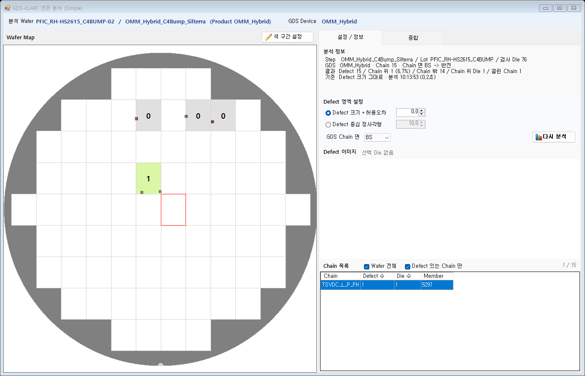
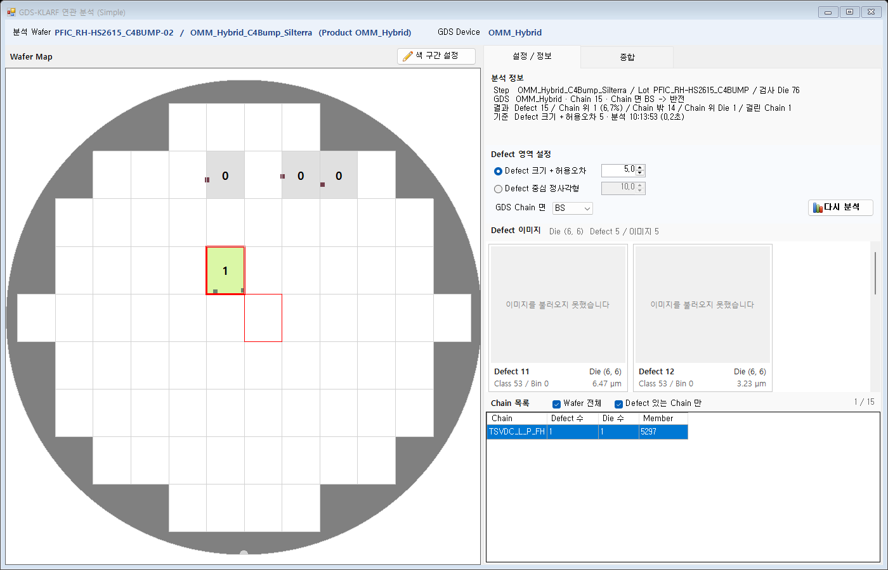
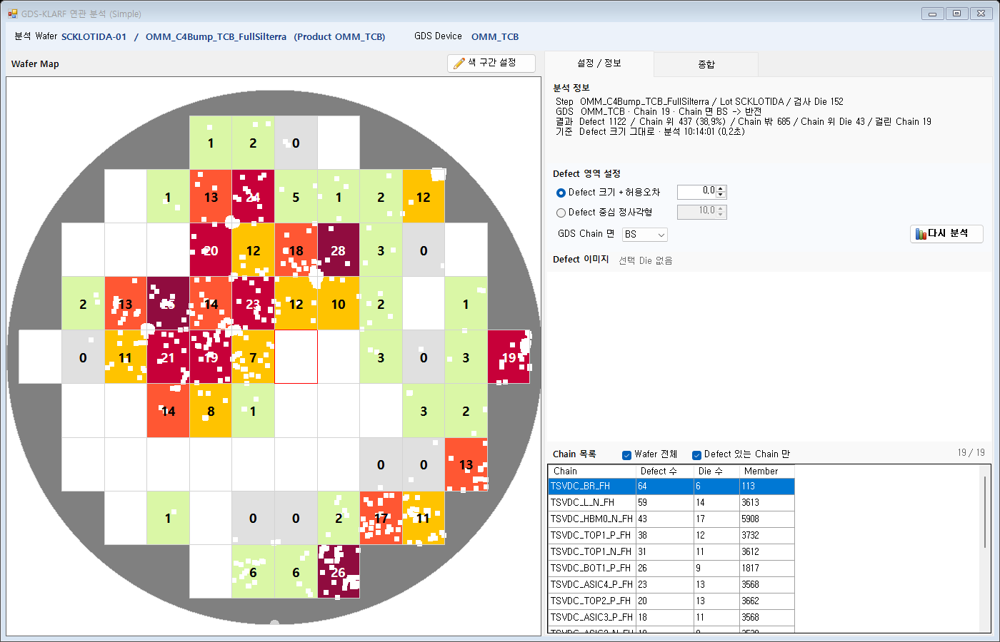
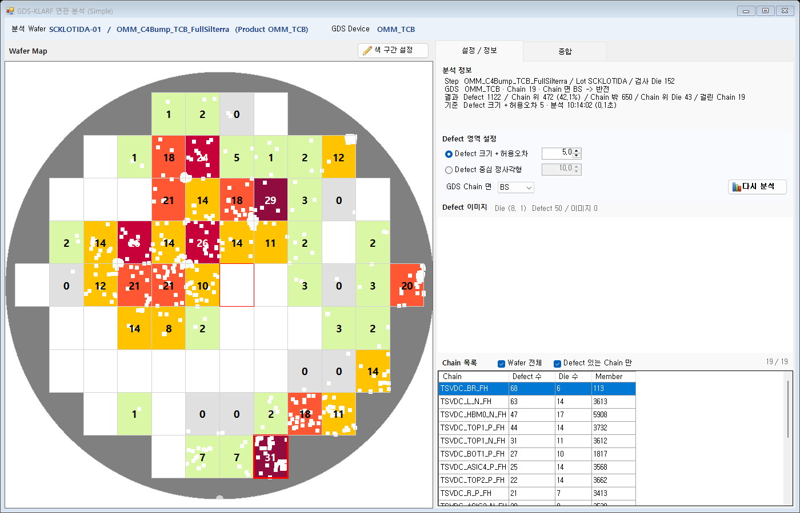
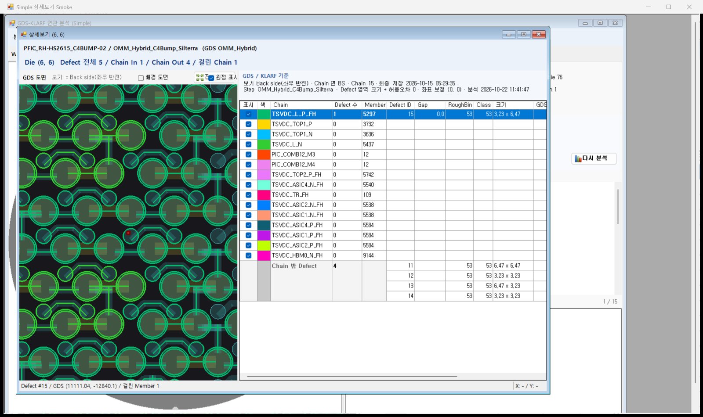
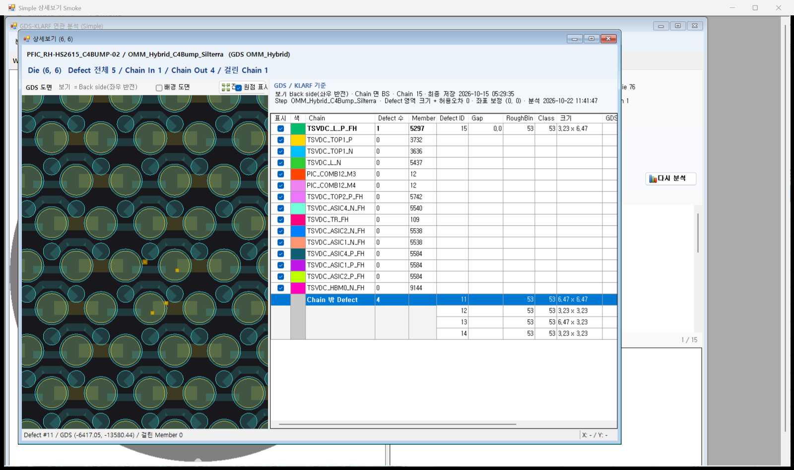
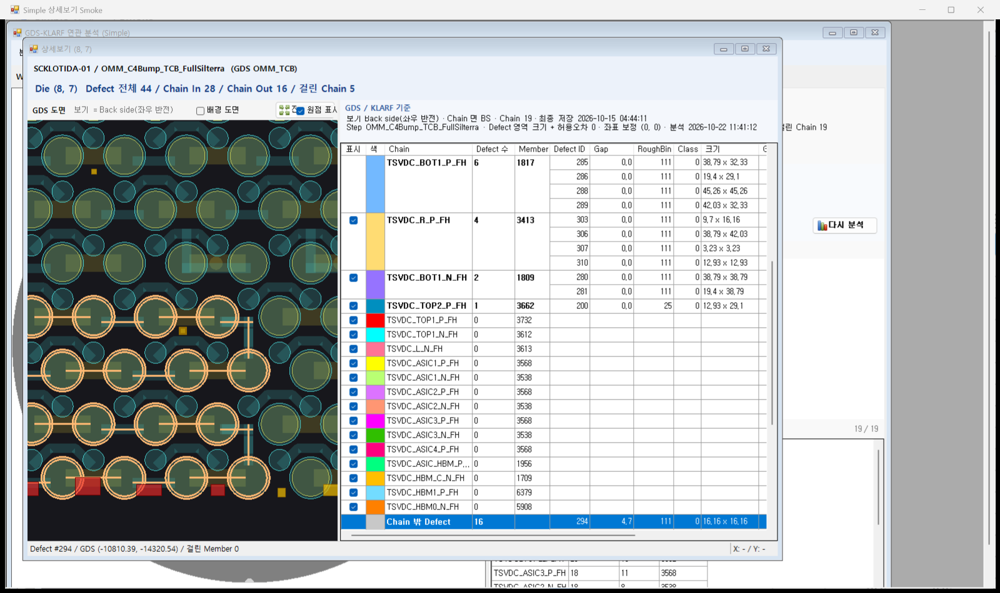

# GDS × KLARF 연관 분석 Simple 화면 설계 (2026-10-22)

작성: 2026-10-22 (CLAUDE-192) / 상태: **결정 완료(S1 ~ S10 권장안) / 1단계 구현 완료(코드) + POC 문구 규칙 + 레이아웃 정리 / TEMP 빌드 + Smoke 17/17 (2개 Wafer) / 배포 안 함 / DMS 화면 확인 대기** (12 · 13 · 14절, 14절이 지금 화면. 이후 15 상세보기 · 16 구분선 · 17 KLARF 위치 조정, Smoke 33/33)

관련: [연관 분석 화면 설계](2026-10-12_GDS_KLARF_연관분석_화면_설계.md)(화면 A / B) / [통합 분석 데이터 설계](2026-10-15_GDS_KLARF_ETest_통합분석_데이터_설계.md)(판정 방식 / 서버 Analyze) / [화면 A 레이아웃](2026-10-19_화면A_레이아웃_후보.md)(지금 배치 / 색 구간 팝업)

## 1. 요청 (2026-10-22)

1. 기존 연관 분석(화면 A)보다 단순하게 보는 **새 화면**을 만든다. 컨셉은 비슷하다.
2. 왼쪽 Defect Search 에서 **Wafer 1개만** 조회한다. 조회하면 **기본 설정으로 1차 분석**을 바로 한다.
   - 1차 분석 = KLARF Defect 가 GDS Chain 위에 올라갔는지 본다.
   - 기본 설정 = **KLARF 에 있는 Defect 크기 그대로** 본다.
3. 분석이 되면 **Wafer Die 마다 Chain 에 올라간 Defect 수**를 보인다.
4. E-Test 분석은 하지 않는다(KLARF ↔ GDS Chain 만). Map 의 빨간 / 남색 삼각형은 보이지 않는다.
5. **색 구간 설정은 그대로** 쓴다.
6. 오른쪽 탭은 2개다.
   - 하나 = 설정 기능 + 간단한 출력 정보. 설정 = Defect 영역 설정 / 이미지 확인 / Chain 목록 확인.
   - 하나 = 기존 Die 종합 화면.
7. 이미지는 Defect View 처럼 Defect 를 고르면 보인다.
8. 좌표 보정 기능은 우선 뺀다.
9. Die 더블클릭 상세는 이 화면의 윤곽이 잡힌 뒤(2단계) 한다.

## 2. 화면 A 와 다른 점

| 항목 | 화면 A (`frmGdsKlarfAnalysis`) | Simple 화면 |
| --- | --- | --- |
| 분석 시작 | Wafer 를 받은 뒤 [분석] 을 누름 | **Wafer 를 받으면 바로 1차 분석** / 설정을 바꾸면 [분석] |
| Defect 영역 기본값 | Defect 크기 + 허용오차 **5 µm** | Defect 크기 + 허용오차 **0 µm** (= 크기 그대로) |
| 좌표 보정 X / Y | 있음 | **없음** (0 고정) |
| E-Test | 탭 / 파일 선택 / Map 삼각형 2종 / E-Test Fail · 연결 탭 | **없음** |
| Wafer Key / [다시 조회] / GDS Map 준비 표 / Pitch 출처 | 있음 | 없음 (서버 `GetWaferReady` 도 부르지 않음, S2) |
| 오른쪽 탭 | [GDS] [KLARF] [E-Test] [종합 (Die)] + 하위 결과 탭 | **[설정 / 정보] [종합 (Die)]** |
| 허용오차 탭(TOL_CURVE) / Defect 표 | 있음 | 없음 |
| 색 구간 | [색 구간 설정] 팝업 | 같음 (E-Test 행 없음) |
| Die 더블클릭 / 우클릭 [Detail Analysis] | 상세보기 열기 | 1단계는 없음 → 2단계 (9절) |
| 서버 | `Analyze` | **같은 `Analyze`** (서버 / Interface 변경 없음) |

## 3. 화면 구성

### 3.1 전체

화면 A 와 같은 틀(위 정보 줄 / 왼쪽 Map / 오른쪽 탭 / 아래 상태줄)을 쓴다. 값은 STEP 528 예시.

```
┌──────────────────────────────────────────────────────────────────────────────────────────────┐
│ 분석 Wafer  PFIC_RH-HS2615_C4BUMP-02 / OMM_Hybrid_C4Bump_Silterra (Product OMM_Hybrid)   GDS Device  OMM_Hybrid │
├───────────────────────────────────────────────┬──────────────────────────────────────────────┤
│ Wafer Map   색 = Chain 위 Defect 수   [색 구간 설정] │ [ 설정 / 정보 ] [ 종합 (Die) ]                  │
│ ┌───────────────────────────────────────────┐ │                                              │
│ │   Die 색 = 색 구간                          │ │   (3.2 / 3.3)                                │
│ │   Die 가운데 숫자 = Chain 위 Defect 수        │ │                                              │
│ │   Defect 점 = 지금 Map 과 같음                │ │                                              │
│ │   E-Test 삼각형 없음 / 선택 Die = 빨간 테두리  │ │                                              │
│ └───────────────────────────────────────────┘ │                                              │
├───────────────────────────────────────────────┴──────────────────────────────────────────────┤
│ Defect 15 중 Chain 위 1 (Die 1) / Chain 15 / BACK 보기 (Chain BS -> 반전) / Defect 크기 그대로      [진행 표시줄] │
│ Die (6, 6)  Defect 5 / Chain 위 1 / Chain 밖 4 / 걸린 Chain 1                                         │
└──────────────────────────────────────────────────────────────────────────────────────────────┘
```

- 위 정보 줄: 분석 Wafer / Step / Product, GDS Device (Product 와 같은 이름의 READY GDS Map, 화면 A 와 같은 규칙). 버튼은 두지 않는다([분석] 은 설정 묶음 안, 3.2).
- 상태줄 첫 줄 = 분석 결과 요약, 둘째 줄 = 마우스 아래 Die(화면 A `map_OnChangeCurrentDie` 와 같은 방식). 오른쪽에 진행 표시줄(`ProgressStatusBar`).
- 용어: 이 화면은 요청 표현대로 **Chain 위 / Chain 밖** 을 쓴다(화면 A 의 Chain In / Chain Out 과 같은 값, S7).

### 3.2 [설정 / 정보] 탭

위에서 아래로 4묶음. 이미지와 Chain 목록은 위아래 나누기(SplitContainer)로 높이를 조절한다(S10).

```
┌ 분석 정보 ────────────────────────────────────────────────────────────┐
│ Step  OMM_Hybrid_C4Bump_Silterra / Lot PFIC_RH-HS2615_C4BUMP / 검사 Die 76 │
│ GDS   OMM_Hybrid · Chain 15 · Chain 면 BS -> 반전                          │
│ 결과  Defect 15 / Chain 위 1 (6.7%) / Chain 밖 14 / Chain 위 Die 1 / 걸린 Chain 1 │
│ 기준  Defect 크기 그대로 (허용오차 0 µm) · 분석 10:12:30 (0.8초)              │
├ Defect 영역 설정 ─────────────────────────────────────────────────────┤
│ (●) KLARF Defect 크기 (XSIZE × YSIZE) + 허용오차 [   0.0 ] µm               │
│ ( ) Defect 중심 정사각형                     [  10.0 ] µm               │
│ GDS Chain 면 [ BS ▼ ]                                         [ 분석 ]  │
├ Defect 이미지  Die (6, 6)  Chain 위 1 (이미지 1)   ☐ Chain 밖 Defect 도 보기 ─┤
│ ── Chain 위 (1) ──────────────────────────                              │
│ ┌─────────┐                                                            │
│ │ 이미지   │  (DPUCDefectImageCard 폭 220, 한 줄에 2장)                    │
│ │ Die · Class · Bin · 크기 │                                             │
│ └─────────┘                                                            │
│ ── Chain 밖 (4) ── (체크를 켰을 때만)                                       │
╞══════════════════════ 위아래 나누기 ═══════════════════════════════════╡
│ Chain 목록   ☑ Wafer 전체   ☑ Defect 있는 Chain 만            1 / 15     │
│ ┌Chain ─────────────┬Defect 수┬Die 수┬Member┐                          │
│ │TSVDC_TOP1_P_FH    │ 1       │ 1    │ 312  │                          │
└────────────────────────────────────────────────────────────────────────┘
```

| 묶음 | 내용 | 결과 표 / 열 |
| --- | --- | --- |
| 분석 정보 | Step / Lot / 검사 Die, GDS Device · Chain 수 · Chain 면과 반전, 결과 합계, 분석 기준 · 분석 시각 · 걸린 시간. 설정을 바꾸고 아직 [분석] 하지 않았으면 기준 줄 끝에 주황 글자 "설정 바뀜 (지금 결과 = 이전 설정)" | ANL_INFO / DIE 합계 / CHAIN 행 수 |
| Defect 영역 설정 | 화면 A KLARF 탭과 같은 두 방식. 기본 = 크기 + 허용오차 **0**. 허용오차 0 ~ 1000 µm(소수 1자리), 정사각형 기본 10 µm. GDS Chain 면 FS / BS(기본 BS, S4). [분석](주 기능, Bold) | 요청 `AreaMode` / `ToleranceUm` / `SquareUm` / `ChainSide` |
| Defect 이미지 | 선택 Die 의 Chain 위 Defect 이미지 카드. "Chain 밖 Defect 도 보기" 를 켜면 Chain 밖 Defect 카드를 아래 묶음으로 더한다(S5). 머리에 Die / Chain 위 수 / 이미지 있는 수 | DEFECT(IN_CHAIN) + `GetDefectImagePath01` |
| Chain 목록 | Wafer 전체 = Chain 별 Chain 위 Defect 수 / Die 수 / Member. "Wafer 전체" 를 끄고 Die 를 고르면 그 Die 의 Chain(Defect 수 / Defect ID / Member). "Defect 있는 Chain 만" 기본 켬(S6). 오른쪽에 "보이는 수 / 전체 Chain 수" | CHAIN / DIE_CHAIN |

- 이미지 카드는 Defect 를 넘기는 생성자 `DPUCDefectImageCard(Defect, path)` 를 쓴다. 카드 둘째 줄에 Die / Class / Bin / 크기가 나오고, 더블클릭하면 큰 이미지 창(`ImagePopUp`)이 열린다(Defect Map Viewer 와 같은 카드).
- Defect 에 이미지가 없으면 카드를 만들지 않고 묶음 제목의 "(이미지 n)" 으로만 안다.
- Chain 목록 행 선택은 1단계에서 보기만 한다(Map 에 반영하지 않음).

### 3.3 [종합 (Die)] 탭

화면 A [종합 (Die)] 표에서 E-Test 열 3개(ET 판정 / Fail Chain / 일치 Chain)를 뺀 표다.

```
Die 3 (Chain 위 Defect 있는 Die 1)
┌X─┬Y─┬Defect 전체┬Chain 위┬Chain 밖┬Chain 수┬검사┐
│ 6│ 6│ 5        │ 1      │ 4      │ 1      │ Y  │
│ 6│ 8│ 5        │ 0      │ 5      │ 0      │ Y  │
│ 8│ 8│ 3        │ 0      │ 3      │ 0      │ Y  │
```

- 행 = Defect 가 있는 Die(`DEFECT_COUNT > 0`). 화면 A 의 "또는 E-Test Fail" 조건은 뺀다.
- 정렬 = 서버 순서 그대로(Chain 위 많은 순 → Defect 전체 많은 순 → Y → X).
- 열 출처: X = XINDEX, Y = YINDEX, Defect 전체 = DEFECT_COUNT, Chain 위 = IN_CHAIN_COUNT, Chain 밖 = OUT_CHAIN_COUNT, Chain 수 = HIT_CHAIN_COUNT, 검사 = IN_PLAN.
- 행 클릭 = Die 선택(Map 테두리 + [설정 / 정보] 탭 이미지 · Chain 목록이 그 Die 로). 탭은 바꾸지 않는다.
- 행 더블클릭 = 2단계(9절).

### 3.4 Wafer Map

- 컨트롤은 화면 A 의 `GdsKlarfAnalysisMap` 을 그대로 쓴다.
- Die 색 = 색 구간(`GdsKlarfColorBands.DieColor`, Defect 없음 흰색 / 표시 기준 미만 연회색 / 그 밖 구간 색).
- Die 가운데 숫자 = IN_CHAIN_COUNT (Defect 가 있는 Die 만, 화면 A 와 같음).
- E-Test 표식: `SetEtMarks` 를 부르지 않는다(삼각형 0).
- Die 클릭 = Die 선택. 처음부터 Die 선택 모드(화면 A 와 같음).
- 우클릭 메뉴: Free Zoom / Fit Size / Center Cross. [Detail Analysis] 는 1단계에서 숨긴다(S9).

### 3.5 색 구간 설정

- 화면 A 와 같은 팝업: 자동 구간(기본 켬, 5구간) / 표시 기준(기본 1) / FROM · TO / 색(더블클릭으로 고름) / Die 수 + 기준 미만 / Defect 없음 행.
- 색 기준 = Chain 위 Defect 수(IN_CHAIN_COUNT) 하나. E-Test 표식 행(Spec Out / Fail Die)은 없다.
- 구현: 화면 A 는 자기 패널(`pnlBand`)을 팝업으로 옮기는 방식이라 그대로 가져올 수 없다. 같은 모양 / 동작의 팝업 클래스를 새 파일로 만들어 새 화면이 쓴다. 화면 A 는 고치지 않는다(S8).
- 구간 값은 지금처럼 화면을 연 동안만 유지한다(저장 안 함).

## 4. 동작 흐름

### 4.1 Wafer 받기 → 1차 분석 (자동)

1. `DrawWafer(DPWafer[])`: Step 기준 1개만 받는다. 0개 / 여러 개는 화면 A 와 같은 문구("1개 Wafer 만 분석할 수 있습니다. Wafer 를 하나만 선택하세요. (선택 n개)")로 막고 지금 화면을 그대로 둔다.
2. 작업 스레드: `GetDefectMapViewer_DefectArray` / `_Info` / `_Map`(화면 A `LoadSelectedWafer` 와 같음) → 화면 스레드에서 Map 을 그린다(Defect 점만, 색 없음).
3. GDS Device = Product 와 같은 이름의 READY GDS Map(`GetMapDeviceList`, 화면을 열 때 1번 읽음). 없으면 4.5.
4. 작업 스레드: `Analyze(요청)` (5.1 기본값). 하나의 진행 작업 "Wafer 조회 + 분석" 으로 묶는다.
5. 결과 반영: 자동 구간 → Map 색 / 숫자 → [종합 (Die)] 표 → Chain 목록(Wafer 전체) → 분석 정보 → 상태줄. 보이는 탭은 [설정 / 정보].
6. 이미지 경로(`GetDefectImagePath01`)는 2 이후 백그라운드로 따로 읽는다(화면 A `LoadImagePathsAsync` 와 같음).
- 분석 중 다른 Wafer 를 받으면 늦게 온 결과는 버린다(화면 A 와 같음).
- 처음 결과에서 Die 를 자동으로 고르지 않는다. 이미지 영역은 비워 두고 Chain 목록은 Wafer 전체를 보인다.

### 4.2 설정 바꾸고 다시 분석

- Defect 영역 / 허용오차 / 정사각형 / Chain 면을 바꾸면 분석 정보 기준 줄에 "설정 바뀜" 을 붙인다. 숫자 칸 값을 바꿀 때마다 서버를 부르지 않는다.
- [분석] = 같은 Wafer 로 `Analyze` 다시 호출 → 4.1 의 5 와 같이 반영. 고른 Die 는 유지한다.

### 4.3 Die 선택

- Map 클릭 / [종합 (Die)] 행 클릭 → 선택 Die 바꿈 → Map 테두리, [종합 (Die)] 행 선택, 이미지 카드, Chain 목록("Wafer 전체" 를 끈 경우), 상태줄.

### 4.4 Defect 이미지

- 선택 Die 의 Defect 중 결과 DEFECT 표 `IN_CHAIN = Y` 인 것을 Chain 위 묶음으로, "Chain 밖 Defect 도 보기" 를 켜면 나머지를 Chain 밖 묶음으로 카드를 만든다.
- 이미지 경로 = `IMAGE_PATH + "/" + IMAGE_FILENAME` (`TQD_IMAGES`, 키 STEP_SEQ + DEFECTID). 파일은 카드가 FTP(`TQC_CONFIG` DEFECT_FTP)에서 받는다.
- 카드를 지울 때는 `Dispose` 로 지운다(화면 A 와 같음, 이미지 / 핸들 남지 않게).
- 경로를 아직 읽는 중이면 머리에 "이미지 경로 읽는 중" 을 보이고, 다 읽으면 다시 그린다.

### 4.5 안내 / 오류

| 경우 | 동작 |
| --- | --- |
| Product 와 같은 이름의 READY GDS Map 없음 | Map 은 Defect 점만. 분석 정보 = "GDS Map 없음 (Product X) - 분석 안 함", [분석] 꺼짐 |
| 서버 분석 오류 | 상태줄 + 메시지 창(화면 A 와 같은 방식). 이전 결과는 지운다 |
| Defect 0 | 분석은 하고 모든 Die 흰색, [종합 (Die)] 빈 표 |
| 선택 Die 에 Chain 위 Defect 없음 | 이미지 머리 "Chain 위 0", 카드 없음 |

## 5. 분석 요청 (서버 변경 없음)

### 5.1 요청 값

`GdsKlarfAnalysisRequest` 를 화면 A 와 같은 `RO.GdsKlarfAnalysis.Analyze` 로 보낸다.

| 필드 | Simple 값 | 화면 A 와 비교 |
| --- | --- | --- |
| Factory | 로그인 Factory(없으면 STEP_INFO.FACTORY) | 같음 |
| DeviceId | Product 와 같은 이름의 READY GDS Device | 같음 |
| WaferKey | `""` (서버는 ANL_INFO 기록에만 씀) | Ready 값 |
| StepSeqs / DisplayStepSeq | 받은 Step 1개 | 같음 |
| ViewSides | `{ "FRONT" }` (KLARF 검사 면 FS 고정, B28) | 같음 |
| ChainSide | Chain 면 콤보(기본 BS = `BACK`) | 같음 |
| AreaMode | `SIZE_TOL`(기본) / `SQUARE` | 같음 |
| ToleranceUm | **0** (기본) | 5 |
| SquareUm | 10 | 같음 |
| OffsetXUm / OffsetYUm | **0 고정** | 화면 입력 |
| ExcludeLargeDefect | false | 같음(숨김) |
| ChainSeqs / ClassValues | null (READY Chain 전체 / 분류 전체) | 같음(숨김) |
| ClassBasis | `ROUGHBIN` | 같음(숨김) |
| EtSrcFileSeq | **0** (E-Test 없음) | 고른 파일 |

### 5.2 "Defect 크기 그대로" 의 뜻 (지금 서버 동작)

- Defect 영역 = Defect 좌표를 중심으로 한 **XSIZE × YSIZE 사각형**(BSL `GdsKlarfMatchEngine.MatchShapes`, `Analyze` 는 크기 사용 고정).
- Chain Member 실제 모양(BOUNDARY 다각형 / PATH 폭 · 끝 · 꺾임)과의 거리(Gap)를 계산하고, **Gap ≤ 허용오차** 면 Chain 위다. 허용오차 0 이면 사각형이 도형과 겹치거나 닿으면 Chain 위다(1e-9 µm 이하 = 0).
- XSIZE / YSIZE 가 0 이면 점으로 판정한다.
- 크기 단위: KLARF 1.2 파일 값 그대로(샘플 모두 1.2), 1.8 은 업로드 때 nm → µm. 시스템 안 길이는 µm(2026-10-16 단위 확인).
- 큰 Defect 도 판정한다(샘플 XSIZE 중앙값 6.5 ~ 16 µm, 최대 5,043 µm). 아주 큰 Defect 는 여러 Chain 에 걸릴 수 있다. 큰 Defect 빼기(`ExcludeLargeDefect`)는 화면 A 처럼 숨긴다.
- DSIZE(지름) / DEFECTAREA 는 쓰지 않는다. 쓰려면 서버 변경이 필요하다(쿼리 열 추가 + 원 거리 계산, 이번 범위 아님).
- 같은 조건(허용오차 · Chain 면 같음, E-Test 없음)이면 Simple 과 화면 A 의 판정 결과는 같다. 다른 것은 기본 허용오차(0 / 5)뿐이라 기본 상태에서는 Simple 의 Chain 위 수가 화면 A 보다 같거나 적다.

### 5.3 쓰는 결과 표

| 결과 표 | 쓰는 곳 | 열 |
| --- | --- | --- |
| DIE | Map 색 / 숫자, [종합 (Die)], 분석 정보 합계 | XINDEX / YINDEX / DEFECT_COUNT / IN_CHAIN_COUNT / OUT_CHAIN_COUNT / HIT_CHAIN_COUNT / IN_PLAN |
| CHAIN | Chain 목록(Wafer 전체), Chain 수 | CHAIN_SEQ / CHAIN_NAME / HIT_DEFECT_COUNT / HIT_DIE_COUNT / MEMBER_COUNT |
| DIE_CHAIN | Chain 목록(선택 Die) | XINDEX / YINDEX / CHAIN_SEQ / DEFECT_COUNT / DEFECT_IDS |
| DEFECT | 이미지 묶음(Chain 위 / 밖) | DEFECTID / XINDEX / YINDEX / IN_CHAIN |
| ANL_INFO | 분석 정보 기준 / 시각 / Chain 면 · 반전 | 기존 열 |
| TOL_CURVE / ET_LINK / DEFECT_CHAIN | 쓰지 않음 | - |

- DEFECT 표는 20,000개가 넘으면 서버가 탐색 거리(50 µm) 안 Defect 만 보낸다. 그때 Chain 밖 카드는 일부만 나온다(Chain 위 Defect 는 모두 있음).

## 6. 재사용 / 새로 / 빼는 것

| 구분 | 항목 |
| --- | --- |
| 그대로 사용 | 기반 `DACruxUXBasic01` + `iSEMControl.DrawWafer`, 메뉴 `RESV_04 = DM`(왼쪽 Defect Search) / Wafer 조회 3개 호출 + Map 설정 순서 / `GdsKlarfAnalysisMap` / `GdsKlarfColorBands` / `ProgressStatusBar` · `BusyCursor` / `RO.GdsKlarfAnalysis.Analyze` / `RO.GdsMapView.GetMapDeviceList` / `RO.DefectMapAnalysis.GetDefectImagePath01` / `DPUCDefectImageCard` |
| 새로 만듦 | Simple 화면 / 색 구간 팝업 클래스 / [설정 / 정보] 탭 묶음(분석 정보 · 설정 · 이미지 묶음 · Chain 목록) / Smoke |
| 조금 고침 | `GdsKlarfAnalysisMap` 에 [Detail Analysis] 표시 여부 속성 1개(기본 = 지금처럼 보임, 화면 A 동작 그대로) |
| 빼는 것 | E-Test 전부 / 좌표 보정 / Wafer Key · [다시 조회] · GDS Map 준비 표 · Pitch 출처 / 허용오차 탭 / Defect 표 / 기능 탭 색 막대 · 기준 접기 / 화면 A 의 숨김 조건(분류 / Chain 고르기 / Die Index / 큰 Defect / 색 기준 4종) |

화면 A 의 private 도우미(`ColText` / `ColInt` / `Rows` 등)는 화면 A 를 고치지 않으려고 새 화면 안에 같은 모양으로 둔다.

## 7. 파일 배치 (구현 시)

| 구분 | 파일 | 내용 |
| --- | --- | --- |
| 신규 | `02_DMS/DACrux.SEMDMS.ENGUI/DefectMapAnalysis/frmGdsKlarfSimple.cs` | 동작(Wafer 받기 / 자동 분석 / Die 선택 / 이미지 / Chain 목록) |
| 신규 | `.../frmGdsKlarfSimple.Designer.cs` / `.resx` | 배치, 버튼 아이콘(POC 버튼 기준: [분석] = 화면 A 와 같은 KEY, [색 구간 설정] = EDIT) |
| 신규 | `.../DefectMapAnalysis/GdsKlarfBandPopup.cs` | 색 구간 팝업(3.5) |
| 수정 | `.../DefectMapAnalysis/GdsKlarfAnalysisMap.cs` | [Detail Analysis] 표시 여부 속성 1개(S9) |
| 수정 | `02_DMS/DACrux.SEMDMS.ENGUI/DACrux.SEMDMS.ENGUI.csproj` | Compile 4 / EmbeddedResource 1 |
| 수정 | `01_WinApp/DACruxV5/MenuFile.mnu` / `100_ClientBin/MenuFile.mnu` | 메뉴 블록 1개를 **파일 맨 뒤**에 추가(2026-10-02 메뉴 순서 문제 재발 방지) |
| 신규 | `.../Verification/GdsKlarfSimpleFormSmoke.cs` / `Verify-GdsKlarfSimple.ps1` | 8절 |
| 수정 | `.../Verification/Verify-PocButtonLayout.ps1` | `$forms` 에 새 화면 1줄 |
| 변경 없음 | Interface / RO / BSL / DSL / Query XML / DB / `06_CoreLibSource` / 화면 A | - |

메뉴(S1 권장):

| 항목 | 값 |
| --- | --- |
| MENU_KEY / MENU_ID | `MNU_GDS_KLARF_SIMPLE` |
| POPUP_MENU | `MNU_POC` |
| CAPTION001 / CAPTION002 | `GDS-KLARF Analysis (Simple)` / `GDS-KLARF 연관 분석 (Simple)` |
| ASSEMBLY | `DACrux.SEMDMS.ENGUI.frmGdsKlarfSimple` |
| MNU_ORDER | 13 (보이는 메뉴 중 연관 분석(10) 바로 뒤. 11 / 12 는 숨김 메뉴) |
| FUNCTION_CODE | `F03129` (지금 POC 마지막 F03128 다음) |
| RESV_04 | `DM` |
| 아이콘 | 연관 분석 메뉴 아이콘 그대로 |

배포: ENGUI DLL + MenuFile.mnu(`100_ClientBin`) → DACrux 다시 시작. 서버는 지금 배포본 그대로(`Analyze` 사용, 변경 없음).

## 8. 검증 계획 (구현 뒤)

- 화면 Smoke `Verify-GdsKlarfSimple.ps1` (로컬 DB, 조회만):
  1. 배치: 오른쪽 탭 2개 / E-Test · 좌표 보정 컨트롤 없음 / 우클릭 메뉴에 [Detail Analysis] 없음 / 화면 A 우클릭 메뉴는 그대로.
  2. Wafer 받으면 [분석] 없이 요청 1번: 값 = 5.1 표(SIZE_TOL / 0 / Offset 0 / EtSrcFileSeq 0 / BACK / FRONT).
  3. Map: Die 숫자 = DIE.IN_CHAIN_COUNT, 삼각형 0, 색 = `DieColor` 결과.
  4. 같은 조건 대조: 허용오차 5 로 바꿔 [분석] → 화면 A 가 같은 Wafer · E-Test 없음 · 허용오차 5 로 받은 DIE 표와 행 / 값이 같다.
  5. 색 구간 팝업: Die 수 합 = Map 에 그린 Die 수, 구간 FROM · TO 를 바꾸면 Map 색이 바뀜.
  6. Die 선택: Chain 목록(Wafer 전체 끔) = 그 Die 의 DIE_CHAIN 행, 이미지 카드 수 = 그 Die 의 Chain 위 Defect 중 이미지 경로가 있는 수.
  7. 여러 Wafer 문구 / GDS Map 없는 Product 안내.
- 데이터: STEP 528(XD106.02 / OMM_Hybrid, 이미지가 있는 유일한 샘플) + SCKLOTIDA-01 STEP 603(OMM_TCB, Defect 많음) + U8 1건(Chain 27,342개, Chain 목록 "Defect 있는 Chain 만" 끄기 시간).
- `Verify-PocButtonLayout.ps1` → `POC_BUTTON_LAYOUT=PASS`.
- 화면 확인(DMS)은 사용자.

## 9. 2단계: Die 더블클릭 상세 (자리만)

> 2026-10-22 2단계 구현: 기존 상세보기를 그대로 열고 Simple 결과일 때만 모양을 바꿨다 -> 15절.

- 1단계: Map Die 더블클릭 / [종합 (Die)] 행 더블클릭은 Die 선택만 한다. 우클릭 [Detail Analysis] 는 숨긴다.
- 2단계에서 정할 것: 기존 상세보기(`frmGdsDieAnalysis`, `AnalyzeDie`) 를 그대로 열지, Simple 전용 상세를 만들지. 요청 객체는 1단계와 같은 것을 넘기면 되므로 서버 변경은 없다.
- 2026-10-21 임시 기능(CLAUDE-186, Defect Map View 우클릭 [Die Detail Analysis (GDS)])은 2단계 결과를 보고 걷어낼지 정한다.

## 10. 결정 필요 (권장안)

| ID | 항목 | 권장 | 다른 안 |
| --- | --- | --- | --- |
| S1 | 화면 / 메뉴 | 새 화면 `frmGdsKlarfSimple`, POC > "GDS-KLARF 연관 분석 (Simple)" (7절 메뉴 표). 화면 A 는 그대로 | 화면 A 에 Simple 보기 전환 / 화면 A 를 대체 |
| S2 | 서버 `GetWaferReady` | 부르지 않음(E-Test 목록 / Wafer Key 불필요, Chain 면은 화면 기본값) | 불러서 Wafer Key 기록 |
| S3 | Defect 영역 기본 / 설정 | 크기 + 허용오차 0 µm 기본, 설정에서 허용오차 · 중심 정사각형으로 바꿀 수 있음(화면 A 와 같은 두 방식) | 크기만(허용오차 입력 없음) |
| S4 | GDS Chain 면 | [설정 / 정보] 탭에 콤보(기본 BS) | BS 고정 / 화면에서 숨김 |
| S5 | 이미지 보이는 단위 | Die 를 고르면 그 Die 의 Chain 위 Defect 카드, 체크로 Chain 밖까지 | Defect View 처럼 우클릭 [Defect Select] 모드를 더해 점을 골라 그 Defect 만 / Chain 위 · 밖 처음부터 모두 |
| S6 | Chain 목록 | 기본 Wafer 전체 + "Defect 있는 Chain 만" 켬, Die 를 고르고 "Wafer 전체" 를 끄면 그 Die Chain | 처음부터 전체 Chain(U8 은 27,342행) |
| S7 | 용어 | Chain 위 / Chain 밖 (요청 표현) | 화면 A 와 같은 Chain In / Chain Out |
| S8 | 색 구간 팝업 구현 | 같은 동작의 팝업 클래스를 새 파일로, 새 화면만 사용(화면 A 그대로) | 화면 A 도 같은 클래스로 바꿈 / 새 화면 안에 복사 |
| S9 | 1단계 더블클릭 / 우클릭 [Detail Analysis] | 더블클릭 = Die 선택만, [Detail Analysis] 숨김(Map 속성 1개, 기본값은 지금처럼 보임) | 화면 A 상세보기를 지금 바로 연결 |
| S10 | [설정 / 정보] 탭 배치 | 한 장: 분석 정보 → 설정 → 이미지 / Chain 목록(위아래 나누기) | 이미지 · Chain 목록을 하위 탭 2개로 |

결정(2026-10-22 사용자): "권장안 S1 ~ S10 으로 1단계 구현 진행" -> S1 ~ S10 모두 권장안.

## 11. 확인 수준

- 이 문서는 **설계**다. 서버 동작(5.2)과 재사용 항목(6절)은 **소스 확인**(2026-10-22 소스 열람: BSL `GdsKlarfAnalysis_Analyze.cs` / `GdsKlarfMatchEngine.cs` / `GdsKlarfShapeGeometry.cs`, ENGUI `frmGdsKlarfAnalysis.cs` / `GdsKlarfAnalysisMap.cs` / `GdsKlarfColorBands.cs`, Control `DPUCDefectImageCard.cs`)이며 실행 / DB 조회는 하지 않았다.
- 3.1 / 3.2 의 숫자는 배치를 보이기 위한 STEP 528 예시다. 허용오차 0 결과는 구현 뒤 Smoke 로 확인한다.
- 고객 서버 이미지 FTP(TRAINING DEFECT_FTP, 2026-10-21 설정 문서)는 아직 적용 확인 전이라 고객 환경 이미지 표시는 별도 확인이다.

## 12. 1단계 구현 결과 (2026-10-22)

### 12.1 파일

| 구분 | 파일 | 내용 |
| --- | --- | --- |
| 신규 | `02_DMS/DACrux.SEMDMS.ENGUI/DefectMapAnalysis/frmGdsKlarfSimple.cs` | Wafer 받기 -> 자동 1차 분석(`AnalyzeCore`) / 요청(`BuildRequest`, 5.1절) / Map 색(`ColorMap`) / 종합 (Die) / Chain 목록 / 이미지 묶음 / 분석 정보 / 상태줄 |
| 신규 | `.../frmGdsKlarfSimple.Designer.cs` / `.resx` | 3절 배치. 버튼 아이콘 2개(`btnAnalyze` / `btnBand`)는 화면 A resx 와 같은 그림 |
| 신규 | `.../DefectMapAnalysis/GdsKlarfBandPopup.cs` / `.Designer.cs` | 색 구간 팝업(3.5절). 화면 A 색 구간 표와 같은 모양 / 동작, 색 기준 = Chain 위 Defect 수 |
| 수정 | `.../DefectMapAnalysis/GdsKlarfAnalysisMap.cs` | `ShowDetailMenu` 속성(기본 true) + 우클릭 메뉴 표시 조건 1곳. 화면 A 는 그대로 [Detail Analysis] 가 보인다 |
| 수정 | `02_DMS/DACrux.SEMDMS.ENGUI/DACrux.SEMDMS.ENGUI.csproj` | Compile 4 / EmbeddedResource 1 |
| 수정 | `01_WinApp/DACruxV5/MenuFile.mnu` | 맨 뒤에 `MNU_GDS_KLARF_SIMPLE` 블록 1개(32줄, 7절 메뉴 표 값, 아이콘 = 연관 분석 메뉴 아이콘). 앞쪽 3,534줄은 그대로 |
| 신규 | `.../Verification/GdsKlarfSimpleFormSmoke.cs` / `Verify-GdsKlarfSimple.ps1` | 8절 Smoke |
| 수정 | `.../Verification/Verify-PocButtonLayout.ps1` | `$forms` 에 `frmGdsKlarfSimple` 1줄 |
| 변경 없음 | Interface / RO / BSL / DSL / Query XML / DB / `06_CoreLibSource` / 화면 A(`frmGdsKlarfAnalysis`) | - |

### 12.2 설계와 달라진 것 / 더한 것

- Defect 영역 라디오 글자: "KLARF Defect 크기 (XSIZE × YSIZE) + 허용오차" -> "Defect 크기 (XSIZE × YSIZE) + 허용오차"(허용오차 칸과 겹치지 않게 앞말을 뺐다).
- 중심 정사각형 입력 최소값 0.1 µm(서버가 0 초과만 받음). 화면 A 는 최소값이 없다.
- 메뉴는 소스 `01_WinApp/DACruxV5/MenuFile.mnu` 에만 넣었다. `100_ClientBin/MenuFile.mnu` 는 운영 폴더라 화면 DLL 과 함께 배포할 때 넣는다(먼저 넣으면 배포되지 않은 화면을 가리키는 메뉴가 생긴다).
- 조회 / 분석 중(작업 스레드 대기 중) DMSearch 에서 Wafer 가 또 들어오면 받지 않고 상태줄 "조회 / 분석 중이라 받은 Wafer 를 그리지 않았습니다." 만 보인다.
- [종합 (Die)] 표 더블클릭은 1단계에서 연결하지 않았다. Map Die 더블클릭은 Die 선택(2단계 상세를 붙일 자리 `map_DieDoubleClicked`).
- [설정 / 정보] 탭 이미지 / Chain 목록 나누기: 안쪽 SplitContainer 의 나누기 위치가 화면 배율에 맞춰 줄지 않아 Chain 목록이 약 100 px 로 낮았다(Smoke 그림 확인) -> 화면이 처음 보일 때(`OnShown`) 반씩 나눈다.
- 이미지 머리의 [Chain 밖 Defect 도 보기] 와 Chain 목록 머리의 "보이는 수 / 전체" 는 오른쪽 Anchor 대신 `Dock = Right`(안쪽 SplitContainer 패널에서 오른쪽 Anchor 가 배율 계산 때 부모 밖으로 밀려 버튼 배치 검사 FAIL 2 -> 수정 후 0).

### 12.3 검증

- 빌드(TEMP, 운영 폴더 안 바꿈): Interface / DSL / BSL / RO 경고 0, Control 경고 12 / ENGUI 경고 4(기존 수, 새 경고 없음), 오류 0. 최종 ENGUI md5 `0f59beae`.
- Smoke `Verify-GdsKlarfSimple.ps1` (로컬 DB, 조회만): DB 연결 이름은 서버 config(CPKMESDV = 실제 앱 DB)가 아니라 Smoke 설정만 DMSMGR(로컬)로 바꿔 썼다.

| Wafer | 결과 | Defect | Chain 위 (허용오차 0) | Chain 위 (허용오차 5) | 자동 분석 |
| --- | --- | --- | --- | --- | --- |
| STEP 528 / XD106.02 / OMM_Hybrid | `GDS_KLARF_SIMPLE_FORM_SMOKE=PASS (17/17)` | 15 | 1 (Die 1, 6.7%) | 1 | 0.5초 |
| STEP 603 / SCKLOTIDA-01 / OMM_TCB | `GDS_KLARF_SIMPLE_FORM_SMOKE=PASS (17/17)` | 1,122 | 437 (Die 43, 38.9%) | 472 | 0.7초 |

  - 검사 항목: 배치(탭 2개 / 빠진 컨트롤 / Simple 우클릭 메뉴에 [Detail Analysis] 없음 · 화면 A Map 에는 있음) / 기본값 / Wafer 받으면 [분석] 없이 요청 1번 = 5.1 표 / 결과 = BSL 직접 호출과 Die 별 같음 / Map 숫자 = IN_CHAIN_COUNT · 삼각형 0 / 분석 정보 · 상태줄 / 종합 (Die) 열 · 행 / Chain 목록 Wafer 전체 · 전체 Chain / 색 구간 팝업(구간 · Die 수 합 · 표시 기준 바꾸면 다시 칠함) / 허용오차 5 로 바꾸면 "설정 바뀜" 만 -> [분석] = BSL 허용오차 5 결과 / Die 선택 -> 그 Die Chain 목록 · 이미지 카드 수 / Chain 밖 포함 / 여러 Wafer 문구 / GDS Map 없는 Product.
  - 허용오차 5 의 STEP 603 결과 472 는 2026-10-19 데이터 검증(F07DATA)의 걸림 472 와 같다.
  - 이미지 카드 FTP 읽기: Smoke 안에서는 카드 5장 모두 "이미지를 불러오지 못했습니다"(Failed 5). 원인 추정(확인 안 함): 카드가 FTP 접속 정보를 Common RO(`ComConfiguration.GetDefectFTP`) 원격 호출로 읽는데 Smoke 는 Service 원격 설정을 뺀 실행이다. 그래서 검사 항목에서 뺐다. 카드 수 / 경로는 확인했고, 실제 이미지 표시는 DMS 화면 확인 대상이다(화면 A Image 탭과 같은 카드).
- 버튼 배치 `Verify-PocButtonLayout.ps1`: Simple 화면 FAIL 0(btnBand / btnAnalyze 아이콘 · 높이 28 OK). 전체 결과는 `POC_BUTTON_LAYOUT=FAIL (5)` 인데 5건 모두 다른 작업(CLAUDE-191)이 고치는 중인 `frmEtParaRegister` [Device 삭제] 버튼(아이콘 없음 / 높이 20 / 겹침 / 부모 밖)이다.
- 미확인: DMS(DACrux) MDI 안 배치 · 색 구간 팝업 위치 · 실제 이미지 표시, U8(Chain 27,342개) Wafer(로컬에 U8 KLARF 없음).

### 12.4 그림 (Smoke 화면 밖 실행, 1400 x 900)






- 이미지 카드 회색 칸은 위 12.3 의 Smoke 환경 FTP 읽기 실패 때문이다.

### 12.5 DMS 에서 확인하려면

1. 배포(사용자 VS 빌드 또는 승인 뒤 배포 스크립트): `DACrux.SEMDMS.ENGUI.dll` -> `100_ClientBin`, `01_WinApp/DACruxV5/MenuFile.mnu` -> `100_ClientBin/MenuFile.mnu`. 서버 DLL 은 바뀌지 않아 SEMDMS Service 재시작은 필요 없다. DACrux 는 다시 시작한다.
   - 주의: 지금 ENGUI 소스에는 다른 작업(CLAUDE-191 E-Test Para 등록 [Device 삭제])의 미배포 코드도 들어 있다. 같은 DLL 로 함께 나간다.
2. POC > GDS-KLARF 연관 분석 (Simple) -> 왼쪽 Defect Search 에서 Wafer 1개 [Search].
3. 기대: [분석] 없이 Map 이 칠해지고 Die 숫자 = Chain 위 Defect 수, [설정 / 정보] 분석 정보 "기준 Defect 크기 그대로", E-Test 삼각형 없음.
4. Die 클릭 -> 이미지(Chain 위 Defect 카드, 더블클릭 = 큰 이미지) / Chain 목록("Wafer 전체" 끄면 그 Die Chain), [종합] 행 클릭도 같은 Die 선택.
5. 허용오차를 바꾸면 "설정 바뀜" -> [분석] 으로 다시 계산. [색 구간 설정] 팝업에서 구간 / 표시 기준을 바꾸면 Map 색이 바로 바뀜.

## 13. POC 문구 규칙 적용 (2026-10-22)

요청: "Simple 화면에도 CLAUDE-193 과 같은 문구 규칙(설명 괄호 / 단위 삭제)을 적용해줘". 기준은 공통 개발 지침 "POC 화면 버튼 / 배치 기준" 절의 문구 규칙이다.

- 이름(Label 제목 / 체크 / 라디오 / 버튼 / 탭 / 표 머리글)에는 설명 괄호를 쓰지 않는다. 값을 보이는 괄호(개수 / 좌표 / 비율 / 시간)는 쓸 수 있다.
- 단위(µm / um / mm / nm)는 화면 어디에도 쓰지 않는다.
- 화면 A 에서 그대로 둔 상태줄 / Wafer 표시의 값 괄호(`(Product X)`, `(선택 n개)`, `(설정 바뀜)`)는 이 화면도 그대로 둔다.

| 곳 | 전 | 후 |
| --- | --- | --- |
| 오른쪽 탭 | 종합 (Die) | 종합 (화면 A 와 같음) |
| Defect 영역 라디오 | Defect 크기 (XSIZE × YSIZE) + 허용오차 | Defect 크기 + 허용오차 (화면 A 와 같음). 입력란을 라디오 바로 옆으로 당김 |
| 입력란 옆 단위 | `µm` Label 2개(lblTolUnit / lblSquareUnit) | 컨트롤째 삭제 (화면 A 와 같음) |
| 설정 바뀜 글자 | 설정 바뀜 (지금 결과 = 이전 설정) | 설정 바뀜 / 지금 결과는 이전 설정 |
| 종합 머리 글자 | Die n (Chain 위 Defect 있는 Die m) | Die n / Chain 위 Defect 있는 Die m |
| 분석 정보 · 상태줄 기준 | Defect 크기 그대로 (허용오차 0 µm) / 크기 + 허용오차 n µm / 중심 정사각형 n µm | Defect 크기 그대로 / Defect 크기 + 허용오차 n / Defect 중심 정사각형 n |
| 분석 정보 GDS 줄(Map 없음) | Map 없음 (Product X) - 분석 안 함 | Product X 와 같은 이름의 Map 없음 / 분석 안 함 |

- 그대로 둔 것: 창 제목 / 메뉴 이름 "GDS-KLARF 연관 분석 (Simple)"(규칙 대상 이름 컨트롤이 아니고 결정 S1 이름), 이미지 묶음 "Chain 위 (n)" / "(이미지 n)"(개수), 결과 줄 "(6.7%)" / 기준 줄 "(0.1초)"(값), 좌표 "Die (x, y)".
- 바뀐 파일: `frmGdsKlarfSimple.Designer.cs` / `frmGdsKlarfSimple.cs`(문구 / 단위 Label 삭제 / 입력란 위치만, 동작 같음), Smoke `GdsKlarfSimpleFormSmoke.cs`(기대 문구 + 문구 규칙 검사 1개). 색 구간 팝업은 괄호 / 단위가 없어 그대로.
- 검증: ENGUI TEMP 빌드 오류 0 / 경고 4(기존 수), `GDS_KLARF_SIMPLE_FORM_SMOKE=PASS (18/18)` STEP 528 · 603(새 검사 "이름 37개 괄호 없음 / 화면 · 정보 · 상태줄 단위 없음"), 버튼 배치 Simple 화면 FAIL 0(전체 FAIL 5 는 `frmEtParaRegister`, 이전과 같음). 12.4절 그림은 이 문구로 다시 찍었다.

## 14. 레이아웃 정리 (2026-10-22)

요청:

1. 최상단의 "색 = Chain 위 Defect 수" 라벨 제거
2. 최하단의 하늘색 라벨 및 정보 부분 제거
3. 우측 분석 버튼 이름을 "다시 분석" 으로 변경
4. Defect 이미지는 Die 를 고르면 그 Die 에 있는 Defect 이미지를 보여 준다. Chain 위 / Chain 밖 로직과 라벨 제거. 분석 버튼 아래에 무엇이 살짝 보이는 것 확인

| 요청 | 바뀐 것 |
| --- | --- |
| 1 | Map 위 막대의 `lblMapBasis` 삭제. "Wafer Map" 제목과 [색 구간 설정] 만 남음 |
| 2 | 아래 상태줄 패널(`pnlStatus` / `lblStatus`, 결과 요약 2줄 + 마우스 Die 정보) 삭제. 마우스 Die 정보(`OnChangeCurrentDie`)도 뺐다. 결과 요약은 분석 정보에 이미 있다 |
| 2 (진행 표시) | 진행 표시(`busyBar`)는 작업이 끝나도 "… 완료" 글자를 남기므로 위 막대 오른쪽으로 옮기고 **작업 중에만 보인다**(`BeginBusy`, 끝나면 숨김). 서버 조회 / 분석은 그대로 작업 스레드에서 돌고, 그동안 화면 입력을 막는다 |
| 2 (알림) | 상태줄에만 나오던 알림(받은 Wafer 없음 / 여러 Wafer / 조회 · 분석 중 받은 Wafer / Wafer 조회 실패 / Device 목록 조회 실패 / 이미지 표시 실패)은 분석 정보 마지막 줄 "알림" 에 보인다. Wafer 를 다시 받거나 분석이 끝나면 지운다. 분석 실패는 결과 줄에 보이고 메시지 창도 그대로 뜬다 |
| 3 | 버튼 글자 "분석" -> "다시 분석"(폭 126 -> 150, 글자 잘림 없음). 메시지 창 제목도 "다시 분석" |
| 4 | 이미지 = 고른 Die 에 있는 모든 Defect 의 이미지 카드(Defect ID 순). Chain 위 / 밖 묶음 제목, [Chain 밖 Defect 도 보기] 체크, 분석 결과(DEFECT.IN_CHAIN)와의 연결을 뺐다. 분석 전이나 GDS Map 이 없어도 Die 를 고르면 보인다. 머리 글자 = "Die (x, y)  Defect n / 이미지 m" |
| 4 (버튼 아래) | 확인 결과: [분석] 버튼 바로 아래는 이미지 머리 줄 오른쪽에 붙은 [Chain 밖 Defect 도 보기] 체크였다. 화면 크기 / 배율에 따라 버튼 밑에 반쯤 걸려 보일 수 있는 자리라 4번에서 체크를 없애면서 함께 사라졌다. 지금 버튼 아래에는 이미지 머리(제목 + Die 정보 글자)만 있다 |

- 결정 S5(이미지 = Chain 위 Defect 먼저, 체크로 Chain 밖)는 이 요청으로 바뀌었다.
- 분석 정보 칸 높이 156 -> 180(알림 줄 자리). 이미지 머리 줄 두 라벨은 Anchor 대신 Dock(제목 = 왼쪽, 정보 = 채움). 넓힌 정보 글자가 안쪽 SplitContainer 의 오른쪽 Anchor 배율 문제로 부모 밖으로 밀려 버튼 배치 검사 FAIL 1 이 났기 때문이다.
- 바뀐 파일: `frmGdsKlarfSimple.Designer.cs` / `frmGdsKlarfSimple.cs` / Smoke `GdsKlarfSimpleFormSmoke.cs`. 서버 / 색 구간 팝업 / Map 컨트롤 / 메뉴 변경 없음.
- 검증:
  - ENGUI TEMP 빌드 오류 0 / 경고 4(기존 수).
  - `GDS_KLARF_SIMPLE_FORM_SMOKE=PASS (17/17)` STEP 528 · 603. 이미지 검사 2개(Chain 위 / Chain 밖 포함)를 1개(그 Die 의 모든 Defect)로 합쳐 18 -> 17.
  - 새 / 바뀐 검사: 없어진 컨트롤(Map 위 색 기준 글자 / 상태줄 / Chain 밖 체크), [다시 분석], 진행 표시 = 위 막대 · 작업 뒤 숨김, 알림 줄, 이미지 카드 = 그 Die Defect 전체 이미지 경로 수(528 Die (6, 6) = 5)
  - 버튼 배치 Simple 화면 FAIL 0(btnAnalyze "다시 분석" 105 x 28 OK). 전체 FAIL 5 는 `frmEtParaRegister`(이전과 같음).
  - 12.4절 그림 S1 ~ S4 다시 찍음. 진행 표시가 작업 중 위 막대에 보이는 모습은 그림으로 찍지 않았다(끝나면 숨김만 확인).

## 15. 2단계: Die 상세보기 (2026-10-22)

요청: "분석 Simple 에 해당하는 상세 기능을 개발. 기존 GDS, Defect, E-Test 결과를 보여 주는 상세 기능을 그대로 사용한다."

1. 최상단의 분석 기준 부분 제거
2. GDS / KLARF 탭: 상단 설명 부분 제거, GDS / KLARF 기준 부분만 그대로. 체크 박스 제거, 기본으로 전부 보여 준다. 행을 고르면 그 Defect 위치로 이동해서 보여 준다. Chain 안 Defect 은 빨간색 채움, Chain 밖 Defect 은 노란색 채움, 흰 점선 제거, Defect #번호 제거. Defect 크기는 분석 화면에서 설정한 Option 그대로
3. 표 머리글 목록을 알려 주면 보고 제거 / 숨김을 정한다 -> 15.5절

### 15.1 여는 방법 / 동작

| 여는 곳 | 동작 |
| --- | --- |
| Map Die 더블클릭 | 그 Die 를 고르고 상세보기 창을 연다 |
| Map 우클릭 [Detail Analysis] | 같음. 1단계에서 숨겼던 메뉴를 다시 보인다(화면 A Map 과 같음) |
| [종합] 탭 행 더블클릭 | 그 행 Die 상세보기 |

- 상세보기 창 / 공유 GDS 상세 화면은 화면 A 것을 그대로 쓴다(`frmGdsDieAnalysis` + `GdsDieAnalysisForm`). Die 마다 창 하나("상세보기 (x, y)"), 같은 Die 를 다시 열면 그 창을 앞으로 가져온다.
- 상세 요청 = 마지막 분석 요청 그대로(`AnalyzeDie(마지막 요청, x, y)`). 그래서 Defect 영역(크기 + 허용오차 / 중심 정사각형)도 분석 화면 설정 그대로다.
- 설정을 바꾸고 [다시 분석] 을 누르지 않은 채 열면 마지막 분석 조건으로 열고 분석 정보 알림 줄에 "설정 바뀜: 상세보기는 마지막 분석 조건" 을 보인다.
- [다시 분석] 뒤 같은 Die 를 다시 열면 같은 창에 새 결과를 보인다(분석 번호로 판단, 화면 A 와 같은 방식).
- [분석] 이 끝나면 화면 A 처럼 GDS 도면을 미리 읽고(`Preload`), Simple 화면을 닫으면 공유 상세 화면 / 미리 읽은 도면을 놓는다(`Release`).

### 15.2 Simple 보기 (Simple 에서 연 결과에만)

Simple 화면은 넘기는 결과 DataSet 에 표시(`ExtendedProperties["DETAIL_VIEW"] = "SIMPLE"`)를 단다. 공유 상세 화면은 이 표시가 있을 때만 아래처럼 바뀌고, 표시가 없는 화면 A 결과는 지금 모양 그대로다(Smoke 7-7 로 확인).

| 요청 | Simple 보기 |
| --- | --- |
| 1 분석 기준 부분 | 위쪽 분석 기준 칸(`lblSumTitle` / `lblSumGds` / `lblSumKlarf` / `lblSumEt`) 숨김. Wafer 줄 / Die 줄(Defect 전체 · Chain In · Chain Out · 걸린 Chain)은 그대로 |
| 2 상단 설명 / 체크 박스 | [GDS / KLARF] 탭 위 줄(`pnlChainHead`: [걸린 Chain 만] · [Chain 밖 Defect] 체크 + 요약 글자) 숨김. "GDS / KLARF 기준" 묶음은 그대로 |
| 2 전부 보여 줌 | 체크 대신 항상 모든 Chain 묶음 + Chain 밖 Defect 묶음. 처음 탭 = [GDS / KLARF] (화면 A 는 [종합]) |
| 2 행 선택 이동 | 화면 A 와 같은 동작(행을 고르면 그 Defect 를 도면 가운데로 옮기고 고른 표시) |
| 2 색 / 점선 / 번호 | 도면 Defect 표시 모양을 "채움" 으로: Chain 안 = 빨강 채움(반투명) + 진한 빨강 테두리, Chain 밖 = 노랑 채움(반투명) + 진한 노랑 테두리. 흰 테두리 / 허용오차 점선 / "#번호" 글자 없음 |
| 2 Defect 크기 | 분석 설정 그대로: 크기 + 허용오차 n = KLARF 크기에 양쪽 n 씩 더한 사각형, 중심 정사각형 n = 한 변 n 사각형 |

- 해석: 요청 2 의 "상단 설명 부분" 은 [GDS / KLARF] 탭 위 체크 2개 + 요약 글자 줄로 봤다. "GDS / KLARF 기준" 묶음은 요청대로 남겼다.
- 해석: 고른 Defect 표시는 흰 테두리 대신 같은 색 계열의 굵은 테두리(3)로 한다(흰 점선 제거 요청).
- 해석: 허용오차가 있으면 화면 A 는 KLARF 크기 사각형 + 점선(허용오차)인데, Simple 은 점선을 없애고 채운 사각형을 허용오차만큼 키웠다(분석이 실제로 본 영역).
- 표 [표시] 열 체크(Chain 별 도면 표시)는 요청 2 의 체크 박스와 다른 것으로 보고 남겼다(기본 모두 켬). 15.5절 목록에 넣었다.

### 15.3 파일

| 구분 | 파일 | 내용 |
| --- | --- | --- |
| 수정 | `02_DMS/DACrux.SEMDMS.ENGUI/DefectMapAnalysis/frmGdsKlarfSimple.cs` | `OpenDetail` / `DetailData`(마지막 요청으로 `AnalyzeDie` + Simple 표시), 더블클릭 / 우클릭 / 종합 행 더블클릭 연결, 분석 뒤 `Preload` · 분석 번호 · 닫을 때 `Release` |
| 수정 | `.../frmGdsKlarfSimple.Designer.cs` | `map.ShowDetailMenu = false` 삭제(기본 true), 이벤트 2개 연결 |
| 수정 | `06_CoreLibSource/GdsMapControl/GdsDieAnalysisForm.cs` | Simple 보기(`SimpleView`, 15.2절). 표시 없는 결과는 지금 동작 |
| 수정 | `06_CoreLibSource/GdsMapControl/Controls/GdsMapControl_DefectOverlay.cs` | `DefectOverlayStyle`(Standard / Filled) + `DefectStyle` 속성, 채움 그리기. 기본 Standard |
| 수정 | `.../Verification/GdsKlarfSimpleFormSmoke.cs` / `Verify-GdsKlarfSimple.ps1` | 상세보기 검사(15.4절), GdsMap EXE TEMP 빌드, `-Capture` |
| 변경 없음 | 서버(Interface / RO / BSL / DSL / Query / DB), `frmGdsDieAnalysis`, 화면 A, 메뉴 | - |

### 15.4 검증

- 빌드(TEMP, 운영 폴더 안 바꿈): ENGUI 경고 4(기존 수) / GdsMap 경고 0, 오류 0. ENGUI md5 `452041ce`, GdsMap md5 `c7c3459c`(BSL `d7e82102`, 서버 소스 변경 없음).
- Smoke `Verify-GdsKlarfSimple.ps1`(로컬 DMSMGR, 조회만): STEP 528 / 603 모두 `GDS_KLARF_SIMPLE_FORM_SMOKE=PASS (25/25)`. 상세보기 검사는 DACrux 처럼 MDI 부모 + 메시지 루프 안에서 실제 경로(더블클릭 -> `AnalyzeDie` -> 상세보기 창 -> 공유 상세 화면)로 돈다.

| 검사 | STEP 528 (Die (6, 6)) | STEP 603 (Die (8, 7)) |
| --- | --- | --- |
| 더블클릭 = "상세보기 (x, y)" 창 / Simple 표시 / 열기 시간 | PASS 2.2초 | PASS 2.3초 |
| 분석 기준 칸 · 체크 줄 숨김 / 기준 묶음 보임 / 처음 탭 GDS / KLARF | PASS | PASS |
| 모든 Chain 묶음 + Chain 밖 묶음 | 15 / 15 + 밖 4 | 19 / 19 + 밖 16 |
| 채움 모양 / 점선 없음 / 크기 = KLARF 크기 / 수 = 그 Die Defect | 5 (5) | 44 (44) |
| 행 선택 = 그 Defect 가운데 / 고른 표시 1개 | PASS | PASS |
| 다시 분석 뒤 같은 창: 허용오차 5 = 양쪽 +5 / 정사각형 10 = 10 x 10 | PASS | PASS |
| 표시 없는 결과(화면 A) = 지금 모양(Standard) | PASS | PASS |
| Simple 화면 닫으면 공유 화면 · 미리 읽은 도면 해제 | PASS | PASS |

- Smoke 안 닫기: Smoke 에는 Remoting 연결이 없어 DACrux 기반 화면의 닫기 처리(사용 기록 원격 호출)에서 끊겨 `Close()` 가 닫지 못한다. 화면 A Smoke 와 같이 `OnFormClosed` 를 직접 불러 해제를 본다. 실제 DMS 닫기는 화면 확인 대상이다.
- 그림(`-Capture`): 화면 복사(CopyFromScreen)는 화면 배율 150% 에서 도면 위에 회색 사각형이 덮여 찍혀 `PrintWindow`(화면 합성 내용 포함)로 바꿨다. 찍는 동안 MDI 창을 화면 왼쪽 위로 잠깐 옮긴다.
- 버튼 배치 `Verify-PocButtonLayout.ps1`: Simple 화면 / `GdsDieAnalysisForm` FAIL 0. 전체 `POC_BUTTON_LAYOUT=FAIL (2)` 는 다른 작업(CLAUDE-191)의 `frmEtParaRegister`(btnOpenFile 높이 24 / btnDeleteDevice 아이콘 없음 · 높이 20).
- 미확인: DMS(DACrux) 안 실제 열기 / 닫기, 여러 Die 창 전환, U8(Chain 27,342개) Die.






### 15.5 표 머리글 (제거 / 숨김 결정용)

Simple 은 E-Test 를 분석하지 않으므로(요청 `EtSrcFileSeq = 0`) E-Test 관련 열은 비어 있거나 "비교 불가" 만 나온다.

[GDS / KLARF] 표 (`dgvChainDefects`, Chain 묶음 첫 행 = Chain 정보, 아래 행 = 그 Chain 위 Defect)

| # | 머리글 | 내용 | Simple 에서 |
| --- | --- | --- | --- |
| 1 | 표시 | Chain 을 도면에 그릴지 체크(묶음 첫 행만) | 모두 켬 |
| 2 | 색 | 도면에 그린 Chain 색 | 값 있음 |
| 3 | Chain | Chain 이름(Chain 밖 묶음은 "Chain 밖 Defect") | 값 있음 |
| 4 | Defect 수 | 그 Die 에서 그 Chain 위 Defect 수 | 값 있음 |
| 5 | 분류 | E-Test 와 맞춘 4분류(일치 / Fail만 / Defect만 / 정상) | 항상 "비교 불가" |
| 6 | ET | 그 Chain E-Test 판정(P / F) | 빈 칸 |
| 7 | Fail Para | Fail Parameter 수 | 빈 칸 |
| 8 | Member | Chain 을 이루는 GDS 도형 수 | 값 있음 |
| 9 | Defect ID | KLARF Defect ID | 값 있음 |
| 10 | Gap | Defect 영역과 Chain 사이 거리(0 = 겹침) | 값 있음 |
| 11 | 가까운 Chain | Chain 밖 Defect 에서 가장 가까운 Chain | Chain 밖 행만 |
| 12 | RoughBin | KLARF ROUGHBINNUMBER | 값 있음 |
| 13 | Class | KLARF CLASSNUMBER | 값 있음 |
| 14 | 크기 | KLARF XSIZE x YSIZE | 값 있음 |
| 15 | GDS X | Defect 중심 GDS X 좌표 | 값 있음 |
| 16 | GDS Y | Defect 중심 GDS Y 좌표 | 값 있음 |
| 17 | XREL | KLARF Die 기준 X | 값 있음 |
| 18 | YREL | KLARF Die 기준 Y | 값 있음 |

[E-Test] 표 (`dgvEtValues`): 판정 / Parameter / 값 / Lower / Upper / GDS Chain / Chain / 헤더 원문 (+ 숨긴 SEQ). Simple 에서는 행 없음.

[종합] 표 (`dgvSummary`, 일치 / Fail만 / Defect만 Chain 만): 분류 / Chain / Defect 수 / 가까운 거리 / ET / Fail Para / Fail Parameter / 값 (+ 숨긴 SEQ). Simple 에서는 분류가 모두 "비교 불가" 라 행 없음.

- 결정(2026-10-22 사용자): "Simple 상세보기에서 분류 / ET / Fail Para 열과 비어 있는 E-Test / 종합 탭을 숨겨줘" -> 15.7절.

### 15.6 DMS 에서 확인하려면

1. 배포(사용자 VS 빌드 또는 승인 뒤 배포): `DACrux.SEMDMS.ENGUI.dll` -> `100_ClientBin`, `NexplantQMS.GdsMap.exe` -> `100_ClientBin/GdsMap`, `01_WinApp/DACruxV5/MenuFile.mnu` -> `100_ClientBin/MenuFile.mnu`(1단계 메뉴, 아직 배포 안 함). 서버 변경 없음. DACrux 다시 시작.
   - 주의: ENGUI 소스에는 다른 작업(CLAUDE-191)의 미배포 코드도 들어 있어 같은 DLL 로 함께 나간다.
2. Simple 화면에서 Wafer 1개 조회 -> 자동 분석 -> Die 더블클릭(또는 우클릭 [Detail Analysis], [종합] 행 더블클릭).
3. 기대: "상세보기 (x, y)" 창, 위쪽 분석 기준 칸 · [GDS / KLARF] 체크 줄 없음, 표 = 모든 Chain + Chain 밖 Defect, 도면 Defect = 빨강 / 노랑 채움(점선 · 번호 없음), 행을 고르면 그 Defect 로 이동.
4. 화면 A 상세보기는 지금 모양 그대로(분석 기준 칸 · 체크 줄 · 외곽선 Defect)인지 함께 본다.
5. (15.7절) Simple 상세보기는 탭이 [GDS / KLARF] 하나이고 표에 분류 / ET / Fail Para 열이 없다. 그 뒤 화면 A 상세보기를 열면 탭 3개 · 열이 다시 보인다.

### 15.7 E-Test 열 / 탭 숨김 (2026-10-22)

요청: "Simple 상세보기에서 분류 / ET / Fail Para 열과 비어 있는 E-Test / 종합 탭을 숨겨줘".

- Simple 보기(15.2절)일 때만: [GDS / KLARF] 표의 분류 / ET / Fail Para 열 `Visible = false`, [E-Test] / [종합] 탭을 탭 목록에서 뺀다(TabPage 는 `Visible` 이 듣지 않음). 탭이 [GDS / KLARF] 하나만 남는다.
- 화면 A 결과를 받으면 열을 다시 보이고 탭을 디자이너 순서 자리([GDS / KLARF] [E-Test] [종합])로 되돌린다. 한 공유 화면을 두 화면 상세보기 창이 같이 쓰므로 `ShowDie` 마다 맞춘다.
- 목록에서 뺀 탭은 화면 컨트롤 목록 밖이라 공유 화면을 닫을 때 따로 해제한다(`Disposed`).
- Simple 표에 남은 열(15개): 표시 / 색 / Chain / Defect 수 / Member / Defect ID / Gap / 가까운 Chain / RoughBin / Class / 크기 / GDS X / GDS Y / XREL / YREL.
- 바뀐 파일: `06_CoreLibSource/GdsMapControl/GdsDieAnalysisForm.cs`(`ApplyViewMode` / `ShowTab` / 생성자), Smoke `GdsKlarfSimpleFormSmoke.cs`. ENGUI / 서버 변경 없음.
- 같은 날 CLAUDE-197([상세보기 오른쪽 한 패널](2026-10-22_상세보기_오른쪽_한패널_설계.md))로 오른쪽 탭이 없어져 탭 빼기 / 되돌리기 코드는 지웠다. Simple 보기는 그 문서 6절대로 체크 줄 · 아래 E-Test 값 표 · 4분류 칸을 숨기고 표 하나만 보인다. 15.4절 그림 D1 ~ D4 는 한 패널 모양으로 다시 찍었다.
- 검증: TEMP 빌드 오류 0(ENGUI 경고 4 / GdsMap 0), GdsMap md5 `503c455a`. `GDS_KLARF_SIMPLE_FORM_SMOKE=PASS (27/27)` STEP 528 · 603. 새 / 바뀐 검사: Simple = 열 3개 · 탭 2개 숨김, 화면 A 결과 = 탭 3개 원래 순서 · 열 보임, 다시 Simple 결과 = 다시 숨김, 닫으면 숨긴 탭도 해제. 버튼 배치 `GdsDieAnalysisForm` FAIL 0(전체 FAIL 2 = `frmEtParaRegister`, 이전과 같음). 15.4절 그림 D1 ~ D4 를 이 모양으로 다시 찍었다.

## 16. 기능별 구분선 (2026-10-22)

- 요청: "각 기능 별로 Line 이 있으면 좋겠다. 혼잡해 보인다"(DMS [설정 / 정보] 탭 사진).
- 바뀐 것: [설정 / 정보] 탭 기능 사이 3곳에 전체 폭 구분선(높이 2, 회청색 RGB 190 / 200 / 214, 실행 약 1 px).
  - 분석 정보와 Defect 영역 설정 사이 `lineArea`: 탭 바로 아래, Dock Top.
  - Defect 영역 설정과 Defect 이미지 사이 `lineImage`: 위쪽 나누기 칸 맨 위.
  - Defect 이미지와 Chain 목록 사이 `lineChain`: 아래쪽 나누기 칸 맨 위.
  - 선은 머리 줄 안이 아니라 그 바깥에 두어, 머리 줄 안쪽 여백(이미지 머리 왼쪽 8)과 상관없이 전체 폭으로 그린다.
- 다음에 넣을 KLARF 위치 조정 묶음([KLARF 위치 조정 설계](2026-10-22_KLARF_위치조정_설계.md))도 같은 구분선을 하나 더 둔다.
- 바뀐 파일: `frmGdsKlarfSimple.Designer.cs`(Panel 3개 추가만, 동작 코드 변경 없음).
- 검증:
  - 별도 TEMP 폴더 `%TEMP%\chippac\simple_line`(공용 검사 폴더를 쓰는 다른 세션과 겹치지 않게)에서 SEMDMS.Control / ENGUI 빌드 오류 0, 경고 Control 12 / ENGUI 4(기존 수).
  - `PocButtonLayoutCheck` Simple 화면만 `POC_BUTTON_LAYOUT=PASS`, 그림으로 선 3개 확인.
  - Smoke: 처음에는 다른 세션(CLAUDE-197)이 같은 Smoke 파일 / 공용 TEMP 폴더를 쓰는 중이라 미뤘다. 그 세션이 끝난 뒤(11:45) `Verify-GdsKlarfSimple.ps1`(전체 TEMP 빌드, DB 연결 DMSMGR) -> STEP 528 / 603 `GDS_KLARF_SIMPLE_FORM_SMOKE=PASS (27/27)`. 구분선 Panel 때문에 바뀐 검사 없음. ENGUI md5 `4d9f79d9`.

## 17. KLARF 위치 조정 (2026-10-22)

- 결정: K1 ~ K8 권장안. 설계와 구현 결과는 [KLARF 위치 조정 설계](2026-10-22_KLARF_위치조정_설계.md) 10절.
- [설정 / 정보] 탭 위에서부터: 분석 정보 / 선 / Defect 영역 설정 / 선 / **KLARF 위치 조정**(X / Y + [◀][▲][▼][▶] + [초기화] + [다시 분석]) / 선 / Defect 이미지 / 선 / Chain 목록.
- [다시 분석] 은 Defect 영역 설정 묶음에서 이 묶음 오른쪽 끝으로 옮겼다. 영역 / 허용오차 / 위치 조정을 다 고른 뒤 한 번 누른다.
- 화살표는 값만 바꾸고 "설정 바뀜" 을 띄운다. 서버는 [다시 분석] 때만 부른다.
- 값은 Wafer 를 바꿔도 남는다. 0 이 아니면 분석 정보 기준 줄 끝에 " · KLARF 위치 X n / Y m" 이 붙는다(분석 뒤에는 결과에 기록된 값).
- 검증: Smoke `PASS (33/33)` STEP 528 / 603(새 검사 6개), Simple 배치 검사 PASS. 배포 안 함 / DMS 화면 확인 대기.


## 18. 상세보기 두 화면 같은 모양 + E-Test 자동 연결 (2026-10-22, CLAUDE-199)

요청: "두 화면에서 동일하게 보여져야 한다. 내가 알려준 컨셉대로 전부 나오게 해야 한다." 결정: 완전히 같게(두 요청 합침) / Simple E-Test = 같은 Wafer 최신 파일 자동. 자세한 내용은 [상세보기 오른쪽 한 패널 설계 12절](2026-10-22_상세보기_오른쪽_한패널_설계.md).

- 결정 S2(GetWaferReady 부르지 않음)가 바뀌었다: Wafer 를 받으면 GetWaferReady 로 같은 Wafer + 같은 Device 의 READY E-Test 중 Test 시각 최신 1개와 Wafer Key 를 찾아 1차 분석에 넣는다(5.1절 요청 표의 E-Test 0 / Wafer Key 빈 값이 바뀜). 없으면 E-Test 없이.
- 분석 정보에 "E-Test" 줄(파일 / 없음 / 조회 실패)을 더했다(5줄 + 알림).
- 15절 Simple 보기(분석 기준 칸 · 체크 줄 숨김, Defect 채움, 열 3개 숨김)는 Simple 전용이 아니라 두 화면 공통이 되었다. 체크 줄은 다시 보이고([걸린 / Fail Chain 만] 기본 끔 = 전부), E-Test 가 연결된 결과면 분류 / ET / Fail Para 열 · 아래 E-Test 값 표가 보인다. 15.4절 그림 D1 ~ D4 는 이전 모양이다.
- Map E-Test 삼각형 / [종합] Die 표는 그대로 E-Test 를 보이지 않는다.
- 검증: Smoke `PASS (33/33)` STEP 528 / 603(1차 분석 요청 E-Test · Wafer Key 기대값, E-Test 연결 상세보기 검사). 로컬 DB 는 E-Test 파일 Device 이름이 GDS Device 와 달라 자동 연결 대상이 없어("E-Test  없음"), 같은 Wafer 파일을 넣어 확인했다.

## 19. 상세보기 창 하나 + 왼쪽 Die 목록 + 분석 화면 동기화 (2026-10-22, CLAUDE-200)

- 근거: [Die 상세 DLL 로딩 + Die 목록 설계](2026-10-22_Die상세_DLL로딩_Die목록_설계.md) 11절. 15절의 "창은 Die 마다 하나" 를 바꿨다.
- 상세보기 창은 전체에서 하나다. 열려 있으면 Die 를 더블클릭해도 새 창 없이 그 창 왼쪽 목록에서 그 Die 를 고른다.
- 왼쪽 목록 = 이 화면 결과의 Defect Die(+ E-Test Fail Die). 목록에서 고르면 0.3초 뒤 그 Die 를 계산해 보이고, 본 Die 는 서버를 다시 부르지 않는다.
- [다시 분석] / Wafer 바꿈 자동 분석이 끝나면 열린 상세보기도 같은 Die 를 새 설정으로 다시 계산한다. 같은 도면이면 확대 위치 / 고른 행을 이어 간다.
- 상세보기 GDS 화면은 `GdsMap\NexplantQMS.GdsMap.dll` 에서 읽는다(EXE 아님).
- 검증: Smoke `PASS (35/35)` STEP 528 / 603(7-1b 목록 / 7-6 동기화 / 7-6b 같은 창). 배포 안 함 / DMS 화면 확인 대기.

## 20. 분석 정보 5줄 제거 (2026-10-22, CLAUDE-209)

- 요청: 캡처의 빨간 네모(분석 정보 아래 Step / GDS / E-Test / 결과 / 기준 5줄) "빨간 네모 제거".
- 남긴 것: 제목 줄 "분석 정보" + "설정 바뀜 / 지금 결과는 이전 설정"(설정을 바꾸고 아직 [다시 분석] 하지 않았을 때).
- 알림은 제목 줄에 한 줄로 잇는다(설정 바뀜이 보이면 그 뒤). 없으면 숨긴다.
  - 알림: GDS Map 없음(분석 안 함) / 분석 실패 / E-Test 파일 조회 실패 / 오류 · 여러 Wafer 선택 등 화면 알림.
- 없어진 표시: Step · Lot · 검사 Die, GDS Chain 수 · Chain 면, E-Test 연결 파일, 결과 합계(Chain 위 수 / 비율 등), 기준(Defect 영역 · KLARF 위치 조정 · 분석 시각 · 걸린 시간).
  - 결과 합계는 Map 숫자 / [종합] 표 / Chain 목록에서, KLARF 위치 조정 값은 숫자칸에서 본다(17절의 "기준 줄 표시" 는 없어짐).
- 배치: `pnlInfo` 높이 180 -> 42(제목 줄만), `lblInfo` = 제목 줄 알림 1줄(주황, 말줄임).
- 검증: Smoke `PASS (36/36)` STEP 528 / 603. 분석 정보 = 제목 줄만 / 알림 없음 / 여러 Wafer 알림 / E-Test 연결은 요청 · 결과 파일 번호로 검사. 그림 `2026-10-22_Simple화면_구현/S6_STEP528_분석정보_제목줄만.png`. 배포 안 함 / DMS 화면 확인 대기.
