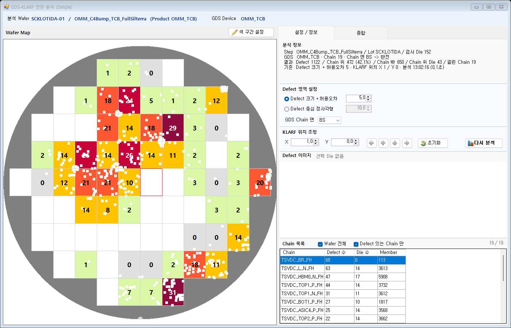

# Simple 화면 KLARF 위치 조정 설계 (2026-10-22)

작성: 2026-10-22 (CLAUDE-198) / 상태: **결정 완료(K1 ~ K8 권장안) / 구현 완료(코드) / TEMP 빌드 + Smoke 33/33 (2개 Wafer) + 배치 검사 PASS / 배포 안 함 / DMS 화면 확인 대기** (10절)

관련:

- [Simple 화면 설계](2026-10-22_GDS_KLARF_연관분석_Simple_화면_설계.md): 5.1절(지금은 보정 0 고정), 14절(지금 배치)
- [연관 분석 화면 설계](2026-10-12_GDS_KLARF_연관분석_화면_설계.md) 6.1절: 좌표 변환 1차 가정
- [통합 분석 데이터 설계](2026-10-15_GDS_KLARF_ETest_통합분석_데이터_설계.md) 20절: Scribe 위치 / 보정 X · Y

## 1. 요청 (2026-10-22)

1. 기존 위치 보정 기능을 다시 설계한다.
2. Simple 화면 "Defect 영역 설정" 아래에 **KLARF 위치 조정** 기능을 넣는다.
3. KLARF 파일에 있는 Defect 의 **REL 값(XREL / YREL)을 조정**하는 기능이다.
4. 위치가 약간씩 틀어질 수 있다는 전제로 **위 / 아래 / 좌 / 우로 1 µm 씩** 조정한다.
5. **GDS 는 맞다**는 전제로 KLARF Data 만 보정한다.

## 2. 지금 동작 (소스 확인)

### 2.1 서버가 보정값을 더하는 곳

BSL `GdsKlarfMatchEngine.ToViewX / ToViewY`:

```
보기 X = XREL − PitchX / 2 + OffsetX
보기 Y = YREL − PitchY / 2 + OffsetY
저장 X = 반전이면 −보기 X, 아니면 보기 X   (Y 는 그대로)
```

- 보정값(`OffsetX / OffsetY`)은 **반전 전에, KLARF 좌표계에서** 더해진다. `XREL + OffsetX` 로 바꿔 쓴 것과 같다.
  - 그래서 지금 있는 보정값이 곧 "KLARF REL 조정"이다. **서버 / Interface 변경은 필요 없다.**
- 요청 필드는 `GdsKlarfAnalysisRequest.OffsetXUm / OffsetYUm`(±100,000)이다.
- 결과 기록:
  - 결과 정보 표 `ANL_INFO.OFFSET_X / OFFSET_Y` 에 남는다.
  - Defect 표 `GDS_X / GDS_Y` 도 이 값을 더한 좌표다.
- 상세보기도 같은 값을 쓴다.
  - Simple 상세보기는 마지막 분석 요청 그대로 `AnalyzeDie` 를 부른다.
  - Defect 를 `DEFECT.GDS_X / GDS_Y` 위치에 그린다.
  - 한 Step 분석에서 `GDS_X` = 보기 X 다(`GdsKlarfAnalysis_Analyze.Match`: 반전을 두 번 적용).
  - 그래서 X +1 은 반전(Back side) 상세보기 도면에서도 **오른쪽**으로 1 움직인다.
- 조정해도 바뀌지 않는 것:
  - Defect 의 Die 는 KLARF `XINDEX / YINDEX` 그대로다. 조정으로 다른 Die 로 넘어가지 않는다.
  - Wafer Map 의 Defect 점은 KLARF 원래 위치에 그려진다. 1 µm 는 Map 에서 보이지 않는 크기라 Map 은 그대로 둔다(K7).

### 2.2 지금 화면

| 화면 | 위치 보정 |
| --- | --- |
| 화면 A (`frmGdsKlarfAnalysis`) | [KLARF] 탭 "좌표 보정 X / Y" 숫자칸 2개(소수 1자리, ±100,000). 값을 직접 넣는다 |
| Simple (`frmGdsKlarfSimple`) | 없음. 요청에 0 고정(1단계 요청 "좌표 보정 기능은 우선 제외") |

## 3. 설계

### 3.1 배치

[설정 / 정보] 탭은 아래 순서다. 각 기능 사이에는 구분선을 둔다(같은 날 요청 "각 기능 별로 Line", 구현함).

1. 분석 정보
2. Defect 영역 설정
3. **KLARF 위치 조정 (신규)**
4. Defect 이미지
5. Chain 목록

```
├─────────────────────────────── 구분선 ───────────────────────────────┤
│ Defect 영역 설정                                                          │
│ (●) Defect 크기 + 허용오차   [  0.0 ]                                      │
│ ( ) Defect 중심 정사각형      [ 10.0 ]                                      │
│ GDS Chain 면 [ BS ▼ ]                                                     │
├─────────────────────────────── 구분선 ───────────────────────────────┤
│ KLARF 위치 조정                                                           │
│ X [  0.0 ]  Y [  0.0 ]   [◀] [▲] [▼] [▶]   [초기화]          [다시 분석] │
├─────────────────────────────── 구분선 ───────────────────────────────┤
│ Defect 이미지  Die (6, 6)  Defect 5 / 이미지 5                             │
```

- **X / Y 숫자칸:** 지금 조정값이다. 직접 넣을 수 있고, 소수 1자리다.
- **[◀] [▲] [▼] [▶]:** 아이콘만 있는 28 x 28 버튼이다(POC 버튼 기준).
  - 위 / 아래는 지금 있는 `MOVE_UP` / `MOVE_DOWN` 아이콘을 쓴다.
  - 좌 / 우는 `button_icons.py` 에 `MOVE_LEFT` / `MOVE_RIGHT` 를 더한다. 원본은 `16x16Icon\arrow_left.png` / `arrow_right.png` 로, 위 / 아래와 같은 계열이다.
- **[초기화]:** X / Y 를 0 으로 되돌린다. 아이콘은 `UNDO`(되돌리기)다.
- **[다시 분석]:** 위치 조정까지 모든 설정을 다 정한 뒤 누르도록 설정 묶음 맨 아래로 옮긴다(K6). 지금은 Defect 영역 설정 묶음 오른쪽 아래에 있다.
- **화면 문구:** POC 문구 규칙대로 단위(µm)와 설명 괄호를 쓰지 않는다. 툴팁도 두지 않는다.

### 3.2 조정 방향 (K1)

KLARF REL 좌표계를 따른다. 원점은 Die 왼쪽 아래이고, X 는 오른쪽이 +, Y 는 위가 + 다.

| 버튼 | 바뀌는 값 | 화면에서 보이는 방향 |
| --- | --- | --- |
| ◀ | X − 1 | 왼쪽 |
| ▶ | X + 1 | 오른쪽 |
| ▲ | Y + 1 | 위 |
| ▼ | Y − 1 | 아래 |

- "화면에서 보이는 방향"은 상세보기 도면 기준이다. Chain 면 BS(반전) / FS 어느 쪽이든 같다(2.1절).
- 요청 값은 그대로 보낸다. `OffsetXUm = X`, `OffsetYUm = Y` 이고, 서버는 바꾸지 않는다.

### 3.3 동작

1. **값을 바꾸면 표시만 한다(K2).** 화살표 / 숫자칸 / [초기화]는 값만 바꾸고 분석 정보 제목 옆에 "설정 바뀜" 을 보인다. [다시 분석] 을 눌러야 다시 계산한다. 이것은 지금 Defect 영역 설정과 같은 규칙이다(숫자를 바꿀 때마다 서버를 부르지 않는다).
2. **이동 단위는 1 고정이다(K3).** 화살표 한 번에 1 이다. 숫자칸 옆 작은 위 / 아래 버튼도 1 씩 바뀐다.
3. **범위는 ±100,000 이다(K4).** 서버 / 화면 A 와 같은 한계다. "약간" 이 대상이지만, 큰 값(4절 U8)을 임시로 넣는 길도 막지 않는다.
4. **Wafer 를 바꿔도 값을 유지한다(K5).** 다른 설정(허용오차 등)과 같다.
   - 같은 검사 장비 / Recipe 의 어긋남은 Wafer 가 달라도 비슷할 것으로 본다.
   - 잊지 않게 0 이 아니면 분석 정보 기준 줄에 보인다(아래 5번).
5. **분석 정보 기준 줄:** 조정값이 0 이 아니면 줄에 붙인다.
   - 예: `기준  Defect 크기 그대로 · KLARF 위치 X 2 / Y -1 · 분석 11:33:40 (0.1초)`
   - 값은 결과 정보 표 `OFFSET_X / OFFSET_Y` 를 읽는다. 즉 분석에 실제로 쓴 값이다.
6. **상세보기:** 마지막 분석 요청을 그대로 넘기므로 조정값이 같이 간다. 설정만 바꾸고 [다시 분석] 전에 열면, 지금처럼 알림 줄에 "설정 바뀜: 상세보기는 마지막 분석 조건" 이 나온다.
7. **Wafer Map:** Defect 점 위치는 바꾸지 않는다(K7). Die 색 / 숫자는 분석 결과로 바뀐다.

### 3.4 화면 A (K8)

- 화면 A 의 "좌표 보정 X / Y" 숫자칸은 그대로 둔다. 요청이 Simple 화면 대상이기 때문이다.
- 화면 A 에도 같은 화살표 줄을 넣는 것은 다른 안이다.

## 4. U8 원점 차이와의 관계 (참고)

- 오늘 U8 에서 Defect 가 Pitch 절반만큼 밀린 원인은 KLARF 어긋남이 아니다. GDS 원점 위치가 다르다(`변경이력/2026-10-22.md` "U8 Defect 위치 어긋남 원인 확인").
  - 서버는 GDS 원점을 Chip 가운데로 본다.
  - U8 GDS 는 원점이 Die 왼쪽 아래다.
- 이 기능의 대상은 "약간씩 틀어진 위치"(수 µm)다. U8 같은 큰 차이(약 X −11,915 / Y +15,026)는 GDS Map 마다 원점 위치를 두는 쪽(그 절의 결정 대기)으로 고치는 것이 맞다.
- K4 를 ±100,000 으로 두면, 원점 기능이 들어가기 전까지는 Simple 화면에서도 큰 값을 직접 넣어 임시로 확인할 수 있다.

## 5. 바뀌는 파일 (구현 시)

| 구분 | 파일 | 내용 |
| --- | --- | --- |
| 수정 | `02_DMS/DACrux.SEMDMS.ENGUI/DefectMapAnalysis/frmGdsKlarfSimple.Designer.cs` / `.resx` | 위치 조정 묶음 `pnlShift`(제목 / X · Y 숫자칸 / 화살표 4 / [초기화]) + 구분선 1개, [다시 분석] 을 이 묶음으로 옮김, 버튼 아이콘 4개 |
| 수정 | `.../frmGdsKlarfSimple.cs` | 화살표 / [초기화] 처리(값 바꿈 + 설정 바뀜), `BuildRequest` 의 `OffsetXUm / OffsetYUm` = 숫자칸, 분석 정보 기준 줄에 조정값 |
| 수정 | `DMS/99_Resource/ByModule/POC/Button/button_icons.py` | `MOVE_LEFT` / `MOVE_RIGHT` 2줄 + `BTN_MOVE_LEFT.png` / `BTN_MOVE_RIGHT.png` 만들기 |
| 수정 | `.../Verification/GdsKlarfSimpleFormSmoke.cs` | 8절 검사. 지금 다른 세션이 같은 파일을 고칠 수 있어 구현 때 먼저 확인 |
| 변경 없음 | Interface / RO / BSL / DSL / DB / 화면 A / 상세보기 화면 | - |

## 6. 결정 필요 (권장안)

| ID | 항목 | 권장 | 다른 안 |
| --- | --- | --- | --- |
| K1 | 조정 방향 기준 | KLARF REL 좌표계(▶ = X +1, ▲ = Y +1). 상세보기 도면에서도 같은 방향 | 반전이면 좌우 부호를 바꿈(필요 없음, 2.1절) |
| K2 | 다시 계산 시점 | 값만 바꾸고 "설정 바뀜" -> [다시 분석] | 누를 때마다 0.5초 뒤 자동 다시 분석 |
| K3 | 이동 단위 | 1 고정 | 단위 콤보(1 / 5 / 10) |
| K4 | 값 범위 | ±100,000(서버 · 화면 A 와 같음) | ±1,000 |
| K5 | Wafer 를 바꿀 때 | 값 유지 + 0 이 아니면 분석 정보 기준 줄에 표시 | Wafer 를 받을 때마다 0 |
| K6 | [다시 분석] 자리 | 위치 조정 줄 오른쪽 끝(설정 묶음 맨 아래)으로 옮김 | 지금 자리(Defect 영역 설정 오른쪽 아래) |
| K7 | Wafer Map Defect 점 | 그대로(KLARF 원래 위치) | 조정값만큼 옮겨 그림 |
| K8 | 화면 A | 그대로(숫자칸 2개) | 화면 A 에도 같은 화살표 줄 |

## 7. 배치 크기 (구현 시, 설계 단위 10 x 18)

| 컨트롤 | 위치 / 크기 |
| --- | --- |
| `pnlShift`(Dock Top, Defect 영역과 같은 연한 배경) | 높이 96 |
| 제목 "KLARF 위치 조정" | (8, 9) 굵게 |
| X 라벨 / 숫자칸 | (18, 54) / (44, 48) 110 x 28 |
| Y 라벨 / 숫자칸 | (176, 54) / (202, 48) 110 x 28 |
| [◀] [▲] [▼] [▶] | (340 / 386 / 432 / 478, 46) 각 42 x 42(실행 28 x 28) |
| [초기화] | (540, 46) 120 x 42 |
| [다시 분석] | 오른쪽 끝 (737, 46) 150 x 42, Anchor 오른쪽 |

- 안쪽 SplitContainer 밖(탭 바로 아래)이라 오른쪽 Anchor 배율 문제(14절)는 없다. 구현 뒤 버튼 배치 검사로 다시 본다.
- `pnlArea` 에서 [다시 분석] 이 빠지므로 높이 186 -> 176 으로 줄인다.

## 8. 검증 계획 (구현 뒤)

- **Smoke**(로컬 DB, 조회만):
  - 화살표 4개 / [초기화]: 값 ±1 / 0, "설정 바뀜" 표시, 서버를 부르지 않음(결과 그대로).
  - [다시 분석]: 요청 `OffsetXUm / OffsetYUm` = 숫자칸. 결과 `ANL_INFO.OFFSET_X / Y` 가 같다.
  - **기준 대조:** 같은 조정값으로 BSL 을 직접 부른 결과와 Die 별 Chain 위 수가 같다.
  - **Defect 좌표:** `DEFECT.GDS_X` 가 조정 전보다 정확히 +1 (X +1 일 때), `GDS_Y` 가 +1 (Y +1 일 때).
  - 분석 정보 기준 줄 "KLARF 위치 X n / Y m"(0 이면 없음).
  - Wafer 를 다시 받아도 값이 유지된다(K5).
  - 상세보기에 넘기는 요청에도 같은 값이 들어간다.
- **버튼 배치 검사:** 화살표 28 x 28 · 아이콘 · 겹침 없음, `POC_BUTTON_LAYOUT` Simple FAIL 0.
- **데이터:** STEP 528(OMM_Hybrid) / 603(OMM_TCB). 조정 0 / ±1 / ±5 에서 Chain 위 수 변화를 표로 남긴다(얼마나 민감한지 참고).

## 9. 확인 수준

- 2.1절은 **소스 확인**이다. 읽은 소스: BSL `GdsKlarfMatchEngine.cs` 131 ~ 140행, `GdsKlarfAnalysis_Analyze.cs` 202 ~ 205 / 363 ~ 383 / 673행, GdsMap `GdsDieAnalysisForm.cs` 560 / 1270행. 실행 / DB 조회는 하지 않았다.
- 기능별 구분선(3.1절)은 **구현 + 화면 밖 배치 검사(PASS)** 까지 했다. 기록은 Simple 화면 설계 16절에 있다.
- 10절 구현 뒤 2.1절 내용은 Smoke 로 **Probe 확인**이 됐다: 보정 X 2 / Y −1 이면 모든 Defect 의 GDS_X 가 +2, GDS_Y 가 −1(반전 Y 결과).

## 10. 구현 결과 (2026-10-22)

결정(2026-10-22 사용자): "KLARF 위치 조정을 권장안 K1 ~ K8 로 구현 진행" -> K1 ~ K8 모두 권장안.

### 10.1 바뀐 파일

| 파일 | 내용 |
| --- | --- |
| `02_DMS/DACrux.SEMDMS.ENGUI/DefectMapAnalysis/frmGdsKlarfSimple.Designer.cs` | `lineShift` + `pnlShift`(제목 / X · Y 숫자칸 소수 1자리 ±100,000 / [◀][▲][▼][▶] 42 x 42 / [초기화]) 추가, [다시 분석] 을 `pnlShift` 오른쪽 끝으로 옮김, `pnlArea` 높이 186 -> 176 |
| `.../frmGdsKlarfSimple.resx` | 버튼 아이콘 5개(`button_icons.py set`: MOVE_LEFT / MOVE_UP / MOVE_DOWN / MOVE_RIGHT / UNDO) |
| `.../frmGdsKlarfSimple.cs` | `ShiftButton_Click`(◀ X−1 / ▶ X+1 / ▲ Y+1 / ▼ Y−1) / `btnShiftReset_Click` / `Shift_ValueChanged`(설정 바뀜) / `BuildRequest` 보정값 = 숫자칸 / 분석 정보 기준 줄 `ShiftText`(0 이 아니면 " · KLARF 위치 X n / Y m", 분석 뒤에는 결과 OFFSET_X / Y) / `ColDouble` |
| `DMS/99_Resource/ByModule/POC/Button/button_icons.py` | KEY `MOVE_LEFT` / `MOVE_RIGHT` 추가 + `BTN_MOVE_LEFT.png` / `BTN_MOVE_RIGHT.png`, 목록 그림 다시 만듦(기존 아이콘 40개 파일은 그대로) |
| `문서/설계/06_환경_운영/2026-10-16_POC_화면_버튼_아이콘_레이아웃_기준.md` | KEY 표에 MOVE_LEFT / MOVE_RIGHT 1줄 |
| `.../Verification/GdsKlarfSimpleFormSmoke.cs` | 5b 절 검사 6개(10.3절) + 참고 출력(조정별 Chain 위 수) |
| 변경 없음 | Interface / RO / BSL / DSL / DB / 화면 A / 상세보기 화면 / 메뉴 |

### 10.2 설계와 달라진 것

- 좌 / 우 아이콘 원본: 처음에는 `arrow_left.png` / `arrow_right.png`(초록)로 만들었다. 그림을 보니 위 / 아래(회색)와 색이 섞여, 같은 회색 계열 `arrow_back.png` / `arrow_next.png` 로 바꿨다.
  - `arrow_back` 은 VALUE_FROM("KLARF 값으로")과 같은 그림이다. 그래서 버튼 배치 검사 표에는 ◀ 가 `VALUE_FROM` 으로 찍힌다. 버튼 기준 문서에 적었다.
- 숫자칸 옆 작은 위 / 아래 버튼도 1 씩 바뀐다(Increment 1). 소수 값은 직접 넣는다.

### 10.3 검증

- 빌드(TEMP, 운영 폴더 안 바꿈):
  - Interface / DSL / BSL / RO / GdsMap 경고 0, Control 12 / ENGUI 4(기존 수), 오류 0.
  - Smoke 안 람다 변수 이름 겹침(CS0136) 1건은 고침.
  - 최종 ENGUI md5 `1a1e5583`.
- `Verify-GdsKlarfSimple.ps1`(DB 연결 DMSMGR, 조회만): STEP 528 / 603 `GDS_KLARF_SIMPLE_FORM_SMOKE=PASS (33/33)`. 새 검사 6개:
  1. 배치: X / Y 0, 화살표 아이콘만, [초기화], [다시 분석] 이 위치 조정 묶음, 구분선 4개.
  2. 화살표: ▶ x3 · ◀ x1 = X 2 / ▲ x1 · ▼ x2 = Y −1. 값만 바뀌고 설정 바뀜이 뜨며, 서버를 부르지 않는다.
  3. [다시 분석]: 요청 보정값 = 결과 OFFSET_X / Y = (2, −1). BSL 직접 호출과 Die 별로 같다. 기준 줄에 "KLARF 위치 X 2 / Y -1".
  4. Defect 보기 좌표: GDS_X +2 / GDS_Y −1 이 모든 Defect 에서 맞다(528 15 / 15, 603 1,122 / 1,122, Chain 면 BS 반전 결과).
  5. [초기화]: 0 -> 조정 전 결과, 기준 줄에서 KLARF 위치가 사라짐.
  6. Wafer 다시 받기: X 1 이 유지되고, 자동 1차 분석 요청 보정값도 X 1 / Y 0 이다.
- 참고(검사 아님): 기본 조건(허용오차 0)에서 위치 조정별 Chain 위 Defect 수.

| Wafer | (0, 0) | X +1 | X −1 | Y +1 | Y −1 | X +5 | X −5 | Y +5 | Y −5 |
| --- | --- | --- | --- | --- | --- | --- | --- | --- | --- |
| STEP 528 (Defect 15) | 1 | 1 | 1 | 1 | 1 | 1 | 1 | 1 | 1 |
| STEP 603 (Defect 1,122) | 437 | 436 | 440 | 440 | 437 | 436 | 448 | 441 | 434 |

- 버튼 배치(별도 TEMP `%TEMP%\chippac\simple_line`, Simple 화면만): `POC_BUTTON_LAYOUT=PASS`. 실행 크기는 화살표 29 x 28 / [초기화] 84 x 28 / [다시 분석] 105 x 28 이다.
- 그림: `2026-10-22_Simple화면_구현/S5_STEP603_KLARF위치조정_X1.png`(X 1 로 Wafer 다시 받은 뒤).
- 미확인: DMS 실제 화면, 상세보기 도면에서 Defect 가 1 씩 옮겨 그려지는 모습(좌표 값은 검사함, 그림은 안 찍음).



- 2026-10-22 CLAUDE-209: Simple 분석 정보 5줄을 빼면서 "기준 줄의 KLARF 위치 X n / Y m" 표시도 없어졌다. 조정 값은 KLARF 위치 조정 숫자칸에서만 보인다. 분석에 쓴 값은 결과 `ANL_INFO.OFFSET_X / Y` 에 그대로 남는다.
