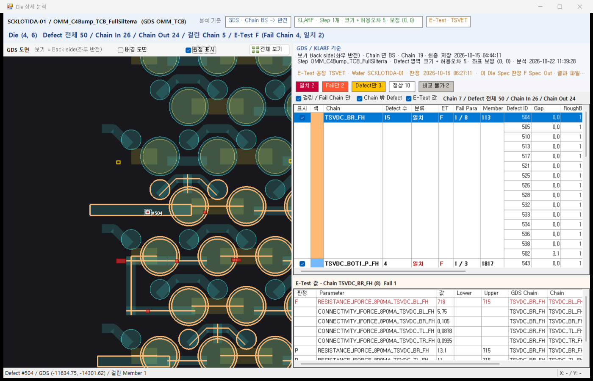
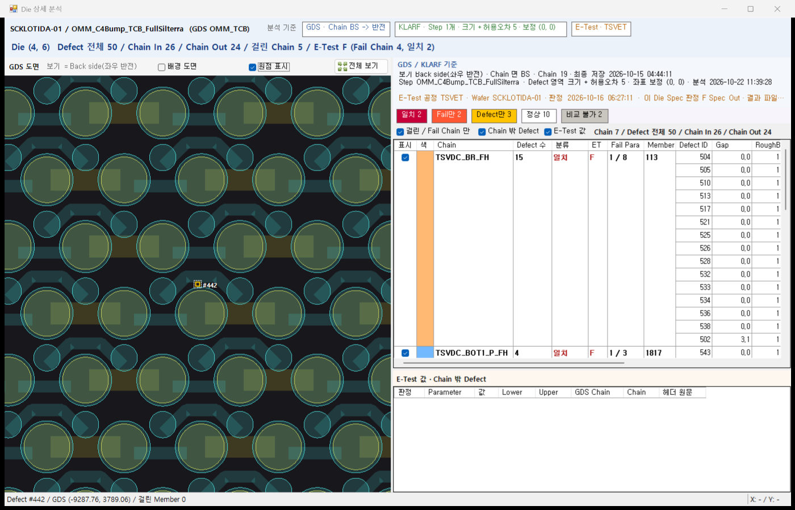
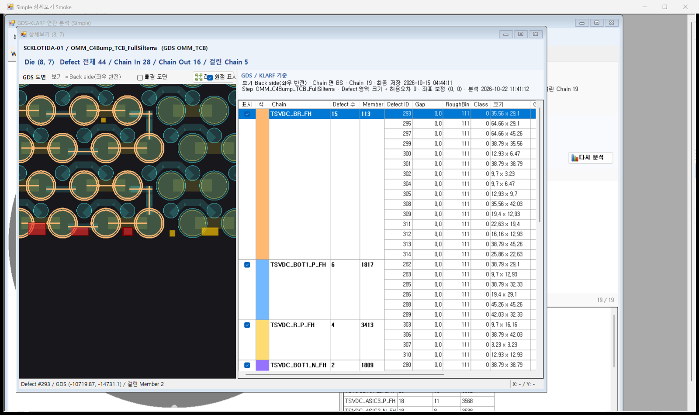
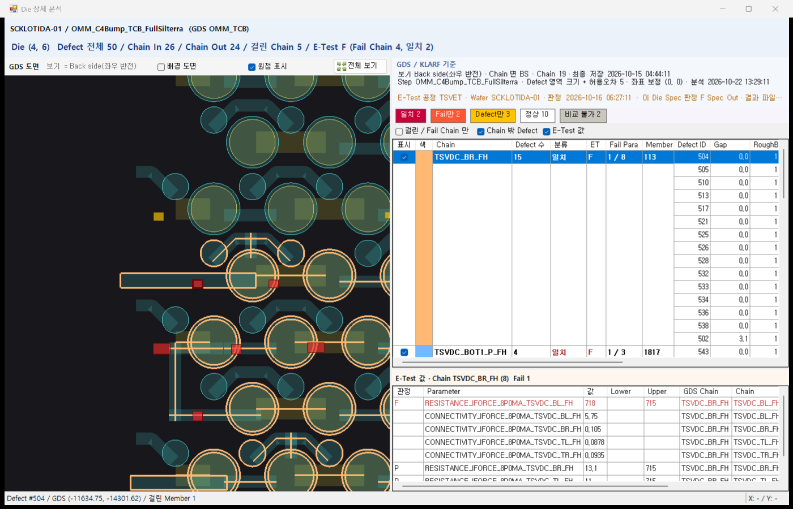
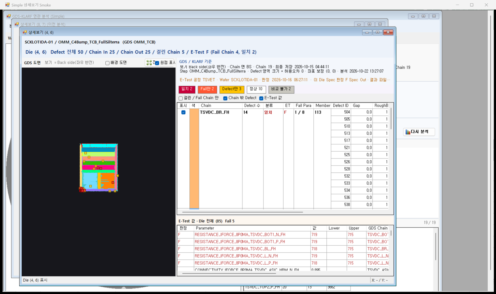
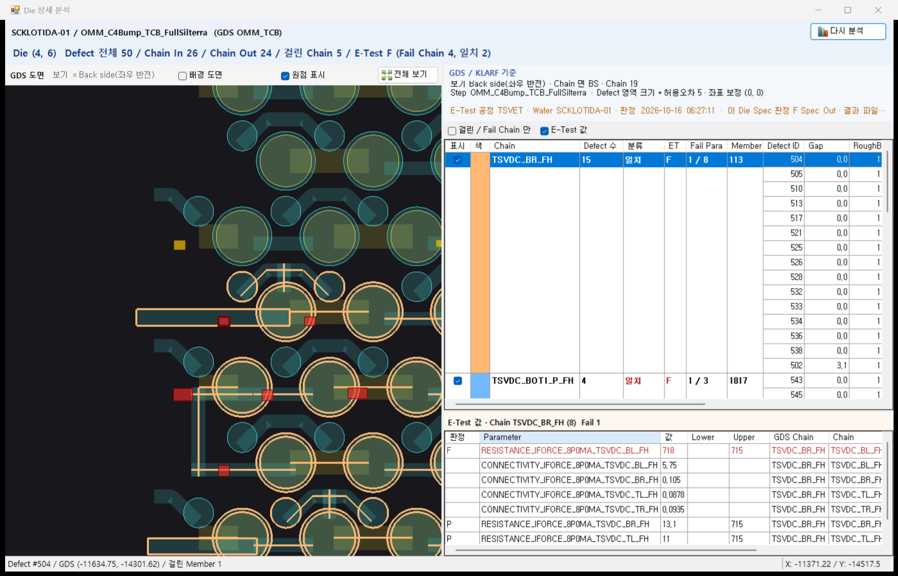
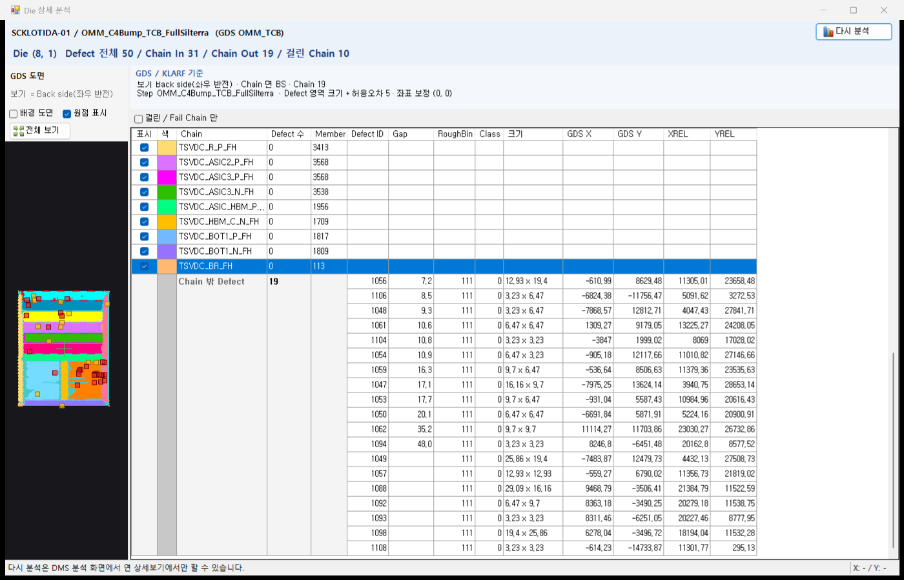
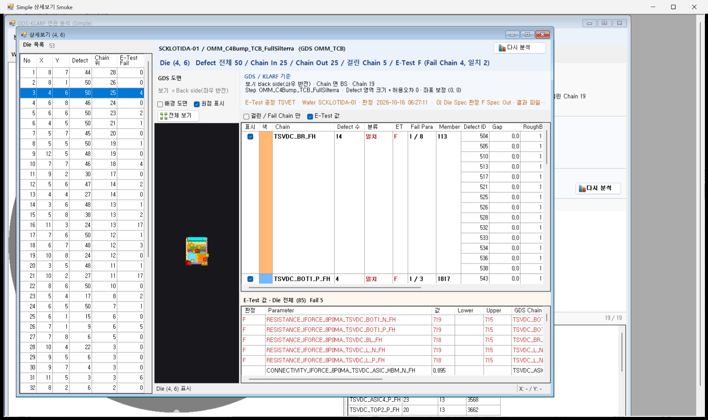

# 상세보기(화면 B) 오른쪽 탭 3개를 한 패널로 합치기 설계

작성: 2026-10-22 (CLAUDE-197) / 상태: **P1 ~ P9 권장안 결정(2026-10-22 사용자) / 구현 완료(11절) / 두 화면 같은 모양 + Simple E-Test 자동 연결(12절, CLAUDE-199) / 배포 안 함 / DMS 화면 확인 대기**

사용자 요청 (2026-10-22):

> 화면 조정을 하자
> 우측의 3개의 탭을 하나의 패널로 Merge
> GDS/KLARF를 Main으로 두고 E Test 결과는 Grid에서 선택 하면 하단에 grid에서 확인 할 수 있도록 한다. 단, 하단의 Etest 결과는 상단에 Visible 체크박스를 두고 사용자가 확인 할 수 있게 한다. 선택된 chain 기준으로 해당 Die의 Parameter Data를 출력해주면 E-test 에 대한 탭은 없어도 된다.
> 종합탭의 정보는 GDS/KLARF Grid 에 필요한 부분 엮어서 같이 볼수 있도록 한다.
> 그리고 defect에 가까운 chain에 정보는 없어도 된다.
> 설계 진행

앞 문서: [GDS / KLARF 합친 탭](2026-10-20_상세보기_GDS_KLARF_합친탭_설계.md) (탭 [GDS] + [KLARF] -> [GDS / KLARF]), [Simple 화면 설계 15절](2026-10-22_GDS_KLARF_연관분석_Simple_화면_설계.md) (Simple 상세보기)

대상: 공유 상세 화면 `06_CoreLibSource/GdsMapControl/GdsDieAnalysisForm` 하나. 화면 A(`frmGdsKlarfAnalysis`)와 Simple(`frmGdsKlarfSimple`) 상세보기 창이 같이 쓰므로 두 화면 상세보기가 함께 바뀐다. 서버(`AnalyzeDie`) 결과는 그대로 쓴다.

---

## 1. 지금과 바뀌는 것

| 항목 | 지금 | 바뀐 뒤 |
| --- | --- | --- |
| 오른쪽 | 탭 3개 [GDS / KLARF] [E-Test] [종합] | 탭 없음. 한 패널 = 위 GDS / KLARF 표(주) + 아래 E-Test 값 표 |
| E-Test 값 | [E-Test] 탭: 이 Die 의 모든 Parameter(역추적이면 그 Chain) | 아래 표: **위 표에서 고른 행의 Chain** 의 이 Die Parameter. 위쪽 체크 [E-Test 값] 으로 보이기 / 숨기기 |
| E-Test 기준 | [E-Test] 탭 위 "E-Test 기준" 2줄 | 기준 묶음 3째 줄 (P3) |
| 종합 | [종합] 탭: Die 요약 줄 / 4분류 수 / 일치 · Fail만 · Defect만 Chain 표 | 4분류 수는 위 표 머리 줄로, 분류 글자색은 위 표 분류 칸으로. 나머지는 위 표 · 위쪽 Die 줄과 겹쳐 뺀다 (4절) |
| 가까운 Chain | 위 표 맨 오른쪽 "가까운 Chain" 열 | 열 삭제 (P6) |
| 역추적 표시 | 탭 제목 끝 " (역추적)" + 위쪽 역추적 글자 · [역추적 해제] | 위쪽 역추적 글자 · [역추적 해제] 만 (탭이 없음) |

도면(왼쪽) / 위쪽 Wafer · Die 줄 / 상태줄 / 서버 결과는 그대로다.

## 2. 배치

```
┌ 오른쪽 패널 ───────────────────────────────────────────────────────────────┐
│ GDS / KLARF 기준                                                            │
│   보기 Back side(좌우 반전) · Chain 면 BS · Chain 19 · 최종 저장 …            │
│   Step … · Defect 영역 크기 + 허용오차 5 · 좌표 보정 (0, 0) · 분석 …          │
│   E-Test 공정 TSVET · Wafer … · 판정 … · 이 Die Spec 판정 F Spec Out · 결과 파일 F Fail Die │  <- P3
├────────────────────────────────────────────────────────────────────────────┤
│ [일치 2] [Fail만 2] [Defect만 3] [정상 …] [비교 불가 …]                        │  <- 종합 4분류 수 (P5)
│ ☑ 걸린 / Fail Chain 만   ☑ Chain 밖 Defect   ☑ E-Test 값    Chain 7 / Defect 전체 50 / Chain In 26 / Chain Out 24 │  <- Visible 체크 (P4)
├────────────────────────────────────────────────────────────────────────────┤
│ 표시│색│Chain│Defect 수│분류│ET│Fail Para│Member│Defect ID│Gap│RoughBin│Class│크기│GDS X│GDS Y│XREL│YREL │
│  (지금 GDS / KLARF 합친 표, "가까운 Chain" 열 없음)                              │
│                                                                            │
├═══════════════ 나누기 막대 (끌어서 높이 조절, P7) ══════════════════════════════┤
│ E-Test 값 · Chain TSVDC_BR_FH (8)  Fail 1                                   │
│ 판정│Parameter│값│Lower│Upper│GDS Chain│Chain│헤더 원문                          │
│  F  │…        │  │     │     │TSVDC_BR_FH│ │                                  │
└────────────────────────────────────────────────────────────────────────────┘
```

- 위 / 아래는 가로 나누기(SplitContainer). [E-Test 값] 을 끄면 아래가 접히고 위 표가 패널 끝까지 늘어난다.
- 아래 표 열은 지금 [E-Test] 탭과 같다(판정 / Parameter / 값 / Lower / Upper / GDS Chain / Chain / 헤더 원문, 숨긴 SEQ). Fail 행이 위, 빨간 글자.
- 아래 머리 글자: Chain 을 골랐으면 "E-Test 값 · Chain 이름 (n)  Fail m", 안 골랐으면 "E-Test 값 · Die 전체 (n)  Fail m" (P1).

## 3. 동작

| 동작 | 결과 |
| --- | --- |
| 위 표 Defect 행 고르기 | 지금처럼 그 Defect 로 도면 이동 + **아래 = 그 행 Chain 의 Parameter** |
| 위 표 Chain 행(걸린 Defect 없는 빈 행) 고르기 | 지금처럼 상태줄 Chain 이름 + 아래 = 그 Chain 의 Parameter |
| 위 표 Chain 밖 Defect 행 고르기 | 도면 이동 + 아래 = 빈 표, 머리 "E-Test 값 · Chain 밖 Defect" (P2) |
| 고른 행 없음(처음 열 때) | 아래 = 이 Die 의 모든 Parameter (지금 [E-Test] 탭과 같음, P1) |
| 아래 표 행 고르기 | 지금 [E-Test] 탭과 같다: 그 Parameter 의 GDS Chain 도형을 선택 색으로 칠하고 상태줄에 Parameter / 값 / 판정 |
| 위 표 Chain 칸 더블클릭 | 역추적(지금과 같음). 역추적 Chain 묶음 첫 행을 고르므로 아래 = 그 Chain |
| 위 표 Defect 칸 더블클릭 | Defect 이미지(지금과 같음) |
| [E-Test 값] 끄기 / 켜기 | 아래를 접기 / 펴기. 값은 화면 하나 설정(창을 바꿔도 그대로, [배경 도면] 과 같은 방식) |
| 도면에서 Defect 클릭 | 그 Defect 첫 행을 고름 -> 아래도 그 Chain |
| 같은 Chain 안에서 행만 바꿈 | 아래 표를 다시 채우지 않는다(Chain 이 바뀔 때만) |

- 화면 A 상세보기를 처음 열 때 지금은 [종합] 탭이 보였다. 바뀐 뒤에는 한 패널이라 탭 선택이 없고, 고른 행이 없으니 아래에 Die 전체 Parameter(Fail 먼저)가 보인다.
- 창별 보기 상태(`CaptureViewState`)의 "오른쪽 탭" 은 없앤다. 고른 행 / 스크롤 / 표시 체크 / 도면 위치는 지금처럼 창마다 되돌린다.

## 4. 종합 탭 정보 처리

| [종합] 의 정보 | 바뀐 뒤 |
| --- | --- |
| Die 요약 줄 (Defect 전체 / Chain In / Chain Out / 걸린 Chain / E-Test 판정) | 위쪽 Die 줄과 같은 항목이라 뺀다 |
| 4분류 수 (일치 / Fail만 / Defect만 / 정상 / 비교 불가) | 위 표 머리 첫 줄에 같은 색 칸 5개 (P5) |
| 표 정렬 일치 -> Fail만 -> Defect만 | 위 표가 이미 같은 순서(일치 -> Fail만 -> Defect만 -> 정상 -> 비교 불가) |
| 분류 / Chain / Defect 수 / ET / Fail Para | 위 표 Chain 칸에 이미 있음 |
| 분류 글자색 (일치 빨강 / Fail만 주황 / Defect만 진노랑) | 위 표 분류 칸에 같은 색 (지금은 일치만 빨강) |
| 가까운 거리 (Chain 최소 Gap) | 위 표 묶음 첫 Defect 행 Gap 과 같다(Gap 순 정렬). 뺀다 |
| Fail Parameter / 값 (첫 Fail Parameter) | 아래 E-Test 표가 그 Chain 의 Fail Parameter 를 위에 보이므로 뺀다 (P5 다른 안: 위 표에 열 추가) |
| 행 더블클릭 = 역추적 | 위 표 Chain 칸 더블클릭과 같아 뺀다 |

## 5. 가까운 Chain 열 삭제

- 위 표의 "가까운 Chain" 열(`colNear`)을 없앤다. 이 열에는 두 가지가 있었다:
  - Chain 밖 Defect 의 가장 가까운 Chain 이름 -> 없어짐.
  - 두 Chain 에 함께 걸린 Defect 의 "함께 걸림: 다른 Chain" -> 없어짐. 그런 Defect 는 지금처럼 Defect ID 굵은 글자로만 보이고 두 묶음에 모두 나온다.
- Chain 밖 Defect 의 Gap(가장 가까운 Chain 까지 거리)은 남긴다(P6). 허용오차를 조금 넓히면 걸릴 Defect 를 아는 값이다.
- [종합] 의 "가까운 거리" 열도 4절대로 함께 없어진다.

## 6. Simple 보기 (Simple 화면 상세보기)

Simple 은 E-Test 를 분석하지 않는다. 지금(설계 15.7절)은 E-Test 열 3개를 숨기고 [E-Test] / [종합] 탭을 뺀다. 바뀐 뒤:

- [E-Test 값] 체크와 아래 표를 숨긴다(아래 접힘). 4분류 수 칸도 숨긴다(모두 "비교 불가").
- 위 표는 지금 Simple 과 같다(분류 / ET / Fail Para 숨김) + 가까운 Chain 열 없음.
- 탭이 없어지므로 15.7절의 탭 빼기 / 되돌리기 코드(`ShowTab`)는 없앤다.
- 화면 A 결과도 E-Test 를 연결하지 않은 분석(E-Test 파일 없음)이면 Simple 과 같이 [E-Test 값] 체크 / 아래 표를 숨긴다(P4).

## 7. 바뀌는 파일 (구현 시)

| 구분 | 파일 | 내용 |
| --- | --- | --- |
| 수정 | `06_CoreLibSource/GdsMapControl/GdsDieAnalysisForm.Designer.cs` | `tabMain` / `tabChainDefect` / `tabEt` / `tabDie` 삭제. 오른쪽 = 기준 묶음 + 머리 줄 2줄 + 가로 SplitContainer(위 `dgvChainDefects` / 아래 머리 + `dgvEtValues`). `pnlDieSummary` · `dgvSummary` · `pnlSummaryHead` · `pnlEtCriteria` 삭제, `flowClass` 는 머리 줄로 옮김. `colNear` 삭제 |
| 수정 | `.../GdsDieAnalysisForm.cs` | E-Test 표 = 고른 행 Chain 기준(`FillEtValueGrid(chainSeq)`), [E-Test 값] 체크 / 나누기, 4분류 수만 남긴 `FillSummary`, 분류 칸 색, E-Test 기준 3째 줄, 탭 관련 코드(`tabMain_*`, `ShowTab`, 탭 제목 역추적 표시, 보기 상태 탭 번호) 삭제, Simple 보기 정리 |
| 수정 | `02_DMS/.../Verification/GdsKlarfAnalysisFormSmoke.cs` | 화면 A 상세보기 검사 중 탭 / 종합 표 / 가까운 Chain("함께 걸림") 기대값을 새 배치로 |
| 수정 | `.../Verification/GdsKlarfSimpleFormSmoke.cs` | Simple 상세보기 탭 검사 -> 아래 표 / 체크 숨김 검사 |
| 수정 | `.../Verification/GdsKlarfLayoutPreview.cs` | 상세보기 그림의 탭 고르기 -> 행 고르기 |
| 변경 없음 | 서버 / DB / `frmGdsDieAnalysis`(호스트) / 화면 A · Simple 화면 / 메뉴 | - |

- 배포는 `NexplantQMS.GdsMap.exe` 1개(100_ClientBin/GdsMap). ENGUI 는 Smoke 만 바뀐다.

## 8. 검증 계획 (구현 뒤)

- TEMP 빌드: GdsMap / ENGUI 오류 0.
- 화면 A Smoke (로컬 DMSMGR 로 연결 이름을 바꿔서, 실제 앱 DB 금지): 위 표 행 고르기 -> 아래 = 그 Chain ET_VALUE 행 수 · Fail 수, 고른 행 없음 = Die 전체, Chain 밖 행 = 빈 표, 아래 행 고르기 = Chain 도형 강조, [E-Test 값] 끄면 아래 접힘 · 다른 창에서도 그대로, 4분류 수 합 = Chain 수, 가까운 Chain 열 없음, 역추적 = 아래 그 Chain.
  - 지금 `Verify-GdsKlarfAnalysis.ps1` 은 서버 config 연결 이름(CPKMESDV = 실제 앱 DB)을 그대로 쓴다. 구현 때 Simple Verify 처럼 `-ConnectId`(기본 DMSMGR) 를 먼저 넣는다.
- Simple Smoke: 아래 표 / 체크 / 4분류 칸 숨김, 위 표 열.
- 버튼 배치 `Verify-PocButtonLayout.ps1`: `GdsDieAnalysisForm` FAIL 0.
- 그림: 화면 A 상세보기(Chain 고름 / Chain 밖 고름 / [E-Test 값] 끔), Simple 상세보기.

## 9. 확인 수준

- 이 문서는 **설계**다. 지금 동작 / 화면 구성은 **소스 확인**(2026-10-22 `GdsDieAnalysisForm.cs` / `.Designer.cs`, Smoke 3개 열람)이며 실행 / DB 조회는 하지 않았다.
- 2절 그림의 숫자(Chain 7 / Defect 50 / Fail Para 1 / 8 등)는 [합친 탭 설계 3절](2026-10-20_상세보기_GDS_KLARF_합친탭_설계.md) 예시 Die (SCKLOTIDA-01 Die (4, 6)) 값을 빌린 배치 예시다. 아래 표 Parameter 값은 구현 뒤 Smoke 그림으로 확인한다.

## 10. 결정 필요 (권장안)

| ID | 항목 | 권장 | 다른 안 |
| --- | --- | --- | --- |
| P1 | 고른 행이 없을 때 아래 표 | 이 Die 의 모든 Parameter(Fail 먼저, 지금 [E-Test] 탭과 같음) | 빈 표 |
| P2 | Chain 밖 Defect 행을 골랐을 때 아래 표 | 빈 표 + 머리 "E-Test 값 · Chain 밖 Defect" | Die 전체 Parameter |
| P3 | E-Test 기준 문구(공정 / Wafer / 판정 시각 / 이 Die Spec 판정 · 결과 파일) 위치 | 기준 묶음 3째 줄 | 아래 표 머리 줄 / 없앰 |
| P4 | Visible 체크 | 이름 "E-Test 값", 위 표 머리 줄([걸린 / Fail Chain 만] [Chain 밖 Defect] 옆), 기본 켬, 화면 하나 설정. E-Test 없는 결과(Simple 포함)는 체크 숨김 + 아래 접힘 | 아래 표 머리에 체크 / 창마다 설정 |
| P5 | 종합에서 가져올 것 | 4분류 수 칸 5개(위 표 머리) + 분류 칸 색. 첫 Fail Parameter / 값은 아래 표로 대신 | 위 표 Chain 칸에 "Fail Parameter" 열 추가 |
| P6 | Chain 밖 Defect 의 Gap | 남김(가장 가까운 Chain 까지 거리, 이름 없음) | Chain 밖 행 Gap 도 비움 |
| P7 | 아래 표 높이 | 오른쪽 패널의 35%, 나누기 막대로 조절(화면 하나 설정) | 고정 높이 |
| P8 | 역추적 표시 | 위쪽 역추적 글자 + [역추적 해제] 만(탭 제목 표시 삭제) | 위 표 머리 줄에도 "(역추적)" |
| P9 | 적용 범위 | 화면 A · Simple 상세보기 모두(공유 화면 하나) | 화면 A 만 바꾸고 Simple 은 지금 그대로 |

결정(2026-10-22 사용자): "권장안 P1 ~ P9 로 구현 진행" -> P1 ~ P9 모두 권장안.

## 11. 구현 결과 (2026-10-22)

### 11.1 파일

| 구분 | 파일 | 내용 |
| --- | --- | --- |
| 수정 | `06_CoreLibSource/GdsMapControl/GdsDieAnalysisForm.Designer.cs` | `tabMain` / `tabChainDefect` / `tabEt` / `tabDie` / `dgvSummary` / `pnlSummaryHead` / `pnlDieSummary` / `pnlEtCriteria` / `colNear` 삭제. 오른쪽 = `pnlGdsCriteria`(+ `lblEtText` 3째 줄) / `flowClass`(4분류 수 칸) / `pnlChainHead`(+ `chkEtValues` "E-Test 값") / 가로 `splitRight`(위 `dgvChainDefects`, 아래 `pnlEtHead` + `dgvEtValues`, 아래 35%) |
| 수정 | `.../GdsDieAnalysisForm.cs` | 아래 표 범위 `_etKey`(null = Die 전체 / "OUT" = Chain 밖 / CHAIN_SEQ), 행 고르기 때 Chain 이 바뀔 때만 다시 채움(`ShowEtValuesFor`), [E-Test 값] 접기(`ApplyEtPanel`), E-Test 없는 결과 숨김(`_etAvailable`), `FillClassCounts`(4분류 수만), 분류 칸 글자색, E-Test 기준 한 줄(`ShowEtCriteria`), 탭 코드 / 탭 제목 역추적 표시 / 보기 상태 탭 번호 / 가까운 Chain 계산 삭제 |
| 수정 | `02_DMS/.../Verification/Verify-GdsKlarfAnalysis.ps1` | `-ConnectId`(기본 DMSMGR, Smoke 설정만) / `-SkipBuild` / `-Capture` 추가. 지금까지는 서버 config 연결 이름(CPKMESDV = 실제 앱 DB)을 그대로 썼다 |
| 수정 | `.../Verification/GdsKlarfAnalysisFormSmoke.cs` | 화면 B 배치 · 열 · 두 Chain · 4분류 · 열기 검사를 새 배치로, 아래 E-Test 값 표 검사(`EtPanelChecks`) + 그림(`CaptureDetail`) 추가 |
| 수정 | `.../Verification/GdsKlarfSimpleFormSmoke.cs` | 탭 검사 -> 아래 표 접힘 · 4분류 칸 · E-Test 줄 숨김 검사 |
| 수정 | `.../Verification/GdsKlarfLayoutPreview.cs` | 상세 그림의 탭 고르기 삭제(B1 역추적 / B2 Die 전체). 컴파일만 확인(`Preview-GdsKlarfLayout.ps1` 은 서버 config 연결 이름을 그대로 써서 실행하지 않음) |
| 변경 없음 | 서버 / DB / ENGUI 화면(`frmGdsDieAnalysis` 호스트, 화면 A, Simple) / 메뉴 | - |

### 11.2 설계와 달라진 것 / 더한 것

- E-Test 기준 3째 줄은 한 줄(`AutoEllipsis`)이다. 오른쪽 폭(700)보다 길면 끝이 "…" 이고 마우스를 올리면 전체가 보인다. 문구 = "E-Test 공정 X · Wafer Y · 판정 시각 [· 판정 뒤 Spec 바뀜] · 이 Die Spec 판정 F Spec Out · 결과 파일 F Fail Die".
- E-Test 없는 결과 문구 "E-Test 파일 없음 (이 분석에는 …)" 은 줄째 숨기므로 없앴다(POC 문구 규칙의 설명 괄호도 함께 없어짐).
- 아래 머리 글자: "E-Test 값 · Chain 이름 (n)  Fail m" / "E-Test 값 · Die 전체 (n)  Fail m" / "E-Test 값 · Chain 밖 Defect".
- 창을 바꿔 돌아왔을 때 고른 행이 없던 창은 아래 = Die 전체(P1 과 같은 규칙).
- E-Test 없는 화면 A 결과에서 분류 / ET / Fail Para 열은 그대로 보인다(값은 "비교 불가" / 빈 칸). 숨기는 것은 Simple 보기만(Simple 설계 15.7절).
- Simple 설계 15.7절의 탭 빼기 / 되돌리기(`ShowTab`)와 뺀 탭 해제 코드는 탭이 없어져 지웠다.

### 11.3 검증

- 빌드(TEMP, 운영 폴더 안 바꿈): GdsMap 경고 0 / ENGUI 경고 4(기존 수), 오류 0. Simple Verify 빌드 GdsMap md5 `4a1b6a72` / ENGUI `ef9e9e81`(ENGUI 소스는 이번 작업에서 바뀌지 않음).
- 화면 A Smoke `Verify-GdsKlarfAnalysis.ps1`(이번부터 로컬 DMSMGR, 조회만):
  - STEP 528 / OMM_Hybrid: `GDS_KLARF_FORM_SMOKE=PASS (82/82)`.
  - STEP 603 / OMM_TCB: 81/82. FAIL 1 은 화면 A [KLARF] 탭 검사의 "Pitch 출처: Map Setup" 기대값(STEP 528 데이터 기준)이 603 에서 "KLARF" 라서다. 이번 변경과 무관하다.
  - 화면 B 새 검사: 오른쪽 탭 없음 / 컨트롤 위치 / E-Test 없는 결과 = 체크 · 아래 표 · 4분류 칸 숨김 / 열 17개(가까운 Chain 없음) / 두 Chain Defect 굵게 / 4분류 합 = Chain 수 / 역추적 열기 = 그 Chain 묶음 + 아래 그 Chain, Die 전체 열기 = 아래 Die 전체.
  - E-Test 연결 검사: 준비 목록은 GDS Device 와 같은 Device 파일만 두므로, 같은 Wafer 의 다른 Device 이름 파일(528 = SRC_FILE_SEQ 361 "OMM", 603 = 331 "OMMTCB")을 파일 목록에서 찾아 연결했다.

| 검사 (E-Test 연결) | STEP 528 Die (6, 6) | STEP 603 Die (4, 6) |
| --- | --- | --- |
| 체크 켬 · 아래 펼침 · 4분류 칸 · E-Test 줄 / 고른 행 없음 = Die 전체 | 10 (10) | 85 (85), Fail 5 |
| 위 Chain 행 고르기 = 그 Chain 만(Fail 먼저) | TSVDC_L_P_FH 2 | TSVDC_BR_FH 8, Fail 1 |
| 아래 행 고르기 = 상태줄 Parameter / GDS Chain / 값 / 판정 | PASS | PASS |
| Chain 밖 행 = 빈 표 | PASS | PASS |
| [E-Test 값] 끄기 = 접힘 · 위 표 늘어남 / 켜기 = 펼침 | 404 -> 623 -> 404 | 404 -> 623 -> 404 |
| 분류 칸 색 / 4분류 합 = Chain 수 | 색 대상 없음(모두 비교 불가) / 15 | 색 28행(일치 · Fail만 · Defect만) / 19 |

- Simple Smoke `Verify-GdsKlarfSimple.ps1`: STEP 528 / 603 `GDS_KLARF_SIMPLE_FORM_SMOKE=PASS (27/27)`(Simple = 체크 줄 · 아래 표 · 4분류 칸 · E-Test 줄 숨김, 열 3개 숨김, 가까운 Chain 열 없음 / 표시 없는 결과 = 열 보임 · 아래 표는 E-Test 없음이라 숨김).
- 버튼 배치 `Verify-PocButtonLayout.ps1`: `GdsDieAnalysisForm` FAIL 0. 전체 FAIL 2 는 다른 작업(CLAUDE-191)의 `frmEtParaRegister`.
- 소스 AI 흔적 0건. 파일 형식 그대로(GdsMap = BOM 없음 + LF, Verification = BOM + CRLF).
- 미확인: DMS(DACrux) 안 실제 화면, 아래 표 높이를 끌어 바꾼 뒤 다른 창 전환, U8(Chain 27,342개) Die.

### 11.4 그림 (Smoke, PrintWindow)



![화면 A STEP 603: [E-Test 값] 끔 -> 위 표가 패널 끝까지, 분류 칸 색](2026-10-22_상세보기_오른쪽_한패널/P3_화면A_STEP603_ETest값끔.png)


### 11.5 DMS 에서 확인하려면

1. 배포(사용자 VS 빌드 또는 승인 뒤 배포): `NexplantQMS.GdsMap.exe` -> `100_ClientBin/GdsMap`. 서버 / ENGUI 는 이번 작업으로 바뀌지 않았다. DACrux 다시 시작.
   - 같은 EXE 에 Simple 2단계 상세보기 변경(채움 Defect / Simple 보기)도 들어 있다. Simple 화면에서 상세보기를 열려면 Simple 설계 15.6절 ENGUI DLL · MenuFile 도 함께 배포한다.
2. 화면 A: E-Test 를 연결해 [분석] -> Die 더블클릭. 오른쪽에 탭이 없고 4분류 수 칸 / [E-Test 값] 체크 / 아래 E-Test 값 표가 보이는지, 위 표 행을 고르면 아래가 그 Chain Parameter 로 바뀌는지, Chain 밖 행은 빈 표인지, [E-Test 값] 을 끄면 아래가 접히는지 본다.
3. 화면 A: E-Test 없이 분석한 결과는 체크 / 아래 표 / 4분류 칸이 없어야 한다.
4. Simple: Die 더블클릭 -> 한 표만(체크 줄 · 아래 표 없음). (12절에서 바뀜)

## 12. 두 화면 같은 모양 + Simple E-Test 자동 연결 (2026-10-22, CLAUDE-199)

요청(배포 뒤 Simple 상세보기 화면을 보고): "두 화면에서 동일하게 보여져야 한다. 내가 알려준 컨셉대로 전부 나오게 해야 한다."

결정(2026-10-22 사용자, 질문 2개):

| 질문 | 결정 |
| --- | --- |
| 어디까지 맞출지 | **완전히 같게(두 요청 합침)**: Simple 전용 표시를 없애고 화면 A · Simple 상세보기가 한 모양. Simple 상세 요청(Simple 설계 15절) + 한 패널 요청(이 문서)을 화면 A 에도 똑같이 적용 |
| Simple 의 E-Test 연결 | **자동(같은 Wafer 최신 파일)**: Wafer 를 받으면 같은 Wafer 의 READY E-Test 중 Test 시각 최신 1개를 연결해 1차 분석. 없으면 E-Test 없이 |

### 12.1 합친 모양 (두 화면 같음)

| 항목 | 지금 모양 | 근거 |
| --- | --- | --- |
| 위쪽 분석 기준 칸(GDS / KLARF / E-Test 요약 3칸) | 숨김. Wafer 줄 / Die 줄은 그대로 | Simple 요청 1 |
| 기준 묶음 | GDS / KLARF 2줄 + E-Test 줄 | Simple 요청 2 + P3 |
| 표 위 요약 글자("Chain n / Defect 전체 …") | 숨김(같은 수가 위쪽 Die 줄에 있음) | Simple 요청 2 "상단 설명 부분 제거" |
| 표 위 체크 | [걸린 / Fail Chain 만] **기본 끔(모든 Chain)** / [Chain 밖 Defect] 켬 / [E-Test 값] 켬 | Simple 요청 2 "기본으로 전부" + 한 패널 요청 Visible 체크(P4). 예전 화면 A 기본은 [걸린 / Fail Chain 만] 켬 |
| 4분류 수 칸 / 아래 E-Test 값 표 / 분류 글자색 | 한 패널 그대로 | 한 패널 요청(P1 ~ P9) |
| 도면 Defect | Chain 안 빨강 / 밖 노랑 채움, 흰 테두리 · 허용오차 점선 · 번호 없음, 크기 = 분석 Defect 영역(크기 + 허용오차는 사각형을 허용오차만큼 키움) | Simple 요청 2. 예전 화면 A 는 테두리 + 점선 + 번호 |
| 가까운 Chain 열 | 없음 | 한 패널 요청 |
| E-Test 를 연결하지 않은 결과 | [E-Test 값] 체크 · 아래 표 · 4분류 칸 · E-Test 줄 · [분류 / ET / Fail Para] 열(비어 있음) 숨김 | Simple 요청 3(빈 열 숨김) + P4. 예전 화면 A 는 E-Test 없어도 분류 · ET · Fail Para 열이 보였다 |

- 예전 Simple 보기 표시(`DETAIL_VIEW = SIMPLE`, `GdsDieAnalysisForm.SimpleView`)는 없앴다. 어느 화면이 연 결과든 위 규칙 하나다.

### 12.2 Simple E-Test 자동 연결

- Wafer 를 받아 GDS Device 가 정해지면 화면 A 와 같은 서버 준비 조회(`GetWaferReady`)를 한 번 부른다. READY_ET(같은 Wafer Key + 분석 GDS Device 와 같은 Device 파일) 중 `SELECTED`(Test 시각 최신 1개) 파일과 Wafer Key 를 분석 요청(`EtSrcFileSeq` / `WaferKey`)에 넣는다. [다시 분석] 도 같은 파일을 쓴다.
- 분석 정보에 "E-Test" 줄을 더했다: 결과가 있으면 "E-Test  공정 · Wafer · 판정 시각"(결과 ANL_INFO), 파일이 없으면 "E-Test  없음", 조회가 실패하면 "E-Test  파일 조회 실패 / E-Test 없이 분석".
- Simple Map 은 그대로 E-Test 삼각형을 그리지 않는다(Simple 요청 2). [종합] Die 표도 그대로다. E-Test 는 상세보기에서 본다.
- 서버 / Interface 변경 없음(화면 A 와 같은 서버 함수).
- 주의(로컬 DB): 로컬 E-Test 파일 Device 이름이 GDS Device 와 다르다(528 Wafer 파일 = "OMM" / GDS OMM_Hybrid, 603 Wafer 파일 = "OMMTCB" / GDS OMM_TCB). 화면 A 와 같은 규칙이라 준비 목록에 없고 Simple 은 "E-Test  없음" 으로 분석한다. 고객 환경에서 E-Test Device 와 GDS Device 이름이 같으면 자동으로 연결된다. 다르면 화면 A 처럼 [직접 찾기]가 없으므로 E-Test 없이 분석된다.

### 12.3 바뀐 파일

| 파일 | 내용 |
| --- | --- |
| `06_CoreLibSource/GdsMapControl/GdsDieAnalysisForm.cs` | Simple 보기 구분(`_simpleView` / `SimpleView` / `DetailViewProperty` / `SimpleDetailView` / `IsSimpleView`) 삭제. 생성자에서 위쪽 분석 기준 칸 · 표 위 요약 글자 숨김, Defect 채움, [걸린 / Fail Chain 만] 기본 끔. `ApplyViewMode` = E-Test 유무로 체크 · 아래 표 · 4분류 칸 · E-Test 줄 · E-Test 열만 바꿈. Defect 크기 = 분석 영역(점선 없음) |
| `02_DMS/.../DefectMapAnalysis/frmGdsKlarfSimple.cs` | `FindEtFile`(같은 Wafer 최신 READY E-Test 자동 연결), `BuildRequest` E-Test / Wafer Key, 분석 정보 E-Test 줄, 상세 결과에 Simple 표시 달지 않음 |
| `.../Verification/GdsKlarfAnalysisFormSmoke.cs` | 화면 B 처음 모양(모든 Chain 표시 · 분석 기준 칸 숨김 · Defect 채움 · E-Test 없는 결과 E-Test 열 숨김), E-Test 연결 결과 E-Test 열 보임 |
| `.../Verification/GdsKlarfSimpleFormSmoke.cs` | 1차 분석 요청 E-Test / Wafer Key = 준비 조회 기대값, 상세보기 같은 모양 검사, E-Test 자동 연결 검사(같은 Wafer 파일을 넣어 [다시 분석] -> 상세보기 E-Test 값) |

### 12.4 검증

- TEMP 빌드 오류 0(GdsMap 경고 0 / ENGUI 경고 4 기존 수). Simple Verify 빌드 md5 ENGUI `f6132300` / GdsMap `716eb06d`.
- Simple Smoke: STEP 528 / 603 `GDS_KLARF_SIMPLE_FORM_SMOKE=PASS (33/33)`.
  - 1차 분석 요청 E-Test = 준비 조회 SELECTED 파일(로컬 DB 는 없음 -> 0) · Wafer Key = 준비 조회 값.
  - 분석 정보 "E-Test  없음" -> 같은 Wafer 파일(528 = 361, 603 = 331)을 넣고 [다시 분석] -> "E-Test  TSVET · Wafer … · 판정 …", 분석 요청 E-Test 파일 = 그 파일.
  - 상세보기(603 Die (4, 6)): [E-Test 값] · 아래 표 Die 전체 85개(Fail 5) · 4분류 칸 · E-Test 줄 · 분류 / ET / Fail Para 열 보임 + 분석 기준 칸 숨김 · Defect 채움 = 화면 A 와 같은 모양. 528 Die (6, 6) 10개.
- 화면 A Smoke: STEP 528 `PASS (82/82)`, 603 81/82(무관 1건 = 화면 A [KLARF] 탭 Pitch 출처 기대값, 11.3절과 같음). 처음 모양(모든 Chain 그림 15 / 15, 분석 기준 칸 · 요약 글자 숨김, [걸린 / Fail Chain 만] 끔, Defect 채움), E-Test 없는 결과 E-Test 열 숨김, E-Test 연결 결과 열 보임.
- 버튼 배치: `GdsDieAnalysisForm` / `frmGdsKlarfSimple` FAIL 0(전체 FAIL 2 = `frmEtParaRegister`). 소스 AI 흔적 0건, 파일 형식 그대로.
- 11.4절 P1 ~ P4 는 12절 이전 모양이다(P1 ~ P3 화면 A 는 분석 기준 칸 · 테두리 Defect, P4 Simple 은 체크 줄 없음).




### 12.5 DMS 에서 확인하려면

1. 배포: `NexplantQMS.GdsMap.exe` -> `100_ClientBin/GdsMap`, `DACrux.SEMDMS.ENGUI.dll` -> `100_ClientBin`(Simple E-Test 자동 연결). 서버 변경 없음. DACrux 다시 시작.
   - 같은 ENGUI DLL 에 다른 작업(CLAUDE-191 / 198 등)의 미배포 코드가 있으면 함께 나간다.
2. Simple: Wafer 1장 조회 -> [설정 / 정보] 분석 정보 "E-Test" 줄에 같은 Wafer 파일이 보이는지(없으면 "없음") -> Die 더블클릭 -> 화면 A 상세보기와 같은 모양(E-Test 가 연결됐으면 아래 E-Test 값 표).
3. 화면 A: E-Test 를 연결해 분석 -> Die 더블클릭 -> 같은 모양인지(분석 기준 칸 없음, Defect 빨강 / 노랑 채움, [걸린 / Fail Chain 만] 꺼짐).

## 13. [다시 분석] 버튼 / Chain 밖 체크 · 상태 칸 · 시각 삭제 (2026-10-22, CLAUDE-205)

요청:

> 상세보기 우측 상단에 다시 분석 버튼 하나 만들어서 조회 할수 있도록 해줘
> check box 걸린/Fail chain만 은 뭐하는거지?
> chain 밖 defect 체크 박스는 없애고 default로 전부 볼수 있게 해줘
> 일치, Fail 만 등등 네모 5개의 상태 박스 제거
> 최종 저장 및 분석에 대한 시간 나오는 부분 제거

같은 날 CLAUDE-200(상세보기 DLL 로딩 + 왼쪽 Die 목록, 창 하나) 저장본 위에서 고쳤다.

| 요청 | 바뀐 것 |
| --- | --- |
| [다시 분석] | 상세 화면 위쪽 첫 줄 오른쪽(Wafer 줄 오른쪽) [다시 분석](ANALYZE 아이콘, 120 x 28). 누르면 **이 상세보기를 연 분석 화면의 [다시 분석] / [분석] 을 그대로 부른다**(그 화면의 지금 설정으로 Wafer 다시 분석). 분석 화면이 결과를 반영하면 CLAUDE-200 동기화(`SourceAnalyzed`)로 왼쪽 Die 목록과 보던 Die 가 새 결과가 된다. 분석 화면에서 허용오차 / KLARF 위치 등을 바꾸고(설정 바뀜) 상세보기에서 바로 다시 분석할 수 있다. 분석 화면이 닫혔으면 "분석 화면이 닫혀 있어 다시 분석할 수 없습니다" 안내 |
| [걸린 / Fail Chain 만] | 그대로 둠(설명은 아래) |
| [Chain 밖 Defect] 체크 | 삭제. Chain 밖 Defect 묶음은 표 맨 아래에 늘 보인다(Die 마다 보기 상태에서도 뺌) |
| 4분류 상태 칸 5개(일치 / Fail만 / Defect만 / 정상 / 비교 불가) | 삭제. 분류는 표의 [분류] 열과 글자색(일치 빨강 / Fail만 주황 / Defect만 진노랑)으로 본다 |
| 최종 저장 / 분석 시각 | 기준 묶음 1줄 "… · 최종 저장 시각", 2줄 "… · 분석 시각" 을 뺐다. E-Test 줄의 "판정 시각"(E-Test 판정 때)은 남겼다 |

[걸린 / Fail Chain 만] 체크(질문 답):

- 켜면 위 표 / 도면에 **이 Die 에서 Defect 가 걸린 Chain 과 E-Test Fail Chain 만** 둔다(둘 다 아닌 Chain 은 행을 만들지 않고 도면에도 그리지 않음). 역추적 Chain 은 늘 둔다. 그 Die 에 걸린 / Fail Chain 이 하나도 없으면 전부 보인다.
- 끄면(기본) 모든 Chain(정상 / 비교 불가 포함)을 보인다. Chain 이 1,000개를 넘는 Device(U8 등)는 꺼도 그 Die 주변(DIE_CHAIN) Chain 만.
- 원래 화면 A 기본은 켬이었고 12절 "두 화면 같은 모양"(Simple 요청 "기본으로 전부")으로 끔이 되었다.

바뀐 파일:

| 파일 | 내용 |
| --- | --- |
| `06_CoreLibSource/GdsMapControl/GdsDieAnalysisForm.Designer.cs` / `.resx` | `btnReanalyze` 추가(`pnlTop` 오른쪽, 아이콘 = `99_Resource/ByModule/POC/Button/BTN_ANALYZE.png`), `flowCriteria` 폭을 줄여 겹치지 않게, `chkOutside` / `flowClass` / `lblClass*` 5개 삭제, `chkEtValues` 를 왼쪽으로 당김 |
| `.../GdsDieAnalysisForm.cs` | `ReanalyzeRequested`(System.Action) 속성 + `btnReanalyze_Click`(호스트 없으면 상태줄 안내), Chain 밖 묶음 늘 표시(`ShowOutside` / 체크 이벤트 / 보기 상태 값 삭제), `FillClassCounts` 삭제, 기준 문구 시각 삭제 |
| `02_DMS/.../GdsMap/frmGdsDieAnalysis.cs` | 공유 화면 만들 때 `ReanalyzeRequested` = 지금 창의 `ReanalyzeSource`(연 화면 `IDetailSource.AnalyzeAgain`), `IDetailSource` 인터페이스 |
| `.../DefectMapAnalysis/frmGdsKlarfAnalysis.cs` / `frmGdsKlarfSimple.cs` | `IDetailSource` 구현 `AnalyzeAgain()` = 각 화면 `btnAnalyze_Click` |
| `.../Verification/GdsKlarfAnalysisFormSmoke.cs` / `GdsKlarfSimpleFormSmoke.cs` | 지운 컨트롤 검사, [다시 분석] 검사, Die 마다 보기 상태 검사를 [Chain 밖 Defect] 대신 [걸린 / Fail Chain 만] 으로 |

검증:

- TEMP 빌드 오류 0(GdsMap 경고 0 / ENGUI 경고 4 기존 수 / Control 12 기존 수).
- 화면 A Smoke: STEP 528 `GDS_KLARF_FORM_SMOKE=PASS (80/80)`(4분류 칸 검사가 빠져 82 -> 80), 603 79/80(무관 1건 = 화면 A [KLARF] 탭 Pitch 출처 기대값). 새 / 바뀐 검사: 버튼 위치(위쪽 오른쪽, Anchor Right) · 아이콘, 호스트 없이 누르면 상태줄 안내, 기준에 "최종 저장" / " · 분석 " 없음, 지운 컨트롤 7개 없음, Chain 밖 묶음 늘 보임, Die 마다 [걸린 / Fail Chain 만] · 확대 위치 되돌림.
- Simple Smoke: STEP 528 / 603 `GDS_KLARF_SIMPLE_FORM_SMOKE=PASS (36/36)`. 새 검사(7-8): Simple 허용오차를 3 으로만 바꾸고(설정 바뀜) 상세 화면 [다시 분석] -> Simple 분석 순번 +1 · 설정 바뀜 풀림 · 요청 허용오차 3 -> 같은 상세보기 창 · 같은 Die 가 허용오차 3 결과.
- 버튼 배치 `Verify-PocButtonLayout.ps1`: `GdsDieAnalysisForm` btnReanalyze OK(ANALYZE, 120 x 28), 전체 FAIL 2 = `frmEtParaRegister`(다른 작업). 소스 AI 흔적 0건, 파일 형식 그대로.
- 그림에서 본 것(이번 변경 아님): 왼쪽 Die 목록이 생겨 도면 칸이 좁아져 도면 머리 줄("보기 = Back side(좌우 반전)" 와 [배경 도면] / [원점 표시])이 겹쳐 보인다.

![Simple STEP 603 Die (4, 6): 위쪽 오른쪽 [다시 분석], 상태 칸 · Chain 밖 체크 없음, 기준에 시각 없음](2026-10-22_상세보기_오른쪽_한패널/P7_Simple_STEP603_다시분석버튼.png)


## 14. 도면 머리 줄 좁은 폭 겹침 (2026-10-22, CLAUDE-206)

요청:

> 상세보기 도면 머리 줄(보기 / 배경 도면 / 원점 표시 / 전체 보기)이 좁은 폭에서 겹치지 않게 고쳐줘

원인: CLAUDE-200 으로 상세보기가 왼쪽 Die 목록 옆에 들어가면서 도면 칸이 좁아졌다(오른쪽 패널은 고정 폭). 기본 창(1200 x 800, 목록 300)에서는 약 190px다. 도면 머리 줄은 고정 좌표(보기 72 / 배경 도면 270 / 원점 표시 430 / [전체 보기] 오른쪽 고정)라서 좁으면 "보기 = Back side(좌우 반전)" 와 [전체 보기] 가 겹치고 체크 2개는 칸 밖으로 잘렸다.

바꾼 것:

| 항목 | 내용 |
| --- | --- |
| 도면 머리 줄 | `pnlMapHead` 를 Panel -> FlowLayoutPanel(AutoSize, 다음 줄로 넘김)로 바꿨다. GDS Map View 도구 막대(`pnlCondition`)와 같은 방식이다. 순서 = GDS 도면 / 보기 / [배경 도면] / [원점 표시] / [전체 보기] |
| 넓을 때 | 한 줄(높이 32). [전체 보기] 는 오른쪽 끝 고정이 아니라 [원점 표시] 바로 뒤에 온다 |
| 좁을 때 | 들어가지 않는 것부터 다음 줄로 넘어가고 머리 줄 높이가 늘어난다. 도면은 늘 머리 줄 바로 아래부터. 190px 이면 4줄(높이 118): GDS 도면 / 보기 = … / [배경 도면] [원점 표시] / [전체 보기] |
| 동작 | 체크 / 버튼 이벤트 · 이름 · 아이콘은 그대로 |

바뀐 파일:

| 파일 | 내용 |
| --- | --- |
| `06_CoreLibSource/GdsMapControl/GdsDieAnalysisForm.Designer.cs` | `pnlMapHead` FlowLayoutPanel(AutoSize GrowAndShrink, Padding 3,0,3,0), 각 컨트롤 Margin(글자 위 8 / 보기 10 / 버튼 2), [전체 보기] Anchor Right 삭제 |
| `02_DMS/.../Verification/GdsKlarfAnalysisFormSmoke.cs` | 새 검사 "화면 B 도면 머리 줄": 넓으면 한 줄(32) · 겹침 없음, 도면 칸 190px 면 높이 > 32 · 겹침 / 칸 밖 없음 · 도면 = 머리 줄 바로 아래, 되돌리면 다시 한 줄. capture 면 `B0_상세_도면칸좁음.png` |

검증:

- TEMP 빌드 오류 0(GdsMap 경고 0 / ENGUI 4 / Control 12 기존 수).
- 화면 A Smoke: STEP 528 `GDS_KLARF_FORM_SMOKE=PASS (81/81)`, 603 80/81(무관 1건 = 화면 A [KLARF] 탭 Pitch 출처 기대값, 이전과 같음). 새 검사는 둘 다 PASS(넓음 680px 높이 32 / 좁음 190px 높이 118 / 되돌림 True).
- Simple Smoke STEP 603 `GDS_KLARF_SIMPLE_FORM_SMOKE=PASS (36/36)`. 그림(P10)으로 실제 호스트(왼쪽 Die 목록 옆) 안에서 머리 줄이 4줄로 나뉘어 겹치지 않는 것을 봤다.
- 버튼 배치 `Verify-PocButtonLayout.ps1`: `GdsDieAnalysisForm` [전체 보기] OK(FIT, 96 x 28, 1400 폭에서 [원점 표시] 뒤 305,72), 전체 FAIL 2 = `frmEtParaRegister`(다른 작업, 이전과 같음). 소스 AI 흔적 0건, 파일 형식 그대로.




DMS 에서 확인하려면: `NexplantQMS.GdsMap.dll` 을 `100_ClientBin/GdsMap` 에 넣고 DACrux 를 다시 시작한다(ENGUI 는 이번에 바뀌지 않음). Simple 또는 화면 A 에서 Die 를 더블클릭해 상세보기를 열고, 도면 머리 줄이 겹치지 않는지 / 창을 넓히면 한 줄로 돌아오는지 본다.

## 15. 버튼 · 열 · 문구 정리 (2026-10-22, CLAUDE-208)

요청(화면 그림과 함께 차례로):

> 역추적 버튼 사이즈 조정. 잘안보임. / GDS X / GDS Y, Gap는 숨김 / Member도 숨김 / 전체 보기 버튼 제거 / 배경 도면 -> 전체 도면으로 이름 변경 / 표시 부분 제거(기준 묶음 E-Test 줄에 빨간 상자)

시작 상태: 14:46 사용자가 VS 디자이너에서 이 화면을 저장했다. 150% 화면 배율 단위(`AutoScaleDimensions` 10 x 18, 폼 2000 x 1350, 줄바꿈 CRLF)로 저장됐고, 역추적 Chain 글자(`lblFocus`)가 삭제됐고, [역추적 해제] 가 위쪽 Die 줄에서 표 위 체크 줄 아래(`pnlChainHead`)로 옮겨졌다. 이 저장본 위에서 고쳤다.

| 요청 | 바뀐 것 |
| --- | --- |
| [역추적 해제] 잘 안 보임 | 디자이너 크기 160 x 26(150% 단위) -> 실행 화면 112 x 17 이라 글자가 잘렸다. 160 x 42(실행 112 x 28, 버튼 기준 높이 28)로, 위치는 [걸린 / Fail Chain 만] 왼쪽 끝 아래(9, 42), 체크 줄 칸 높이 81 -> 90(실행 60) |
| Gap / GDS X / GDS Y / Member 숨김 | 4열 `Visible = false`. 값은 채워 두고(행 선택 · 도면 이동은 Defect 행 값을 씀) 보이지만 않는다. 보이는 열 = 표시 / 색 / Chain / Defect 수 / (분류 / ET / Fail Para) / Defect ID / RoughBin / Class / 크기 / XREL / YREL |
| [전체 보기] 제거 | `btnFit` · 아이콘(resx) · `btnFit_Click` 삭제. 도면 머리 줄 = GDS 도면 / 보기 / [전체 도면] / [원점 표시] |
| [배경 도면] -> [전체 도면] | 글자만 바꿈. 동작 그대로(켜면 Map 의 모든 Layer 를 읽음) |
| 표시 부분(E-Test 줄) 제거 | 기준 묶음 3줄째 "E-Test 공정 … · 이 Die Spec 판정 … · 결과 파일 …" 을 E-Test 가 있어도 숨긴다. 기준 묶음 높이 = GDS / KLARF 2줄. 이 Die 판정은 위쪽 Die 줄("E-Test F (Fail Chain n, 일치 m)")에 그대로 있다 |

함께 고친 것(150% 저장 영향): 아래 E-Test 값 표 높이. VS 가 나누기 위치(`splitRight.SplitterDistance` 648)를 150% 단위로 저장했는데 실행 때 배율대로 줄지 않아 아래 표가 최소 높이(약 1행)로 눌렸다. 아래 표를 처음 펼 때 한 번 오른쪽 높이의 35% 로 맞춘다(원래 설계 비율, 그 뒤 사용자가 옮긴 위치는 그대로). 다른 배율로 다시 저장해도 같은 비율이다.

바뀐 파일:

| 파일 | 내용 |
| --- | --- |
| `06_CoreLibSource/GdsMapControl/GdsDieAnalysisForm.Designer.cs` / `.resx` | `btnFit` 삭제(+ 아이콘), `chkBackground` 글자, `btnClearFocus` 크기 · 위치, `pnlChainHead` 높이, `colMember` / `colGap` / `colGdsX` / `colGdsY` 숨김 |
| `.../GdsDieAnalysisForm.cs` | `btnFit_Click` 삭제, `lblEtText` 늘 숨김 + 기준 묶음 높이 = GDS 2줄, `ApplyEtPanel` 아래 표 35% 한 번 맞춤(`_etSplitSized`), 주석 [전체 도면] |
| `02_DMS/.../Verification/GdsKlarfAnalysisFormSmoke.cs` | 보이는 열 10개, [역추적 해제] 크기 · 위치 · 해제 뒤 숨김, `btnFit` / `lblFocus` 없음 · [전체 도면] 글자, E-Test 줄 숨김(E-Test 있어도) · 아래 표 높이 1/4 이상, 도면 머리 줄 검사 = 줄 수로(버튼이 없어져 한 줄 높이가 32 보다 낮아짐), 10절 역추적 확인 = [역추적 해제] 보임 + 역추적 Chain 번호(`lblFocus` 대신) |
| `.../GdsKlarfSimpleFormSmoke.cs` | 7-7 E-Test 연결 상세보기: 기준 E-Test 줄 숨김 기대(같은 시각 Simple 분석 정보 정리 작업의 lblInfo 검사 위에서 고침) |

검증:

- TEMP 빌드 오류 0(GdsMap 경고 0 / ENGUI 4 / Control 12 기존 수).
- 화면 A Smoke: STEP 528 `GDS_KLARF_FORM_SMOKE=PASS (81/81)`, 603 80/81(무관 1건 = 화면 A [KLARF] 탭 Pitch 출처 기대값, 이전과 같음). [역추적 해제] 실행 112 x 28 @ (6, 28), 체크 줄 칸 높이 60 안. 아래 E-Test 값 표 221 / 639(35%). 도면 머리 줄 넓음 1줄(높이 29) / 190px 3줄(86).
- Simple Smoke STEP 603 `GDS_KLARF_SIMPLE_FORM_SMOKE=PASS (36/36)`. 보이는 열 = 표시 / 색 / Chain / Defect 수 / 분류 / ET / Fail Para / Defect ID / RoughBin / Class / 크기 / XREL / YREL.
- 버튼 배치: `GdsDieAnalysisForm` [역추적 해제] 112 x 28 OK · [다시 분석] OK. 처음 돌렸을 때 "부모 밖: splitRight 아래 칸"(150% 나누기 위치)이 나와 생성자에서도 35% 로 맞추게 고친 뒤 없어짐. 전체 FAIL 2 = `frmEtParaRegister`(이전과 같음). 소스 AI 흔적 0건. Designer 줄바꿈은 VS 저장 때 CRLF 였던 것이 이번 수정으로 LF(GdsMap 소스 기준)가 됐다.
- 남은 것: 역추적이 아닐 때 체크 줄 아래 [역추적 해제] 자리(실행 약 30px)가 비어 있다(사용자가 옮긴 배치 그대로 둠).

![화면 A STEP 603 Die (4, 6): 열 숨김 · E-Test 줄 없음 · [전체 도면] · [전체 보기] 없음 · 아래 E-Test 값 표 35%](2026-10-22_상세보기_오른쪽_한패널/P11_화면A_STEP603_열숨김_ETest줄없음.png)

## 16. E-Test 값 행 고를 때 도면 노랗게 칠하기 삭제 (2026-10-22, CLAUDE-211)

요청(화면 그림: 아래 E-Test 값 행을 고르자 도면 Chain 도형이 노랗게 채워짐):

> E Test 값의 Row 선택시 Map에 노란색으로 채워진다. 채워지는 로직 예전에 삭제 요청 했던것 같다. 해당 기능 삭제.

- 예전 요청(2026-10-20)으로 뺀 것은 위 GDS / KLARF 표 행을 고를 때의 칠하기다. 아래 E-Test 값 표(2026-10-22 한 패널로 옮김)의 행 선택에는 그 Parameter 의 GDS Chain 도형을 선택 색(노랑)으로 칠하는 코드(`map.HighlightChainElements`)가 남아 있었다.
- 바꾼 것: `dgvEtValues_SelectionChanged` 에서 칠하기를 지우고 상태줄 글자(Parameter / GDS Chain / 값 / 판정)만 남겼다. 이제 위 · 아래 표 어느 행을 골라도 Chain 은 표시 체크한 Chain 색 그대로이다.
- 바뀐 파일: `06_CoreLibSource/GdsMapControl/GdsDieAnalysisForm.cs`, `02_DMS/.../Verification/GdsKlarfAnalysisFormSmoke.cs`(아래 행 고르기 검사에 "도면 선택 도형(`_selectedItems`) 0" 추가).
- 검증: TEMP 빌드 오류 0(GdsMap 경고 0 / ENGUI 4 / Control 12 기존 수). 화면 A STEP 528 `PASS (81/81)`(아래 행 고르기 = 상태줄 + 칠한 도형 0), 603 80/81(무관 Pitch 출처 1건, 이전과 같음). Simple 603 `PASS (36/36)`. 소스 AI 흔적 0건, 파일 형식 그대로.
- 배포: `NexplantQMS.GdsMap.dll` -> `100_ClientBin/GdsMap`, DACrux 다시 시작.

## 17. 표 더블클릭 삭제 / Defect 이미지 = 오른쪽 클릭 메뉴 (2026-10-22, CLAUDE-216)

배경(원인 분석): 역추적 중인 Chain 을 바꾸려고 3번째 Chain 을 더블클릭하면 줄이 사라져 보였다. 원인은 두 가지였다. ① 역추적 Chain 묶음에만 탐색 거리 안 · 허용오차 밖 Defect 가 회색 행으로 붙어 있다가, 역추적을 다른 Chain 으로 옮기면 빠지면서 아래 행이 올라왔다. ② 역추적 Chain 묶음 첫 행이 맨 위가 되도록 스크롤돼 위쪽 Chain 이 화면 위로 밀렸다. 로컬 STEP 603 Die (4, 6) 허용오차 0 으로 재현했다(BOT1_P 역추적 64 -> 67행, L_N 역추적 67 -> 64행 · L_N 행 21 -> 18).

요청:

> 더블클릭 역추적 기능 제거. 클릭하면 defect 만 따라간다. 더블클릭하면 아무 작업 없음. check box 기능은 그대로. Defect Image 보여 주는 더블클릭은 Context Menu로 이미지 보여주는 것으로 변경

| 동작 | 지금 |
| --- | --- |
| 클릭 | 그대로. Defect 행 = 도면이 그 Defect 를 따라감, Chain 행 = 상태줄 Chain 이름. 아래 E-Test 값 표 범위도 그 행 Chain 으로 |
| 더블클릭 | 아무 일도 하지 않음(Chain 칸 역추적 · Defect 칸 이미지 보기 삭제) |
| 표시 체크 | 그대로(그 Chain 을 도면에 그림 / 안 그림) |
| 오른쪽 클릭 | Defect 가 있는 행이면 그 행을 고르고(도면이 따라감) 메뉴 [Defect 이미지 보기]. 누르면 DMS 호스트가 그 Defect 이미지 창을 연다(호스트 없이 연 화면은 상태줄 안내). Defect 없는 Chain 행은 메뉴 없음 |
| 역추적 | 분석 화면에서 Chain 을 지정해 열 때(E-Test Fail 역추적 등)만. [역추적 해제] 로 푼다(그대로) |

바뀐 파일:

| 파일 | 내용 |
| --- | --- |
| `06_CoreLibSource/GdsMapControl/GdsDieAnalysisForm.Designer.cs` | `CellDoubleClick` 연결 삭제 -> `CellMouseClick`, `mnuDefect`(ContextMenuStrip) + `mnuDefectImage` "Defect 이미지 보기" |
| `.../GdsDieAnalysisForm.cs` | `dgvChainDefects_CellDoubleClick` 삭제, `dgvChainDefects_CellMouseClick`(오른쪽 버튼 + Defect 행 -> 행 고름 + 메뉴), `mnuDefectImage_Click`(고른 행 Defect -> `RequestDefectImage`) |
| `02_DMS/.../Verification/GdsKlarfAnalysisFormSmoke.cs` | 역추적 검사를 더블클릭 대신 Chain 지정 열기(`ShowDieAsync(…, Chain)`)로 + 더블클릭 처리 없음, 새 검사 "Defect 행 오른쪽 클릭"(행 고름 · 메뉴 1개 · 호스트 요청 Defect = 그 행 · 호스트 없음 안내 · 빈 행 메뉴 없음) |

검증: TEMP 빌드 오류 0(GdsMap 경고 0 / ENGUI 4 / Control 11 = 같은 시각 CLAUDE-212 변경 포함). 화면 A STEP 528 `GDS_KLARF_FORM_SMOKE=PASS (82/82)`(검사 1개 추가), 603 81/82(무관 Pitch 출처 1건). Simple 603 `PASS (36/36)`. 버튼 배치 상세 화면 OK(전체 FAIL 2 = `frmEtParaRegister`). 소스 AI 흔적 0건, 파일 형식 그대로. 호스트 이미지 창은 같은 `DefectImageRequested(stepSeq, defectId)` 를 써서 CLAUDE-212(창 크기 맞춤)가 그대로 적용된다.

배포: `NexplantQMS.GdsMap.dll` -> `100_ClientBin/GdsMap`, DACrux 다시 시작.

## 18. [역추적 해제] 위쪽 칸 [다시 분석] 아래로 이동 (2026-10-22 사용자 디자이너 변경, 2026-10-23 CLAUDE-220 Smoke 맞춤)

- 2026-10-22 17:07 사용자가 VS 디자이너에서 [역추적 해제] 를 표 위 체크 줄 아래(`pnlChainHead`)에서 위쪽 칸(`pnlTop`) [다시 분석] 바로 아래로 옮겼다(15절 위치를 바꿈).
  - 설계 값: `btnClearFocus` (1825, 55) 160 x 42, [다시 분석] (1814, 6) 171 x 45. 두 버튼 오른쪽 끝 = 1985 로 같다.
- 화면 A Smoke 검사를 새 위치 기준으로 바꿨다(`GdsKlarfAnalysisFormSmoke.cs` 9절):
  - 부모 = `pnlTop`, 실행 크기 높이 28 · 폭 100 이상, 위쪽 칸 안(잘림 없음), [다시 분석] 아래 · 오른쪽 끝 맞춤(12px 안), 위쪽 칸 다른 컨트롤과 겹치지 않음, 해제하면 숨김.
  - 새 검사: 화면 폭 1100 / 1700 으로 바꿔도 위 조건 그대로(상세보기 호스트 패널 폭은 창마다 다르다).
- 결과(STEP 528): `GDS_KLARF_FORM_SMOKE=FAIL (81/83)`. 두 검사 모두 실제 배치 문제를 잡았다.
  - [역추적 해제] 의 `Anchor` 가 기본값(Top | Left)이고 [다시 분석] 은 Top | Right 라, 화면 폭이 설계 폭과 다르면 두 버튼이 따로 논다.
  - 기본 크기(창 1400, 위쪽 칸 1384): 버튼 112 x 28 @ (1278, 37), 오른쪽 끝 1390 -> 위쪽 칸 밖으로 6px 잘림, [다시 분석] 오른쪽 끝 1374 와 16px 어긋남.
  - 폭 1100: 버튼이 위쪽 칸(1084) 밖이라 보이지 않는다. 폭 1700: [다시 분석] 보다 400px 왼쪽에 남는다.
- 고칠 방법: `GdsDieAnalysisForm.Designer.cs` 의 `btnClearFocus` 에 `Anchor = Top | Right` 한 줄. 설계 값 오른쪽 끝이 같아 어느 폭에서나 [다시 분석] 아래에 맞는다. 고치면 GdsMap DLL 배포가 필요하다.
- 결정(2026-10-23 사용자): Anchor 는 넣지 않고 지금 배치 그대로 둔다. 화면 A Smoke 의 이 검사 2건 FAIL 은 알려진 실패다. 검사는 그대로 둬서 나중에 배치를 고치면 바로 확인할 수 있다.

## 19. [전체 표시] 추가 + [E-Test 값] 체크 삭제 (2026-10-23, CLAUDE-221)

- 요청:
  - [걸린 / Fail Chain 만] 질문("뭐하는거지? 아무것도 안한다") 설명 뒤 "지금 동작 그대로 둬. 단 전체 체크 / 미체크 기능은 필요 할것 같다".
  - 이어서 "E-test 값에 대한 체크 기능 없애고 그냥 보여주는 걸로".
- [걸린 / Fail Chain 만] 은 그대로다: 걸린 Chain 또는 E-Test Fail Chain 이 있는 Die 에서만 거른다. 둘 다 없는 Die 는 켜도 모든 Chain(설계 그대로, 사용자 결정).
- 표 위 체크 줄 = [걸린 / Fail Chain 만] / **[전체 표시]**. [전체 표시] 는 예전 [E-Test 값] 자리다.
  - 켜면 모든 Chain 의 표시 체크를 켜고, 끄면 모두 끈다. 도면에 바로 반영한다. 역추적 중이어도 따른다.
  - Chain 하나의 표시 체크를 바꾸면 [전체 표시] 가 따라간다(Chain 이 모두 켜져 있으면 켬, 하나라도 꺼져 있으면 끔). 표를 새로 채울 때 / Die 를 오갈 때 되돌린 보기 상태에도 맞춘다.
  - Chain 밖 Defect 묶음은 표시 체크가 없어 건드리지 않는다.
- [E-Test 값] 체크 삭제: E-Test 를 연결한 결과면 아래 E-Test 값 표를 늘 보인다(높이 35% 그대로). E-Test 가 없는 결과는 전처럼 아래 표를 접는다.
- 바뀐 파일: `06_CoreLibSource/GdsMapControl/GdsDieAnalysisForm.Designer.cs`(`chkEtValues` -> `chkShowAll`, 같은 자리 (214, 9)) · `.cs`(`chkShowAll_CheckedChanged` / `SyncShowAll` 추가, `chkEtValues_CheckedChanged` 삭제, `ApplyEtPanel` = E-Test 있으면 펼침). 화면 A / Simple 이 같은 상세 화면을 쓰므로 둘 다 바뀐다.
- 검증(STEP 528, TEMP 빌드 GdsMap 경고 0):
  - 화면 A Smoke `FAIL (82/84)`: 실패 2건 = 18절의 알려진 [역추적 해제] 배치. 새 검사 [전체 표시] PASS(Chain 15: 처음 켬 / 끄면 표시 0 · 도면 0 / 켜면 15 / 하나 끄면 꺼짐 · 다시 켜면 켬). [E-Test 값] 체크 없음 · E-Test 결과 다시 보여도 아래 표 펼침 PASS.
  - Simple Smoke 528 / 603(`-Device OMM_TCB`) `PASS (37/37)`.
  - 버튼 배치 상세 화면 OK(전체 FAIL 2 = `frmEtParaRegister`, 이전과 같음).

![화면 A STEP 528 Die (6, 6): 체크 줄 [걸린 / Fail Chain 만] · [전체 표시], 아래 E-Test 값 표 늘 보임](2026-10-22_상세보기_오른쪽_한패널/P12_화면A_STEP528_전체표시_ETest체크없음.png)
